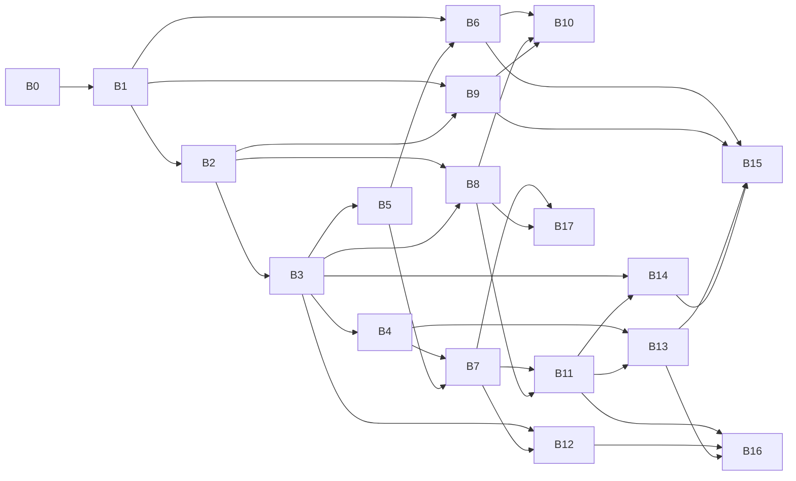

# ayaka-kernel — ROADMAP triển khai (từ dễ đến khó, theo phụ thuộc)

Cập nhật 2026-11-10. Roadmap này liệt kê 236 `__global__` kernel trong 18 bước. Checkout này hiện có **190 kernel có thân**: toàn bộ B0–B10 và B12 (185) và 5 kernel của B17 (`lowbit_*`, `moe_w2_*`); 46 kernel còn lại của B11, B13–B16 là contract trong header, chưa có định nghĩa. Repo là `ayaka-kernel`; namespace C++ và tiền tố ABI là `kops` (không phải `ayaka`).

**Chiến lược 2026-10-31, đọc §0.7 và §3 trước.** Roadmap được xây đủ **chỉ với một RTX 3050 Laptop (SM86, 4 GB)**, không thuê GPU, và **không dùng PyTorch, torch binding, CUTLASS/CuTe hay provider adapter**. API duy nhất là `csrc/<family>/ops.h` (`kops::Status` + `Tensor`/`LaunchContext`/`Workspace`); thân kernel và launcher viết ngay trong `csrc/<family>/<stem>.cu`; test và benchmark là C++/ctest. FlashMLA, DeepGEMM, vLLM, SGLang, hpc-ops và attention.rs trong `3rd/` chỉ là **nguồn đọc** (thuật toán, layout, edge case), không được link hay build. §2 nói mỗi ô đạt tới đâu khi chỉ có SM86; §3 nói thứ tự P0–P8 và kỹ thuật K1–K7 (K1/K2/K6 deferred vì cần PyTorch).

- **Không có mốc thời gian.** Thứ tự chỉ dựa vào độ khó và phụ thuộc kỹ thuật. Tiến độ đo bằng status ladder trong registry, theo từng ô (kernel, exact SM): `planned → authored → implemented → compiled → numerically_validated → benchmarked → release_supported`. `authored` là ô đã viết đủ (thân, test, benchmark) nhưng nhắm phần cứng mà máy dev không chạy được (§2).
- **Mỗi kernel thuộc đúng một bước:** bước có bản native đầu tiên của nó. Instantiation cho kiến trúc mới được liệt kê riêng ở bước của kiến trúc đó.
- `tools/check_roadmap.py` (đã có; mở rộng theo §1.6) kiểm tra quy tắc trên mỗi khi bảng kernel hoặc file nguồn thay đổi.
- **Cột Reference** trong mọi bảng kernel trỏ tới code tương tự trong vLLM, SGLang, hpc-ops, attention.rs, FlashMLA và DeepGEMM để đối chiếu khi viết kernel (§0.6).
- **Nhịp và ngân sách file (§1).** Đơn vị công việc là một hàng của bảng kernel, gọi là *nhịp*, và mọi nhịp theo cùng một vòng năm việc. Số file mới tăng theo family, theo nhóm kernel (một file `.cu`) và theo ô arch (một ô của lưới family × arch), không tăng theo kernel; trần nằm ở Phụ lục E.
- **Hiện trạng (2026-11-10).** 190/236 kernel có thân: B0 đủ 2/2, B1 đủ 32/32, B2 đủ 20/20, B3 đủ 21/21, B4 đủ 18/18, B5 đủ 16/16, B6 đủ 18/18, B7 đủ 16/16, B8 đủ 7/7 (`csrc/attention/{prefill,decode}.cu`, xem "Hiện trạng" của B8), B9 đủ 20/20, B10 đủ 4/4 (`csrc/sampling/speculative.cu`, `csrc/state/state_cache.cu`), B17 đủ 5/5 (`csrc/attention/lowbit.cu`, `csrc/moe/fused_moe.cu`: `moe_w2_pack` + `moe_w2_gemm`). Các file `csrc/{model_ops,norm,activation,position,embedding,sampling,attention,kvcache,state,quantization}/*.cu` có launcher, test C++ (`test_m1`, `test_model_ops`, `test_norm`, `test_activation`, `test_position`, `test_embedding`, `test_sampling`, `test_merge`, `test_kvcache`, `test_state`, `test_quantization`, `test_gemm`, `test_moe`) và benchmark C++ (`bench_model_ops`, `bench_norm`, `bench_activation`, `bench_position`, `bench_embedding`, `bench_sampling`, `bench_merge`, `bench_chains`, `bench_kvcache`, `bench_state`, `bench_quantization`, `bench_gemm`, `bench_moe`). `KOPS_ABI_VERSION` là 6 (chưa phát hành): B17 thêm `kops::experimental::lowbit::*` và `kops::experimental::moe_w2::*`; B6 thêm bốn host entry (`route_fused`, `moe_sum`, `latent_combine_norm`, `gumbel_max_sample`), B7 thêm `launch_gemm_mma_sync`, `marlin_moe_gemm`, `moe::moe_gemm`, `MmaGemmParams`/`MmaRowMap`, `MarlinParams::a_tmp` và đổi tham số `gemm_mma_sync_kernel`/`gguf_moe_mmq_kernel`, B8 đổi mask thành trường runtime. Registry đã có hàng SM89 cho B0–B9; B7 mới có 3 hàng (`gemm_mma_sync`, `dual`, `bmm`) nên các nhịp 3–10 còn chờ evidence. `tools/check_roadmap.py` đang pass với 236 kernel được gán đúng một bước.
- **Phần cứng (§2).** Máy dev chỉ có một GPU SM86 (RTX 3050 Laptop, 4 GB VRAM), chạy WSL2 với CUDA 12.9, nên compile được cả 8 exact SM. Kernel nhắm SM khác (SM80, SM89, SM90a, SM100a/103a/120a/121a), nhiều GPU hoặc VRAM lớn vẫn được viết đủ theo vòng năm việc, sau khi đọc code đã chạy thật trong sáu project reference. Chúng không chạy được ở máy dev: ô (kernel, SM) đó dừng ở `authored`/`compiled` kèm evidence twin và SASS (§2.2 mục 6, §3.2). Bộ test C++ viết sẵn thành gói bàn giao cho bất kỳ ai có đúng phần cứng (§2.5, Phụ lục B). Không thêm file: test nằm trong `tests/unit/test_<family>.cc`, benchmark trong `benchmark/bench_<family>.cc`, evidence nằm trong registry.

Bước được đặt tên `B0…B17`, mốc model là `Mốc 1…10`. Cách đặt tên này tránh trùng với nhãn ưu tiên P0/P1/P2 của proposal và với mã catalog (A01, M01, …). Bước mở nhiều việc cùng lúc được chia thành đợt, đặt tên `B0.1…B0.2` và `B1.1…B1.3` (§1.4).

---

## 0. Cách đọc

### 0.1 Thang độ khó

| Mức | Tiêu chí | Ví dụ |
|---|---|---|
| ★ | Elementwise / copy theo chỉ số, không có hợp tác giữa các thread | `cast_kernel`, `copy_pages_kernel` |
| ★★ | Reduction trên một hàng, scatter/gather có bookkeeping, đóng gói bit, memory-bound cần đạt băng thông | `rms_norm_kernel`, `reshape_and_cache_flash_kernel`, `gemv_kernel` |
| ★★★ | Chọn lọc/sắp xếp ở mức warp, online softmax, tile tensor core `mma.sync`, scan song song, sampling có kiểm định thống kê | `moe_grouped_topk_kernel`, `paged_decode_kernel`, `gemm_mma_sync_kernel` |
| ★★★★ | TMA + `wgmma` + warp specialization, đại số chunked nhạy số học (`solve_tril`), đồng bộ đa GPU, fusion xuyên op | `fp8_gemm_wgmma_kernel`, `chunk_scaled_dot_kkt_kernel`, `allreduce_fusion_kernel` |
| ★★★★★ | `tcgen05`/TMEM/2-SM, sparse attention nhiều tầng, overlap comm-GEMM, persistent xuyên op, megakernel | `fp4_gemm_tcgen05_kernel`, `sparse_mla_kernel`, `mega_decoder_layer_kernel` |
| ⚠ | **Rủi ro đặc tả**: semantics lấy từ tech report 2026 hoặc layout do provider sở hữu. Code có thể đơn giản, nhưng kernel không qua được `numerically_validated` khi chưa có code tham chiếu chính thức hoặc `config.json` | `hc_coeff_kernel`, `kv_compressor_kernel` |

### 0.2 Nguyên tắc

1. **Native-first, không adapter trong giai đoạn này.** Mọi op đi thẳng vào kernel native trong `csrc/<family>/*.cu`. `GemmBackend` và `Provider` trong header giữ nguyên ABI, nhưng chỉ `kNative` được cài; `kCublasLt`, `kCutlass`, `kDeepGemm`, `kFlashInfer`, `kFlashMLA`, `kTrtllmGen`, `kNccl`, `kDeepEP`, `kFLA`, `kTriton`, `kMarlin`, `kMachete` trả `kUnsupportedBackend` hoặc `kNotImplemented` cho tới giai đoạn sau. Không có `csrc/providers/`.
- Kernel native là đường duy nhất; không có fallback ngầm.
- `registry::select` chỉ chọn candidate `kNative` đã `release_supported`; không bao giờ đổi semantics.
- Không thêm provider file; `bindings/c_api` chỉ mở khi có consumer FFI thật.
2. **Bước đo độ khó kernel, Mốc đo mức phủ native.** Bước đi theo thứ tự dễ → khó, trong giới hạn phụ thuộc. Mốc model-level (chạy checkpoint thật) thuộc giai đoạn tích hợp engine, ngoài repo này; gate của repo là phủ kernel và conformance cấp layer bằng golden vector (§3.5).
3. **Thứ tự kiến trúc:** SM80 → SM89/SM120 → SM90a → SM100a/SM103a.
   - SM120/121 dùng `mma.sync` (thêm block-scale) nên tái sử dụng khung SM80 và dễ hơn SM100, dù ra đời sau Hopper.
   - SM100 là mô hình lập trình mới (TMEM, `tcgen05`, 2-CTA, CLC) nên làm cuối.
4. **Điều kiện ra bước:**
   - Mọi kernel của bước đạt `numerically_validated` trên các SM bắt buộc của bước và đã `benchmarked`.
   - Với ô (kernel, SM) mà máy dev không chạy được, điều kiện ra bước là **Gate dev** (§2.2): `authored` kèm bộ test C++ viết sẵn đủ. Lộ trình kết thúc ở Gate dev của mọi bước; handoff kit (§2.5) chỉ là tuỳ chọn để nâng status khi có phần cứng, không chặn bước nào.
   - `release_supported` là điều kiện của layer conformance, không chặn bước kế tiếp: có thể tối ưu song song.
   - Nhịp có điều kiện (§1.1) chỉ cần xong khi điều kiện của nó đúng; nó không chặn ra bước.
5. **Không suy diễn giữa kiến trúc.** Kết quả trên SM100 không chứng minh gì cho SM103 hay SM120. Mỗi exact SM có compile log, test và benchmark riêng.
6. **Nhịp là một hàng bảng.** Mỗi nhịp theo cùng một vòng năm việc (§1.1) và chỉ xong khi kernel của hàng đó `numerically_validated`. Bước nào mở quá hai family hoặc quá 15 file mới thì chia đợt (§1.4).
7. **File tăng theo family, nhóm kernel (một file `.cu`) và ô arch, không theo kernel.** Nhịp thêm chỉ sửa file có sẵn; chỉ nhịp mở tạo file, và chỉ ở các vị trí cố định của §1.2.
8. **Một máy SM86 là đủ để viết hết, không đủ để chứng minh hết (§2.2 mục 6, §3.2).** Mọi kernel đều được viết, compile cho đúng exact SM và đẩy lên mức bằng chứng cao nhất mà SM86 cho phép: chạy thật nếu thân chạy được trên SM80-class, còn không thì twin, SASS và oracle fp64. Bằng chứng gián tiếp không bao giờ được ghi thành `numerically_validated` của exact SM khác. Không dùng PyTorch để làm oracle trong giai đoạn này.
9. **Nguồn chính thức là provenance, không phải oracle chạy được.** Với semantics riêng của DeepSeek, thứ tự tin cậy vẫn là code chính thức (FlashMLA, DeepGEMM, `inference/` trong repo checkpoint), rồi bản port độc lập, rồi code cộng đồng. Nhưng K1 (nạp reference PyTorch của upstream) và K2 (`torch.utils.cpp_extension.load_inline`) bị **deferred**; oracle chạy được của repo là `csrc/reference/` fp64 và golden vector. Một ⚠ chỉ được gỡ bằng nguồn bậc đầu (R6).

### 0.3 Toàn cảnh

| Tầng | Bước | Nội dung | Độ khó | Kernel | Phụ thuộc chính | Mở Mốc | Máy dev (SM86, CUDA 12.9) | Handoff (tuỳ chọn) |
|---|---|---|---|---|---|---|---|---|
| I | B0 | Nền móng + walking skeleton | ★ | 2 | — | | đủ | `sm80`, `sm90a` |
| I | B1 | Elementwise và reduction một hàng | ★–★★ | 32 | B0 | | đủ | `sm80`, `sm90a`; `sm100a`/`sm120a` (vector 256-bit) |
| I | B2 | Bộ nhớ theo chỉ số: KV cache, state cache, page | ★–★★ | 20 | B1 | Mốc 1 | đủ | `sm80`, `sm90a`; `sm89` (FP8 `cvt`) |
| I | B3 | Lượng tử hóa runtime (activation, KV) | ★★–★★★ | 21 | B2 | | đủ (nhánh software) | `sm80`, `sm90a`; `sm89`, `sm100a`, `sm120a` (nhánh `cvt`) |
| I | B4 | Biến đổi weight lúc load | ★–★★ | 18 | B3 | | đủ | `sm80`, `sm90a`; `sm120a`, `sm100a` (layout scale) |
| II | B5 | GEMV và GEMM decode trên CUDA core | ★★ | 16 | B3 | | đủ, trừ nhánh `cvt` FP8 | `sm80`, `sm89`, `sm90a` |
| II | B6 | Routing, permute, sampling | ★★–★★★ | 15 | B1, B5 | Mốc 2 | đủ | `sm80`, `sm90a` |
| III | B7 | Tensor core thế hệ 1: `mma.sync` | ★★★–★★★★ | 16 | B4, B5 | | đủ, trừ FP8 `mma.sync` (compile + twin) | `sm80`, `sm89`, `sm120a` |
| III | B8 | Attention native lớp SM80 | ★★–★★★ | 7 | B2, B3 | Mốc 3 | đủ (FP8 KV: nhánh software) | `sm80`, `sm89`, `sm120a` |
| III | B9 | Recurrent: conv1d, Mamba, linear attention, GDN/KDA | ★★–★★★★ | 20 | B1, B2 | Mốc 4 | đủ (chuỗi dài: không vừa 4 GB) | `sm80`, `sm90a` |
| III | B10 | Speculative decoding | ★★★ | 4 | B6, B8, B9 | Mốc 5 | đủ | mọi lô (§2.5) |
| IV | B11 | Hopper: TMA + `wgmma` + warp specialization | ★★★★ | 12 | B7, B8 | Mốc 6 | `mla_get_metadata`, `machete_prepack`, phần dựng problem của `grouped_gemm_prepare` và thân SM80-class của `mla_decode` chạy thật; còn lại compile + SASS + twin | `sm90a` |
| IV | B12 | Communication: TP, EP, comm-GEMM | ★★–★★★★★ | 11 | B0, B3, B7 | Mốc 7 | đủ; rank ảo 2/4/8 trên một GPU, 2 GPU host-staged không P2P (§3.3 K5) | `multi` |
| V | B13 | Blackwell: SM120 trước, SM100/103 sau | ★★★–★★★★★ | 12 | B4, B7, B11 | Mốc 8 | compile 4 target Blackwell + SASS + twin; oracle layout scale | `sm120a`, `sm100a`, `sm103a`, `sm121a` |
| V | B14 | Sparse và compressed attention | ★★★★–★★★★★ | 8 | B3, B11 | Mốc 9 | đủ qua thân SM80-class (T1, §3.3 K3); thân Sm90a/Sm100a: compile + twin | `sm90a`, `sm100a` |
| V | B15 | Cấu trúc mới DeepSeek-V4/V4.1 / Kimi K3 | ★–★★★★ ⚠ | 8 | B6, B9, B13, B14 | Mốc 10 | đủ (generic); mHC có reference chính thức (DeepGEMM), AttnRes của Kimi K3 vẫn ⚠ | `sm90a`, `sm100a` |
| V | B16 | Persistent execution và megakernel | ★★–★★★★★ | 6 | B11, B12, B13 | — | đủ cho `mega_*` trên mainloop B7/B8; `mega_moe_ep` qua rank ảo | `sm90a`, `sm100a`, `multi` |
| — | B17 | Thử nghiệm (low-bit KV, expert 2-bit) | ★★★★ | 5 | B7, B8 | — | đủ | — |
| | | **Tổng** | | **233** | | | | |

Cột **Máy dev** cho biết bước chạy được tới đâu trên máy dev SM86 (§2.1): "đủ" nghĩa là mọi kernel của bước có `numerically_validated` ở dev (với B14–B16 là qua thân SM80-class, §3.3 K3). Cột **Handoff** liệt kê kit tuỳ chọn (Phụ lục B), nằm ngoài lộ trình (§2.5). Phần chạy được ở dev vẫn phải chạy lại ở từng lô, vì kết quả SM86 không thay cho SM khác (nguyên tắc 5). Ô nào máy dev không chạy được dừng ở `authored` hoặc `compiled`, kèm evidence twin và SASS (§2.2 mục 6). Thứ tự thực hiện chỉ với SM86 nằm ở §3.4: P1 làm B0–B10 + B17 trước, rồi P2–P7.

Thứ tự bước là phụ thuộc trước, độ khó sau, nên độ khó không tăng đơn điệu: B4 (★–★★) đứng sau B3 (★★–★★★) vì phụ thuộc B3, và B15 (★–★★★★) đứng sau B14 (★★★★–★★★★★) vì phụ thuộc B14. B8 (★★–★★★) đứng sau B7 (★★★–★★★★) theo số thứ tự, nhưng cột phụ thuộc chỉ ghi B2, B3, nên làm song song được với B7 (Phụ lục D).

Số nhịp, family hoặc ô arch mở và số file mới của từng bước nằm ở Phụ lục E.1.



### 0.4 Mốc model

| Mốc | Sau bước | Phạm vi native | Model / gate (engine integration) |
|---|---|---|---|
| Mốc 1 | B0–B2 | Elementwise/KV native | Dense BF16/FP16 |
| Mốc 2 | B3–B6 | Quant/routing/permute/GEMV native | Checkpoint FP8/INT8; MoE |
| Mốc 3 | B7–B8 | Native trên SM80/86/89/120 | + W4A16/W8A16, W8A8, GGUF, LoRA, GPT-OSS, Llama 4, DBRX |
| Mốc 4 | B9 | + recurrent native | Mamba 1/2, Jamba, Nemotron-H, Granite-4.0-H, MiniMax-01/M1, Qwen3-Next, Kimi Linear, LFM2 |
| Mốc 5 | B10 | + speculative | MTP, EAGLE, n-gram, tree draft |
| Mốc 6 | B11 | Native trên SM90a | DeepSeek-V3/R1/V3.1, Kimi K2/K2.5, GLM-4.5/4.6, Qwen3 FP8, GPT-OSS trên Hopper |
| Mốc 7 | B12 | Collectives và EP native | TP/EP không cần NCCL/DeepEP |
| Mốc 8 | B13 | Native trên SM100a/103a/120a/121a | NVFP4, MXFP8, FP8-UE8M0, GPT-OSS W4A8-MX |
| Mốc 9 | B14 | DSA native | DeepSeek-V3.2 |
| Mốc 10 | B15 | Toàn bộ | DeepSeek-V4/V4.1 Flash/Pro, Kimi K3 |

Chi tiết điều kiện và gate của từng Mốc nằm ở cuối bước mở Mốc đó. **Trong giai đoạn C++-only, Mốc model-level không phải gate của repo**: nó chỉ chạy khi engine tích hợp (ngoài repo) gọi các kernel này. Gate thay thế là **layer conformance** bằng golden vector C++ (§3.5), dùng `csrc/reference/` và dữ liệu sinh offline; không cần PyTorch ở runtime.

**Mốc và phần cứng.** Gate cấp layer chạy được ở máy dev khi layer vừa 4 GB; model đầy đủ vẫn cần phần cứng thật và engine. Với model quá lớn cho một lô, gate của Mốc được thay bằng conformance từng layer với trọng số đúng shape.

### 0.5 Provider adapter (deferred)

Không provider nào được cài trong giai đoạn này. `GemmBackend`/`Provider` enum trong header vẫn giữ nguyên giá trị ABI, nhưng chỉ `kNative` có implementation; mọi giá trị khác trả `kUnsupportedBackend` hoặc `kNotImplemented`. Không có `csrc/providers/`, không có file provider, không có gate hay Mốc nào phụ thuộc adapter.

| Op (catalog) | Backend tương lai (nếu mở lại) | Ghi chú |
|---|---|---|
| G01 dense GEMM | `kCublasLt` | B7/B11/B13 native thay |
| G03 FP8/INT8 | `kCublasLt`, `kCutlass`, `kDeepGemm` | native ở B7/B11/B13 |
| G05 FP4/MX | `kCublasLt`, `kCutlass`, `kTrtllmGen` | native ở B13 |
| G06 grouped/MoE | `kCutlass`, `kDeepGemm` | native ở B7/B11/B13 |
| A01–A06 attention | `kFlashInfer` | native ở B8/B11/B13 |
| A12 MLA | `kFlashMLA`, `kFlashInfer` | native ở B11 |
| A11/A13 DSA | `kFlashMLA`, `kDeepGemm` | native ở B14 |
| mHC / gate V4 / Mega MoE | `kDeepGemm` | native ở B15/B16 |
| L02 Mamba/GDN/KDA | `kFLA`, `kTriton` | native ở B9 |
| C01/C02 | `kNccl`, `kDeepEP` | native ở B12 |

Bảng này chỉ để tra cứu lịch sử và provenance; nó không phải điều kiện của bước, nhịp hay Mốc. Khi một consumer thật cần backend ngoài, mở lại thành một giai đoạn riêng có file provider và test riêng.

### 0.6 Dự án tham chiếu (cột Reference)

Mỗi bảng kernel có thêm cột **Reference**, trỏ tới code tương tự trong sáu project dưới đây (FlashMLA và DeepGEMM thêm ngày 2026-10-28). Khi bắt đầu một kernel, mở reference trước để đối chiếu thuật toán, layout và edge case. Reference không phải đặc tả: header trong `csrc/`, các file trong `docs/` và gate của từng bước vẫn là chuẩn.

| Alias | Project | Thư mục gốc của đường dẫn (máy dev, từ gốc repo) | Upstream |
|---|---|---|---|
| `vllm` | vLLM | `3rd/vllm/csrc` | github.com/vllm-project/vllm (bản vendor không có `.git`, không biết commit) |
| `sglang` | SGLang `sgl-kernel` | `3rd/sglang/sgl-kernel/csrc` | github.com/sgl-project/sglang, commit `96a04cb` (bản tải 2026-10-01) |
| `hpc-ops` | Tencent hpc-ops | `3rd/hpc-ops/src` | github.com/Tencent/hpc-ops, commit `2a2e265` (bản tải 2026-10-01) |
| `attn-rs` | attention.rs | `3rd/attention.rs/src/kernels/src` | github.com/guoqingbao/attention.rs, commit `c0f19f2` (bản tải 2026-10-01) |
| `flashmla` | DeepSeek FlashMLA | `3rd/FlashMLA` | github.com/deepseek-ai/FlashMLA, commit `395cb3a` (2026-10-27; SM100/103, V4.1, có `.git` local) |
| `flashmla@ba89a34` | FlashMLA, bản cuối có Hopper | `3rd/FlashMLA`, đọc bằng `git -C 3rd/FlashMLA show ba89a34:<đường dẫn>` | commit `ba89a34` (2026-09-15; SM90 + SM100, V3.2/V4.0/V4.1) |
| `deepgemm` | DeepSeek DeepGEMM | `3rd/DeepGEMM` | github.com/deepseek-ai/DeepGEMM, commit `5081f85` (2026-10-20, có `.git` local) |

`3rd/` nằm trong `.gitignore`: đây là bản đọc tại chỗ, không phải dependency của build.

**Cách đọc một ô.**
- `alias:đường/dẫn` là đường dẫn tương đối so với thư mục gốc ở bảng trên. Tên trong dấu `` ` `` sau dấu "—" là hàm `__global__` hoặc hàm/struct dùng để grep. Chữ trong ngoặc là điểm giống hoặc khác với contract của roadmap.
- Các mục xếp theo độ gần với kernel của roadmap: đọc mục đầu tiên trước.
- Dòng **Không có:** liệt kê phần của hàng mà các project đều không có. Ô ghi "4 project" được viết trước 2026-10-28 và chỉ nói về vLLM, SGLang, hpc-ops, attention.rs. Ô chỉ có "—" nghĩa là không tìm thấy bản tương đương; dùng nguồn ghi ở cột "Điểm cần chú ý" (FlashInfer, FLA, mamba_ssm, DeepGEMM, …).
- Mọi đường dẫn và tên hàm trong cột đã được kiểm tra là tồn tại ở bản tải về ngày 2026-10-01. Các project đổi nhanh, nên kiểm lại khi một đường dẫn không còn khớp. Kiểm lại 2026-10-28 với bản trong `3rd/`: 221 đường dẫn còn đúng; 6 đường dẫn không còn ở bản vendor: `sglang:elementwise/dsv4_norm_rope.cu`, `sglang:infllm_v2/*` (ba file), `vllm:libtorch_stable/moe/dsv3_router_gemm_float_out.cu` (bản SGLang cùng tên vẫn có ở `sglang:gemm/`), `vllm:libtorch_stable/quantization/gptq_allspark/allspark_utils.cuh`. Đường dẫn `flashmla:` và `deepgemm:` được kiểm ngày 2026-10-28.

**Lưu ý khi dùng.**
1. Chỉ lấy thuật toán, layout và edge case. Bỏ lớp framework của reference (`torch::stable::Tensor`, `TORCH_LIBRARY`, FFI Rust/candle): entry point của repo này nhận `kops::Tensor` và trả `kops::Status`; lõi kernel nhận con trỏ thiết bị và `kops_stream_t` (cùng kiểu với hpc-ops).
2. Port thân kernel thì ghi commit, đường dẫn và license vào `THIRD_PARTY_NOTICES.md` trước khi merge (R7).
3. `hpc-ops` chỉ nhắm SM90 (kèm một kernel SM100) và tối ưu cho H20. Ô ghi "SM90" nghĩa là không chạy được trên SM80/86/89: ở B1–B8 chỉ lấy ý tưởng, từ B11 mới dùng làm khung.
4. `attn-rs`: nhiều file chỉ là adapter gọi FlashInfer/FlashMLA/TRT-LLM (`flashinfer_*.cu`, `trtllm/`), ô ghi "adapter" khi gặp. Các kernel trong `deepseek_v4/` và `qwen4/` là bản cộng đồng, không phải code chính thức: ô ghi ⚠ vẫn phải xác nhận bằng code chính thức theo R6.
5. `sglang`: một số file chỉ bọc FlashInfer (ô ghi "wrapper") hoặc được chuyển từ DeepEP, TRT-LLM, llama.cpp, tilelang. Xem license từng file trước khi port.
6. `vllm`: thư mục `attention/` chỉ có header dtype và kernel attention (paged/flash) không nằm trong `csrc` của bản này, nên các hàng attention chủ yếu lấy reference từ attn-rs, hpc-ops và SGLang.
7. `flashmla`: bản `395cb3a` chỉ còn SM100/103 (sparse decode và prefill cho V4.1, kernel fused norm + RoPE + attention + RoPE + cast, FMHA dense CUTLASS fwd/bwd) cùng hai kernel không phụ thuộc arch trong `csrc/cuda_kernels/smxx/` (metadata của tile scheduler, combine split-KV). Hopper, MLA decode dense và các định dạng V3.2 (656 B/token) và V4.0 (584 B/token) chỉ còn ở `ba89a34`. Định dạng KV và reference nằm ở `tests/quant.py` và `tests/ref.py` (PyTorch thuần). Quy ước khác repo này: query không có key hợp lệ trả LSE = +inf (repo này: −inf), và sink nhân vào output mà không vào LSE trả về (§3.3 K1). License MIT.
8. `deepgemm`: kernel viết tay (CuTe ít, PTX qua `deep_gemm/include/deep_gemm/ptx/*`), compile JIT lúc chạy và chọn cấu hình bằng heuristic (`csrc/jit_kernels/heuristics/*`). Tên `D = C + A @ B.T` theo layout NT. Scale SM90 là fp32, scale SM100 là UE8M0 đóng 4 giá trị vào một int32, MN-major, căn TMA. Các kernel `k_grouped_*`, `batched_syrk`/`batched_symm` phục vụ huấn luyện (wgrad, optimizer), nằm ngoài phạm vi repo này. `deep_gemm/legacy/*.py` là Triton, chạy được trên SM86. License MIT.
9. Phần không phụ thuộc arch của FlashMLA và DeepGEMM (`smxx`, `smxx_layout.cuh`, `scheduler/gemm.cuh`) là nguồn đọc; K2 (`load_inline` bằng PyTorch) bị **deferred**, nên không compile hay chạy chúng trong giai đoạn C++-only. Phần chỉ chạy trên SM90/SM100 vẫn là nguồn đã chứng minh (§2.3), không phải đối tượng chạy ở dev.
10. **Quy ước gate trong bảng kernel.** Mọi câu "bit-exact với X" / "khớp X" (vLLM, CUTLASS, FlashInfer, DeepGEMM, FlashMLA, HF) được đọc là **khớp oracle fp64 hoặc golden vector của repo**; X chỉ là provenance và chỉ được chạy khi có second implementation. Không thêm dependency vào build/test vì một ô gate.

### 0.7 Chiến lược binding (2026-10-31)

Repo không có tầng binding framework. Ba tầng của một kernel:

| Tầng | File | Vai trò | Trong giai đoạn này |
|---|---|---|---|
| API C++ | `csrc/<family>/ops.h` | contract duy nhất: `kops::Status`, `Tensor`, `LaunchContext`, `Workspace` | đã đủ cho 233 kernel; không sửa khi implement |
| Device | `csrc/<family>/*_kernels.cuh` | `__global__`, param struct, layout, launch notes | chỉ sửa khi contract kernel đổi (PR riêng + `KOPS_ABI_VERSION++`) |
| Cài đặt | `csrc/<family>/<stem>.cu` | kernel anonymous-namespace + launcher + instantiation | thêm dần theo bảng bước |

Luật:

1. **Không có binding framework.** Không `csrc/bindings/`, `torch_binding.cpp`, pybind, `python/`, `setup.py`. API C++ trong `ops.h` là binding duy nhất.
2. **Không third-party.** `KOPS_WITH_TORCH=OFF`, `KOPS_WITH_CUTLASS=OFF`; không CUTLASS/CuTe/CCCL/PyTorch. Kernel dùng CUDA C++ (`mma.sync`, `cp.async`, `wgmma`, `tcgen05`), intrinsic và inline PTX khi cần.
3. **Header giữ nguyên.** Thêm kernel không sửa `ops.h`/`*_kernels.cuh`. Nếu thiếu khai báo, mở PR contract riêng, cập nhật `KOPS_ABI_VERSION`, không gộp vào PR kernel.
4. **Provider enum là ABI, provider code thì không.** `GemmBackend`/`Provider` giữ nguyên giá trị; chỉ `kNative` được cài. Giá trị khác trả `kUnsupportedBackend`/`kNotImplemented`.
5. **C ABI để sau.** `bindings/c_api/kops_c.h` (+ `kops_c.cpp`) là bề mặt FFI duy nhất; chỉ thêm entry point khi có consumer Rust/C/Go thật. Không tạo file theo family, không phải điều kiện của nhịp.
6. **Test/benchmark C++.** `tests/unit/test_<family>.cc` + `tests/unit/harness.h`; `benchmark/bench_<family>.cc` + `benchmark/harness.h`. Chạy bằng `ctest` hoặc trực tiếp; không pytest, không marker Python. Benchmark ghi JSON (provenance + per-case median/p10/p90) và không link framework nào.
7. **Python chỉ ở build tooling và benchmark comparison.** `tools/check_*.py`, `tools/gen_registry.py` và `benchmark/compare/*.py` được phép. `benchmark/compare/` là công cụ dev: không build, không link, không `ctest`, không ship; nó đọc cùng case JSON do benchmark C++ phát ra (`--dump-cases`). Không có Python runtime, test hay benchmark trong sản phẩm.

---

## 1. Quy ước triển khai: nhịp và ngân sách file

Phần này đặt ra hai quy ước mà các bảng bước không tự nêu: đơn vị công việc và trần số file.

- **Đơn vị công việc.** Một bước có từ 2 đến 32 kernel và từ 1 đến 11 hàng bảng kernel (đếm theo hàng kernel gốc, không tính hàng instantiation); B1 mở 6 family. 16 trong 40 nhóm kernel (file `.cu`) bị chạm ở từ 2 bước trở lên (6 nhóm ở 4 bước: 5 nhóm `gemm/*` và `moe/fused_moe`), và family `attention` xuất hiện ở 6 bước. Vì vậy cần một đơn vị chung để các bước chạy cùng một nhịp.
- **Trần số file.** Nếu mỗi kernel kéo theo một chuỗi file riêng (thân, instantiation, test, dòng registry, case benchmark) thì 233 kernel cho khoảng 1.165 file (ước lượng minh họa: 233 × 5). Trần ở đây tính theo family, nhóm kernel và ô arch: **112 file nguồn mới**, không có provider (Phụ lục E).

Quy ước dưới đây không đổi bước nào chứa kernel nào, không đổi Mốc và cột Reference. Nó định nghĩa đơn vị công việc và nơi mỗi thứ được phép nằm. Ngoài ra §1.1 làm rõ một điểm của nguyên tắc 4: bốn hàng tự ghi "chỉ làm khi …" không chặn ra bước.

### 1.1 Nhịp

Một **nhịp** là một hàng của bảng kernel (ô Header cùng danh sách Kernel của hàng đó). Mỗi hàng của bảng "Instantiation mới cho kernel đã có" ở B11, B13, B14 và B15 cũng là một nhịp. Roadmap có 125 nhịp (115 hàng kernel + 10 hàng instantiation; ba hàng instantiation của B14, B15 thêm ngày 2026-10-28 cho định dạng và gate của DeepSeek-V4/V4.1) cho 233 kernel, mỗi bước từ 1 đến 12 nhịp.

Cỡ của một nhịp có hai giới hạn: không quá 4 kernel và không quá 4 file mới (3 file của family và 1 `.cu`). 112 trong 115 hàng kernel có không quá 4 kernel, và 124 trong 125 nhịp tạo không quá 4 file mới. Ba nhịp vượt giới hạn kernel: B5 hàng 5 (5 kernel GEMV dequant trong register), B9 hàng 6 (5 bước SSD của Mamba-2) và B9 hàng 7 (7 kernel của chuỗi chunk delta rule). Một nhịp vượt giới hạn file: B5 hàng 7 (mở `moe` và 2 `.cu`, tổng 5 file). Nhịp vượt giới hạn được làm thành các commit con theo thứ tự trong hàng, trong cùng một PR; nhịp xong khi commit con cuối vào và cả hàng `numerically_validated`.

Mỗi nhịp theo cùng một vòng, đúng thứ tự:

1. **Oracle.** Reference fp64 trong `csrc/reference/` và các case lỗi (dtype, shape, stride, alignment) trong `tests/unit/test_<family>.cc`. Chưa viết thân kernel khi chưa có oracle.
2. **Thân kernel** trong `<stem>.cu` (nhóm kernel của hàng), hoặc trong ô arch của family nếu dùng tập lệnh riêng của arch (§1.3).
3. **Launcher** trong cùng file `<stem>.cu`: kiểm tra đầu vào, chọn theo exact SM, thêm một dòng vào danh sách instantiation; khai báo đã có trong `csrc/<family>/ops.h` (không sửa header).
4. **Test + registry:** thêm case vào `tests/unit/test_<family>.cc` và dòng (kernel, SM) vào `registry/capabilities/<family>.yaml`; chạy `ctest -R <family>`. Test của exact SM, số GPU hoặc VRAM mà máy dev không đáp ứng trả mã 77 (`SKIP_RETURN_CODE`) và vẫn phải được viết ở bước 1.
5. **Benchmark:** thêm case vào `benchmark/bench_<family>.cc`, chạy bằng target C++.

Nhịp xong khi mọi kernel của hàng `numerically_validated` trên các SM của bước mà máy dev chạy được, và mọi ô (kernel, SM) còn lại của hàng ở `authored` đã qua Gate dev (§2.2). Không có gate thứ hai: ô `authored` giữ nguyên cho tới khi có handoff kit. `benchmarked` và các mục riêng của bước được kiểm ở **Gate ra bước**. Trong một luồng (Phụ lục D) các nhịp làm tuần tự theo thứ tự hàng; các luồng khác nhau chạy song song. Mỗi nhịp là một PR độc lập.

Có hai loại nhịp:

- **Nhịp mở** tạo file, chỉ với ba lý do: nhịp đầu tiên của một family (bộ file của family, §1.2); hàng đầu tiên dùng một nhóm kernel chưa có file `.cu`; nhịp đầu tiên cần tập lệnh riêng của một arch trong một family (ô arch). Có 42 nhịp mở. `gemm` và `communication` mở ở nhịp native đầu tiên của chúng; không có adapter mở trước.
- **Nhịp thêm** chỉ sửa file đã có. Có 83 nhịp thêm. Phụ lục E.1 cho biết nhịp mở nằm ở bước nào.

Bốn nhịp là **nhịp có điều kiện**: chính ghi chú của hàng, hoặc rủi ro mà nó trỏ tới ở Phụ lục C, nói rằng chỉ làm khi một điều kiện đúng. Đó là B11 hàng instantiation 4 (chunk kernel SSD / delta rule trên Sm90a: "chỉ làm khi benchmark chứng minh có lợi"), B13 hàng 7 (NVFP4 `ds_mla`: R1 giữ `planned` cho tới khi có spec), B14 hàng 5 (block sparse: "ưu tiên thấp vì chưa có model production bắt buộc") và B17 hàng 2 (`moe_w2`: "chỉ làm khi có checkpoint cần"). Cả bốn đều là nhịp thêm và không có file nào của sổ E.1 gắn với chúng. Chúng vẫn thuộc đúng một bước, nhưng không chặn Gate ra bước khi điều kiện chưa đúng; registry giữ chúng ở `planned`. Đây là điểm bổ sung cho nguyên tắc 4: bản gốc đòi mọi kernel của bước xong, nhưng các hàng này tự ghi là làm có điều kiện. Các hàng ⚠ còn lại (B6, B14 hàng 4, B15) không thuộc loại này: Gate ra bước của chúng đòi đặc tả đã được chốt.

### 1.2 Bộ file cố định

| Loại | Đường dẫn | Số lượng | Tạo ở |
|---|---|---|---|
| API C++ của family | `csrc/<family>/ops.h` | 1 mỗi family (14) | đã có; **không sửa** khi implement kernel |
| Device contract | `csrc/<family>/*_kernels.cuh` | 1+ mỗi family | đã có phần lớn; chỉ sửa khi contract kernel đổi (PR riêng + ABI) |
| Nhóm kernel / miền | `csrc/<family>/<stem>.cu` | 1 mỗi nhóm kernel hoặc miền chức năng (46) | hàng đầu tiên dùng nhóm đó |
| Ô arch | `csrc/<family>/<arch>_impl.cuh`, `<arch>` ∈ `sm90a`, `sm100a`, `sm120a` | 1 mỗi ô của lưới family × arch (7) | nhịp đầu tiên cần tập lệnh riêng của arch |
| Test C++ | `tests/unit/test_<family>.cc` | 1 mỗi family (14) | nhịp đầu tiên của family |
| Benchmark C++ | `benchmark/bench_<family>.cc` | 1 mỗi family (14) | nhịp đầu tiên của family |
| Registry | `registry/capabilities/<family>.yaml` | 1 mỗi family (14) | nhịp đầu tiên của family |
| Harness | `tests/unit/harness.h`, `benchmark/harness.h` | 2 | B0.1 |
| Hạ tầng | danh sách ở Phụ lục E.2 | 17, cố định | B0.1 (14), Mốc 1 (1), B2 (1), Mốc 2 (1) |

`<stem>` là tên **miền chức năng** của file, lấy từ bộ từ vựng đóng: `host`, `dense`, `moe`, `chunk`, `recurrent`, `stats`, `select`, `sparse`, `lowbit`, `prep`, hoặc tên nhóm kernel gốc (`norm`, `rope`, `kvcache`, `gemm_mma`, `marlin_dense`, …). **Cấm hậu tố số thứ tự** `_part<N>`, `_v<N>`, `_new`, `_old`: mọi `.cu` phải có trong danh mục Phụ lục E.2 và `tools/check_roadmap.py` từ chối tên ngoài danh mục. Một nhóm kernel là một file `.cu` chứa toán học device, kernel `__global__`, launcher `kops::Status`, instantiation tường minh. `csrc/<family>/ops.h` khai báo mọi entry point của family; `csrc/<family>/*_kernels.cuh` khai báo `__global__` và param struct. Repo có 14 kernel family + 4 service family (`backends`, `load`, `memory`, `reference`) + `execution`; service family và `execution` không có kernel trong bảng 233.

Trần: **112 file nguồn mới** trong sổ theo bước (Phụ lục E.1) = 46 file `.cu` + 14 × 3 file family (test, benchmark, registry) + 7 ô arch + 17 hạ tầng; **0 provider**. `benchmark/compare/*.py` là dev tooling nằm ngoài trần này (không build, không ship). Đã có trong repo: 14 `ops.h`, 3 `.cu` (`norm`, `activation`, `merge`) và 5 file hạ tầng; phần còn phải tạo khoảng 104 file. Trần chỉ tăng qua một header contract riêng mới (§1.3, mục 6), mỗi lần cần chủ repo duyệt.

### 1.3 Đặt code ở đâu

1. **Không file theo kernel, dtype, shape hay SM**; ngoại lệ duy nhất là 7 ô arch ở mục 2. Biến thể là tham số template cộng một dòng trong danh sách instantiation tường minh của `<stem>.cu` (dạng X-macro). Không có file `.cu` instantiation riêng. Hàm host không có kernel (ví dụ `rope::compute_inv_freq`, `kv::swap_pages`, `kv::copy_batch_async`) nằm trong `.cu` của nhóm kernel mà chúng phục vụ. Kernel `__global__` và hàm device nằm trong namespace ẩn danh của `<stem>.cu`: ABI là `ops.h` (giá trị enum, layout struct tham số, chữ ký entry point), không phải chữ ký kernel.
2. **Ô arch** là một ô của lưới family × arch, chứa thân dùng tập lệnh MMA riêng của arch: `wgmma` (sm90a), `tcgen05`/TMEM (sm100a), `mma.sync` block-scaled (sm120a). Còn lại nằm trong `<stem>.cu`. Có 7 ô: `gemm` {sm90a, sm100a, sm120a}, `attention` {sm90a, sm100a}, `model_ops` {sm100a}, `mega` {sm100a} (hai ô cuối thêm ngày 2026-10-28, xem cuối mục này). Khi một arch chỉ cần trait hoặc tile mới trên thân có sẵn thì thêm dòng instantiation, không thêm ô: attention SM120a tái dùng thân `mma.sync` của B8 (nguyên tắc 3), KV NVFP4 chỉ là chuyển đổi FP4 nên dùng cổng exact-SM trong `csrc/common/macros.cuh`. File `.cu` của nhóm include ô arch sau cổng exact-SM. Lưới ô chỉ đổi bằng một PR sửa mục này và Phụ lục E (ví dụ ô `state`/sm90a, nếu nhịp có điều kiện "Chunk kernel SSD / delta rule" ở B11 được làm và cần `wgmma`). **Quyết định 2026-10-28 về hai ô mới.** (1) Mở `model_ops/sm100a_impl.cuh` cho thân Sm100a của `mega_mhc_kernel` (đọc `deepgemm:deep_gemm/include/deep_gemm/impls/sm100_mega_mhc.cuh`, khoảng 1 400 dòng gồm epilogue, scheduler, layout). Đó là một kernel `tcgen05` TF32 riêng, có cấp phát TMEM, vai trò warp và epilogue Sinkhorn/RMSNorm/cast FP8 của riêng nó, không phải lời gọi vào mainloop GEMM. Ô được mở ở cuối P3 của §3.4, sau khi thân generic đã validate. (2) Mở `mega/sm100a_impl.cuh` cho thân Sm100a của `mega_moe_local_kernel` và `mega_moe_ep_kernel` (đọc Mega MoE của DeepGEMM: khoảng 1 300–1 500 dòng mỗi biến thể, cộng scheduler, layout và barrier giữa rank). Ô được mở ở cuối P7, chỉ khi twin FP8×FP4 của `grouped_gemm_tcgen05_kernel` (P5) và EP rank ảo (P6) đã xanh; nếu chưa thì không tạo ô, và hai ô Sm100a đó giữ `planned`. Không đặt hai thân này vào `gemm/sm100a_impl.cuh`: kernel phải nằm ở family launch nó, và ô `gemm` đã gánh toàn bộ B13. Helper `tcgen05` dùng chung (cấp phát TMEM, descriptor UMMA, TMA, pipeline `mbarrier`) chuyển sang `csrc/common/` khi family thứ hai cần tới (AGENTS.md). Không mở ô `sm90a` cho hai family này: trên SM90 dùng thân generic (split-K + `last_cta_arrive`), vì bản cluster của Hopper không có nguồn đã chứng minh. Thân twin (`_twin`, §3.3 K3) và thân SM80-class không phải ô arch: chúng là dòng instantiation trong `<stem>.cu`.
   **Quyết định 2026-11-10 (đợt B11/B14/B15, build-first).** (1) `model_ops/sm100a_impl.cuh` phục vụ cả `mega_mhc_kernel` và `attn_res_kernel` Sm100a; `attn_res` Sm100a port `3rd/vllm/csrc/kimi_k3/attn_res_kernel.cu` (commit `07aea9d`) và chỉ dùng cho H=7168 / tối đa 8 block. (2) Twin T2 chạy trên SM120 thay vì SM86 trong đợt này vì máy dev là SM120; twin chỉ kiểm scheduler/layout/pipeline/epilogue, không kiểm TMA/TMEM/cluster. (3) Handoff kit `sm90a`/`sm100a` được build và đóng gói tại máy dev; registry giữ `compiled` + evidence `sass`/`twin` cho tới khi chạy E4 trên H100/B200.
3. **Mã sinh ra** (bảng registry từ YAML, mở rộng instantiation, bảng test/registry) chỉ nằm trong build tree, không commit.
4. **Provider không phải nhịp và không được cài trong giai đoạn này.** `GemmBackend`/`Provider` enum trong header giữ nguyên ABI; chỉ `kNative` có implementation. Không có `csrc/providers/`, không có file `cublaslt.cc`/`cutlass.cc`/`deepgemm.cc`/`flashmla.cc`/`nccl.cc`/`deepep.cc`. Khi một consumer thật cần backend ngoài, mở lại thành giai đoạn riêng có file provider, test và registry riêng.
5. **Thứ tự của E.1 là kế hoạch, không phải ràng buộc.** E.1 xếp theo thứ tự tài liệu (B0 → B17, hàng Mốc đặt sau bước cuối của Mốc). Mốc không chặn bước, và B4, B5 chỉ phụ thuộc B3 còn B12 phụ thuộc B0, B3, B7 (§0.3), nên các bước này có thể đến trước hàng Mốc tương ứng. Family do nhịp nào đến trước mở. Khi thứ tự thực tế khác E.1, chuyển 3 file family từ hàng Mốc sang nhịp đến trước, ghi lại ở E.1 và kiểm lại giới hạn đợt (§1.4).
6. **API contract của family (`ops.h`) không bị tách theo kernel.** Thêm một nhóm kernel mới thì thêm `.cu` và một dòng vào E.2; không thêm file host theo kernel. Chỉ khi một family thật sự cần header riêng (ví dụ `execution`, không có bộ family) mới thêm header, và phải ghi vào E.2. Nếu phải đổi chữ ký hay layout trong `ops.h`/`*_kernels.cuh`, mở PR contract riêng và tăng `KOPS_ABI_VERSION`.
7. **Conformance cấp layer:** `tests/unit/test_conformance.cc` + golden vector trong `tests/golden/`, sinh offline. Không có `tests/test_models.py`, không chạy HF/vLLM ở runtime.
8. **`docs/TREE.md`:** nếu có, phần proposed tree phải khớp Phụ lục E. Khi lệch thì Phụ lục E thắng và proposed tree được sinh lại. Trong checkout này `docs/` chưa có file nào được track.
9. **Kernel chưa cài đặt chỉ là declaration.** Các header hiện tại là contract thật, không có khối `#if 0` brief. Nhịp cài đặt thêm định nghĩa và launcher trong `<stem>.cu`, giữ nguyên chữ ký trong `ops.h`; kiểu dùng chung mới (nếu có) được khai báo trong `csrc/common/` ở nhịp đầu tiên cần tới nó, kèm PR contract.

### 1.4 Đợt

Một đợt mở không quá 2 family và tạo không quá 15 file mới. Bước vượt giới hạn thì chia đợt. Gate ra bước áp theo đợt cho phần của đợt đó; bước chỉ xong khi mọi đợt xong.

- **B0** chia hai đợt: B0.1 dựng hạ tầng (14 file, chưa có kernel) và B0.2 là nhịp đầu tiên (mở `model_ops`, 4 file). Riêng B0, Gate ra bước áp sau B0.2, trên các file do B0.1 dựng.
- **B1** mở 6 family với 25 file mới nên chia B1.1–B1.3, mỗi đợt 2 family và 8–9 file mới.
- Mọi bước khác đã nằm trong giới hạn: lớn nhất là B5 (11 file) và B2 (10 file, gồm `docs/KV_CACHE_PARITY.md`). Mốc 1 và Mốc 2 chỉ tạo 1 file hạ tầng mỗi hàng; `gemm` mở ở B4 (5 file) và `communication` mở ở B12 (6 file).

### 1.5 Tách file: theo miền, không theo số thứ tự

Một file `.cu` chứa thân kernel, launcher, instantiation và entry point của **một miền chức năng**. Không có `_part2`, `_part3`, `_v2`: tên file phải nói *nó là gì*, không phải *nó được cắt lần thứ mấy*. `tools/check_roadmap.py` từ chối mọi tên khớp `_(part|v)[0-9]+$` hoặc không có trong Phụ lục E.2.

**Khi nào được tách.** Chỉ khi hai nửa có định nghĩa khác nhau, không phải khi file dài:

| Miền | Điều kiện tách | Ví dụ |
|---|---|---|
| `dense` / `moe` | hai template hoặc hai namespace upstream khác nhau | `marlin_dense.cu` (Marlin dense) vs `marlin_moe.cu` (`marlin_moe_wna16`) |
| `chunk` / `recurrent` | hai thuật toán khác nhau (chunked WY vs recurrent step) | `delta_rule_chunk.cu` vs phần recurrent trong `delta_rule.cu` |
| `stats` / `select` | nhóm kernel thống kê hàng vs nhóm chọn token | `sampling_stats.cu` vs `sampling_select.cu` |
| `host` / body | phần host không phụ thuộc arch, phần thân dùng lệnh riêng của arch | `gemm/gemm_wgmma.cu` (host) + `gemm/sm90a_impl.cuh` (thân) |

**Ngưỡng kỹ thuật** (chốt trong `CONTRACTS.md`, không phải lý do đặt tên): một translation unit ≤ **90 giây** ở Release, và file nguồn ≤ **2.500 dòng**. Vượt ngưỡng thì xử lý theo thứ tự: (1) chuyển thân arch vào `<arch>_impl.cuh`, (2) chuyển instantiation sang danh sách X-macro, (3) mới tách theo miền ở bảng trên. Không bao giờ đặt tên theo số.

**Đổi tên file cũ.** Sáu file tách cũ đổi sang tên miền (không đổi số file, không đổi ký hiệu):

| Cũ | Mới |
|---|---|
| `gemm/mixed_input_gemm.cu` | giữ nguyên (machete + tcgen05 mixed) |
| `gemm/mixed_input_gemm_part2.cu` | `gemm/marlin_dense.cu` |
| `gemm/mixed_input_gemm_part3.cu` | `gemm/marlin_moe.cu` |
| `gemm/dense_gemm_part2.cu` | `gemm/gemm_mma.cu` |
| `gemm/dense_gemm_part3.cu` | `gemm/gemm_wgmma.cu` |
| `state/delta_rule_part2.cu` | `state/delta_rule_chunk.cu` |
| `sampling/sampling_part2.cu` | `sampling/sampling_select.cu` |

Đổi tên là **di chuyển nguyên định nghĩa**: giữ thứ tự include, `Requires:`, danh sách instantiation và tập ký hiệu. Kiểm bằng cách so tập ký hiệu trước/sau (AST hoặc `nm`) và build lại mọi exact SM; chỉ xoá file rỗng sau khi cả hai bước đạt.

### 1.6 Kiểm tra tự động

`tools/check_roadmap.py` cần được mở rộng, không thêm công cụ mới. Ngoài quy tắc "mỗi kernel đúng một bước", nó kiểm:

- mỗi đợt mở không quá 2 family và tạo không quá 15 file mới;
- mọi file nguồn mới trong `csrc/`, `tests/`, `benchmark/`, `registry/` khớp một mẫu ở §1.2 và nằm trong danh mục E.2; tên chứa tên kernel, dtype hoặc SM bị báo lỗi, trừ khi đó là `<stem>` của một header contract (ví dụ `fp8_gemm`) hoặc tên ô arch;
- **không tên file nào khớp `_(part|v)[0-9]+$`** (kể cả trong bảng nhịp, bảng biến thể và E.2);
- số file theo từng loại không vượt Phụ lục E;
- mỗi ô `authored` trong registry có `needs: <exact SM>` và ít nhất một test lớp (c) (§2.4) mang marker `arch(...)` của đúng SM đó; không ô nào ở trên `authored` mà evidence thiếu `commit` hoặc có `arch_tag` khác exact SM của ô (§2.5).

**Biến thể thân kernel.** Khi `__global__` trong code mang tên khác tên kernel của bảng nhịp (thân tile hóa, một thân phục vụ nhiều dòng), kernel đó không thành dòng mới: bảng dưới gán nó cho kernel sở hữu trong đúng file. `tools/check_roadmap.py` đọc các dòng dạng này và báo lỗi nếu chủ sở hữu không có trong file đó hoặc thân không còn trong code.

| Thân trong code | File | Kernel sở hữu |
|---|---|---|
| `softmax_rows_kernel` | sampling/sampling.cu | `softmax_kernel` |
| `argmax_rows_kernel` | sampling/sampling.cu | `argmax_kernel` |
| `top_k_top_p_renorm_probs_kernel` | sampling/sampling.cu | `top_k_renorm_probs_kernel` |
| `fused_sampling_kernel` | sampling/sampling.cu | `top_k_top_p_sampling_kernel` |
| `gemm_simt_tiled_kernel` | gemm/dense_gemm.cu | `gemm_simt_kernel` |
| `router_gemm_tiled_kernel` | gemm/dense_gemm.cu | `router_gemm_kernel` |
| `reshape_and_cache_legacy_staged_kernel` | kvcache/kvcache.cu | `reshape_and_cache_legacy_kernel` |
| `mma_splitk_reduce_kernel` | gemm/gemm_mma.cu | `gemm_mma_sync_kernel` |
| `fp4_gemv_warp_kernel` | gemm/fp4_gemm.cu | `fp4_gemv_kernel` |
| `fp4_gemv_mma_kernel` | gemm/fp4_gemm.cu | `fp4_gemv_kernel` |
| `fp4_grouped_gemv_mma_kernel` | gemm/fp4_gemm.cu | `fp4_gemv_kernel` |
| `chunk_scaled_dot_kkt_tc_kernel` | state/delta_rule_chunk.cu | `chunk_scaled_dot_kkt_kernel` |
| `chunk_scaled_dot_kkt_tc_kda_kernel` | state/delta_rule_chunk.cu | `chunk_scaled_dot_kkt_kernel` |
| `recompute_w_u_tc_kernel` | state/delta_rule_chunk.cu | `recompute_w_u_kernel` |
| `chunk_state_fwd_tc_kernel` | state/delta_rule_chunk.cu | `chunk_state_fwd_kernel` |
| `chunk_output_fwd_tc_kernel` | state/delta_rule_chunk.cu | `chunk_output_fwd_kernel` |
| `chunk_output_fwd_tc_kda_kernel` | state/delta_rule_chunk.cu | `chunk_output_fwd_kernel` |
| `weight_transpose_tile_kernel` | gemm/gemm_prep.cu | `weight_transpose_kernel` |
| `weight_transpose_nibble_kernel` | gemm/gemm_prep.cu | `weight_transpose_kernel` |
| `weight_transpose_bytes_kernel` | gemm/gemm_prep.cu | `weight_transpose_kernel` |
| `fp8_block2d_quant_weight_vec_kernel` | gemm/gemm_prep.cu | `fp8_block2d_quant_weight_kernel` |
| `glu_weight_interleave_rows_kernel` | gemm/gemm_prep.cu | `glu_weight_interleave_kernel` |
| `router_weight_split_vec_kernel` | gemm/gemm_prep.cu | `router_weight_split_bf16x2_kernel` |
| `int8_weight_colsum_rows_kernel` | gemm/gemm_prep.cu | `int8_weight_colsum_kernel` |
| `block_scale_swizzle_tiles_kernel` | gemm/gemm_prep.cu | `block_scale_swizzle_kernel` |
| `fp8_scale_transpose_kernel` | gemm/gemm_prep.cu | `fp8_scale_to_tma_layout_kernel` |
| `fp8_scale_pack_ue8m0_kernel` | gemm/gemm_prep.cu | `fp8_scale_to_tma_layout_kernel` |
| `marlin_repack_tiles_kernel` | quantization/weight_repack.cu | `gptq_marlin_repack_kernel` |
| `gptq_stable_argsort_kernel` | quantization/weight_repack.cu | `gptq_marlin_repack_kernel` |
| `identity_perm_kernel` | quantization/weight_repack.cu | `gptq_marlin_repack_kernel` |
| `marlin_awq_zero_points_words_kernel` | quantization/weight_repack.cu | `marlin_awq_zero_points_kernel` |
| `awq_dequantize_words_kernel` | quantization/weight_repack.cu | `awq_dequantize_kernel` |
| `gguf_dequantize_blocks_kernel` | quantization/weight_repack.cu | `gguf_dequantize_kernel` |
| `fp4_marlin_scales_kernel` | quantization/weight_repack.cu | `fp4_marlin_repack_kernel` |
| `copy_bytes_kernel` | quantization/weight_repack.cu | `fp4_backend_shuffle_kernel` |
| `fp8_block_scale_to_ue8m0_blocks_kernel` | quantization/weight_repack.cu | `fp8_block_scale_to_ue8m0_kernel` |
| `smoothquant_compute_scales_elems_kernel` | quantization/weight_repack.cu | `smoothquant_compute_scales_kernel` |
| `smoothquant_scale_rows_kernel` | quantization/weight_repack.cu | `smoothquant_fold_kernel` |
| `smoothquant_scale_rows_scalar_kernel` | quantization/weight_repack.cu | `smoothquant_fold_kernel` |
| `smoothquant_fold_norm_kernel` | quantization/weight_repack.cu | `smoothquant_fold_kernel` |
| `chunk_histogram_kernel` | moe/permute.cu | `moe_align_block_size_kernel` |
| `chunk_scan_kernel` | moe/permute.cu | `moe_align_block_size_kernel` |
| `expert_begin_kernel` | moe/permute.cu | `moe_align_block_size_kernel` |
| `chunk_place_kernel` | moe/permute.cu | `moe_align_block_size_kernel` |
| `align_pad_kernel` | moe/permute.cu | `moe_align_block_size_kernel` |
| `moe_fused_router_gemm_tile_kernel` | moe/routing.cu | `moe_fused_router_topk_kernel` |
| `moe_router_topk_from_logits_kernel` | moe/routing.cu | `moe_fused_router_topk_kernel` |
| `moe_permute_map_kernel` | moe/permute.cu | `moe_permute_kernel` |
| `gemm_mma_reduce_kernel` | gemm/gemm_mma.cu | `gemm_mma_sync_kernel` |
| `marlin_permute_cols_kernel` | gemm/marlin_dense.cu | `marlin_gemm_kernel` |
| `fused_moe_task_map_kernel` | moe/fused_moe.cu | `fused_moe_gemm_kernel` |
| `barrier_peer_kernel` | communication/allreduce.cu | `peer_barrier_kernel` |
| `epoch_tick_kernel` | communication/allreduce.cu | `peer_barrier_kernel` |
| `allreduce_peer_kernel` | communication/allreduce.cu | `allreduce_kernel` |
| `allreduce_two_shot_kernel` | communication/allreduce.cu | `allreduce_kernel` |
| `copy_kernel` | communication/allreduce.cu | `allreduce_kernel` |
| `allgather_peer_kernel` | communication/allreduce.cu | `allgather_kernel` |
| `reduce_scatter_peer_kernel` | communication/allreduce.cu | `reduce_scatter_kernel` |
| `fusion_w1_kernel` | communication/allreduce.cu | `allreduce_fusion_kernel` |
| `fusion_peer_kernel` | communication/allreduce.cu | `allreduce_fusion_kernel` |
| `ep_layout_kernel` | communication/ep.cu | `ep_dispatch_layout_kernel` |
| `ep_dispatch_normal_kernel` | communication/ep.cu | `ep_dispatch_kernel` |
| `ep_dispatch_ll_simple_kernel` | communication/ep.cu | `ep_dispatch_kernel` |
| `ep_combine_normal_kernel` | communication/ep.cu | `ep_combine_kernel` |
| `ep_combine_ll_kernel` | communication/ep.cu | `ep_combine_kernel` |

Bảng trên chưa đủ cho B7 (khoản nợ tài liệu, sửa ở P0 của §3.4 cùng `tools/check_roadmap.py`). `gemm_mma_sync_kernel` (`gemm/gemm_mma.cu`) là thân chung, được launch qua `launch_gemm_mma_sync`, của các hàng B7 không có `__global__` riêng: `dual_gemm_kernel`, `bmm_kernel`, `fp8_gemm_mma_sync_kernel`, `fp8_bmm_kernel`, `fp8_block_gemm_small_m_kernel`, `int8_gemm_mma_sync_kernel`, `w4a8_int_gemm_kernel`, `grouped_gemm_mma_sync_kernel` (`gemm/grouped_gemm.cu`), `fused_moe_gemm_kernel` (`moe/fused_moe.cu`), `lora_shrink_kernel`, `lora_expand_kernel`. Mỗi cặp (thân, kernel sở hữu) cần một dòng; kernel sở hữu nằm ở file khác thân nên quy tắc "chủ sở hữu có trong file đó" của checker phải cho phép tham chiếu chéo file khi thân được gọi qua launcher dùng chung. Các dòng biến thể mới của B11–B16 (thân SM80-class, thân `_twin` của §3.3 K3, metadata của indexer) thêm vào bảng này trong nhịp tạo ra chúng.

---

## 2. Phần cứng: một RTX 3050, viết đủ cho mọi exact SM

Từ B7 (FP8 `mma.sync`), B11 (Hopper), B12 (nhiều GPU) tới B13–B16 (Blackwell, sparse, persistent), nhiều kernel nhắm GPU mà máy dev không có. Từ 2026-10-31 roadmap chỉ dựa vào **một máy: RTX 3050 Laptop (SM86, 4 GB)**. Quy ước: **vẫn viết đủ thân kernel, launcher, test C++ và benchmark C++ theo vòng năm việc (§1.1) cho mọi exact SM, sau khi đọc code reference (§2.3), rồi đẩy bằng chứng lên mức cao nhất mà SM86 cho phép (§2.2 mục 6, §3.2). Không chạy được thì không tuyên bố chạy đúng.** Lô thuê (§2.5) không phải một bước của lộ trình: nó là gói bàn giao để bất kỳ ai có đúng phần cứng chạy lại bộ test C++ viết sẵn. Phần này không thêm file: mọi thứ nằm trong các vị trí của §1.2.

### 2.1 Máy dev và nguồn bằng chứng

Máy dev (kiểm 2026-10-31): Windows + WSL2 (Linux, gcc), driver host 591.59; RTX 3050 Laptop, SM86, 16 SM, 4 GB VRAM; CUDA Toolkit 12.9 (`nvcc --list-gpu-arch` tới `compute_121`, nên compile được cả 8 exact SM, kể cả `sm_100a`, `sm_103a`, `sm_120a`, `sm_121a`); RAM của WSL2 khoảng 5–6 GB, 4 nhân. Công cụ: `cmake`, `ninja`, `ccache`, `ctest`, `compute-sanitizer`, `ncu`, `cuobjdump`, `ptxas`. **Không có PyTorch, torch, vLLM, FlashInfer, FLA, transformers hay Python runtime**; `3rd/` chỉ để đọc code. Vì RAM, build dùng `ninja -j 2` và `nvcc --threads=2` (`cmake --build build -j 2`) và không chạy hai build cùng lúc.

| Việc | Máy dev (SM86) | Ngoài lộ trình (gói bàn giao, §2.5) |
|---|---|---|
| Compile 8 exact SM, `ptxas -v`, SASS | có (`cmake --build`, `ptxas -v`, `cuobjdump -sass`) | — |
| Build gcc/Linux | có (WSL2) | — |
| Test, benchmark, `compute-sanitizer` trên SM86 | có | — |
| Chạy thân dùng lệnh riêng của arch (`wgmma`, TMA, `tcgen05`/TMEM, `mma.sync` block-scaled, FP8 `mma.sync`, `cvt` FP8/FP4) | không; twin SM86 kiểm phần logic (§3.3 K3) | exact SM đó |
| Nhiều GPU, P2P, NVLink | không; rank ảo trên một GPU kiểm giao thức (§3.3 K5) | handoff kit `multi` |
| VRAM > 4 GB | không; cấu hình thu nhỏ, golden vector, nạp theo layer (K6 deferred) | GPU lớn |
| Oracle chính thức của DeepSeek (FlashMLA, DeepGEMM, HF) | **deferred**: cần PyTorch (K1) | — |
| Thư viện đối chiếu chạy thật | không dùng; chỉ đọc code trong `3rd/` | — |

Hệ quả:
1. `compiled` của mọi exact SM lấy ngay ở máy dev. Thêm, đổi tên hay xóa `.cu` thì cấu hình lại build (`cmake -S . -B build`), vì glob nguồn không có `CONFIGURE_DEPENDS` (AGENTS.md).
2. Mọi test dùng shape cỡ model thật gắn tier `large` hoặc `mem_gb(n)` trong harness C++; chúng trả 77 ở máy dev và được liệt kê trong gói bàn giao.
3. Kết quả SM86 không phải bằng chứng cho SM khác (nguyên tắc 5 của §0.2). Ngoại lệ duy nhất là smoke, không phải bằng chứng: cubin `sm_80` chạy được trên SM86 (cùng major). Cubin `sm_89`, `sm_90a`, `sm_100a`, `sm_120a` không chạy được trên SM86.

### 2.2 Status `authored`, Gate dev và trần bằng chứng trên SM86

Ô (kernel, exact SM) có thêm status `authored` (Phụ lục A): thân kernel, launcher, test C++ và case benchmark đã viết xong theo §1.1, nhưng chưa có bằng chứng chạy trên exact SM đó. Luật:

1. **Áp dụng khi** máy dev không chạy được exact SM đích, hoặc kernel cần nhiều GPU, hoặc cần VRAM vượt máy dev.
2. **Gate dev** của một ô `authored`, đủ để vào main:
   - Thân, launcher và case benchmark đã viết. Entry point kiểm tra đối số **trước** khi chọn exact SM: trên máy không đủ SM, đối số sai vẫn trả đúng `Status` contract, còn đối số đúng trả `kUnsupportedArch` có thông điệp riêng và không launch gì (một test khẳng định điều này).
   - Bộ test đủ các lớp của §2.4: lớp (a), (b), (s) và, nếu thân dùng lệnh riêng của arch, (t) xanh ở máy dev; lớp (c) và (d) trả 77 đúng lý do, ví dụ `needs architecture 90a, found 86`.
   - `test_<family> --dryrun` xanh và `test_<family> --mutate` đỏ: test phát hiện được kernel sai trước khi kernel chạy.
   - Compile: mọi exact SM của ô compile sạch ở máy dev (CUDA 12.9), ghi `ptxas -v` (register, smem, spill) và SASS probe (§3.3 K4).
   - PR ghi *nguồn đã chứng minh* của ô (§2.3), hoặc ghi rõ "không có nguồn đã chứng minh".
3. **`authored` không đủ để** được `registry::select` chọn tự động (chỉ `release_supported` mới được, theo AGENTS.md), tính vào gate model (engine integration), hay ghi `numerically_validated`, `benchmarked` khi không có bằng chứng của đúng exact SM đó. Evidence `twin`, `sass`, `oracle_f64` (§3.2) đi kèm ô nhưng không đổi status.
4. **Nhịp xong ở dev** khi mọi ô chạy được ở SM86 đạt `numerically_validated` và mọi ô còn lại qua Gate dev. Bước **ra** ở Gate dev. Không có bước "đóng" bằng thuê GPU: layer conformance (§3.5) là gate thay thế chạy được trên SM86; bằng chứng của exact SM khác chỉ được bổ sung qua handoff kit (tuỳ chọn, §2.5).
5. **Tầng nền trước.** Ô `authored` dựa trên ô `authored` khác (ví dụ `grouped_gemm_wgmma_kernel` trên `gemm_wgmma_kernel` và helper TMA; comm-GEMM trên mainloop GEMM) nhân rủi ro: lỗi ở tầng nền làm hỏng mọi ô ở tầng trên, và chỉ lộ ra khi chạy trên phần cứng thật (R8). Viết theo tầng, và tầng nền phải có twin xanh (§3.3 K3) trước khi viết tầng trên.
6. **Trần bằng chứng khi chỉ có SM86:**

   | Loại ô | Mức cao nhất đạt được với RTX 3050 | Bằng chứng |
   |---|---|---|
   | (kernel, SM86), gồm thân SM80-class (§3.3 K3, T1) | `benchmarked` (`diagnostic_only` cho tới khi có commit sạch) | JSON của `ctest` và benchmark C++ trên SM86 |
   | (kernel, SM80) | `compiled`, cộng smoke cubin `sm_80` trên SM86 (không tính là bằng chứng) | `ptxas -v`, SASS |
   | (kernel, SM89/90a/100a/103a/120a/121a) | `compiled` + evidence `sass`, `twin`, `oracle_f64` | §3.2 |
   | Đa GPU thật | `authored` + evidence rank ảo (§3.3 K5) | report rank ảo |
   | Mốc | layer conformance (§3.5) | JSON conformance C++ |

   Ô SM86 lên được `release_supported` khi chủ repo cho tạo commit sạch (report có `git.dirty = false`) và layer conformance của model đi qua kernel đó pass (Phụ lục A, R15). Ô của exact SM khác không lên `release_supported` trong lộ trình này.
### 2.3 Học từ reference trước khi viết

Ô không chạy được thì phải dựa vào code đã chạy thật. Với mỗi ô `authored`:

1. **Chọn nguồn đã chứng minh theo arch.** Đường dẫn dưới đây đã có ở cột Reference của các hàng; cách đọc ở §0.6. FlashMLA và DeepGEMM là code chính thức của DeepSeek, đã chạy trong production trên H800/B200; với kernel riêng của DeepSeek (MLA, DSA, indexer, mHC, MoE gate, Mega MoE) chúng đứng trước bốn project còn lại.

   | Arch | Nguồn đã chứng minh (ưu tiên từ trên xuống) |
   |---|---|
   | SM89 FP8 `mma.sync`, SM120a | `vllm:libtorch_stable/quantization/w8a8/cutlass/scaled_mm_c2x_sm89_fp8_dispatch.cuh`; `vllm:libtorch_stable/quantization/w8a8/cutlass/c3x/*sm120*`; `vllm:libtorch_stable/quantization/fp4/nvfp4_scaled_mm_sm120_kernels.cu` |
   | SM90a GEMM, grouped GEMM (`wgmma`, TMA) | `deepgemm:deep_gemm/include/deep_gemm/impls/sm90_bf16_gemm.cuh`, `sm90_fp8_gemm_1d2d.cuh`, `sm90_fp8_gemm_1d1d.cuh` (persistent, TMA multicast, promote FP32 mỗi khối K 128, `GemmType` Normal / MGroupedContiguous / MGroupedMasked / Batched / psum), `deepgemm:deep_gemm/include/deep_gemm/scheduler/gemm.cuh`; `hpc-ops:gemm/sm90/gemm.cu`, `hpc-ops:group_gemm/sm90/*`, `hpc-ops:utils/tma.cuh`; `vllm:libtorch_stable/quantization/w8a8/cutlass/c3x/*sm90*`; `sglang:cutlass_extensions/gemm/*` |
   | SM90a attention, MLA | `flashmla@ba89a34:csrc/kernels/sm90/decode/dense/splitkv_mla.cuh` (MLA decode dense BF16/FP16, FlashMLA gốc), `flashmla@ba89a34:csrc/kernels/sm90/decode/sparse/splitkv_mla.cuh` và `flashmla@ba89a34:csrc/kernels/sm90/prefill/sparse/phase1.cuh` (sparse FP8, V3.2/V4.0); `flashmla:csrc/cuda_kernels/smxx/decode/*` (metadata, combine, không phụ thuộc arch); `hpc-ops:attention/prefill/sm90/*`, `hpc-ops:attention/decode/sm90/*`; `attn-rs:mla_paged_attention.cu` (tự viết) |
   | SM90a indexer DSA | `deepgemm:deep_gemm/include/deep_gemm/impls/sm90_fp8_mqa_logits.cuh`, `sm90_fp8_paged_mqa_logits.cuh`, `deepgemm:deep_gemm/include/deep_gemm/scheduler/sm90_paged_mqa_logits.cuh` |
   | SM100a (`tcgen05`, TMEM) | `deepgemm:deep_gemm/include/deep_gemm/impls/sm100_bf16_gemm.cuh`, `sm100_fp8_fp4_gemm_1d1d.cuh`, `deepgemm:deep_gemm/include/deep_gemm/mma/sm100.cuh`, `deepgemm:deep_gemm/include/deep_gemm/ptx/tcgen05.cuh` (GEMM tổng quát, FP8×FP4, 2-CTA, scale UE8M0 packed); `flashmla:csrc/cuda_kernels/sm100/*` (sparse decode/prefill V4.1, FMHA dense CUTLASS), `flashmla:csrc/3rdparty/kerutils/include/kerutils/device/cuda/sm100/*`; `hpc-ops:gemm/sm100/gated_mla_gemm.cuh`; `vllm:libtorch_stable/quantization/w8a8/cutlass/c3x/*sm100*`; `sglang:expert_specialization/es_sm100_*` |
   | SM100a megakernel, EP trong kernel, mHC | `deepgemm:deep_gemm/include/deep_gemm/impls/sm100_fp8_fp4_mega_moe.cuh`, `sm100_bf16_mega_moe.cuh`, `deepgemm:deep_gemm/include/deep_gemm/scheduler/mega_moe.cuh`, `deepgemm:deep_gemm/include/deep_gemm/layout/sym_buffer.cuh`, `deepgemm:deep_gemm/include/deep_gemm/comm/barrier.cuh`; `deepgemm:deep_gemm/include/deep_gemm/impls/sm100_mega_mhc.cuh`, `sm100_bf16_mega_gate.cuh` |
   | Collective, peer barrier, multimem | `vllm:custom_all_reduce.cuh`; `sglang:allreduce/custom_all_reduce.cuh`; `hpc-ops:allreduce/*`; `hpc-ops:communicator/multicast_communicator.h` |

2. **Đọc và tóm tắt trước khi viết thân.** Mô tả PR nêu: pipeline (số stage, giao thức barrier/`mbarrier`, vai trò từng warp), tile, cluster, swizzle và layout scale, epilogue; phần giữ nguyên và phần khác contract của roadmap (nhất là các dòng *Không có:*).
3. **Giữ cấu hình đã chứng minh** (tile, stage, cluster shape, số thanh ghi của `setmaxnreg`, TMA box, swizzle mode, layout scale) thay vì tự suy; chỉ đổi khi có bằng chứng từ phần cứng đích. Cấu hình tự suy không kiểm được là nguồn lỗi chính khi không có phần cứng. DeepGEMM chọn cấu hình lúc chạy (JIT, `deepgemm:csrc/jit_kernels/heuristics/sm90.hpp`, `sm100.hpp`): repo này không mang JIT; mỗi cấu hình được chọn thành một dòng instantiation tường minh (§1.3), còn heuristic thành bảng tactic.
4. **Không dùng CUTLASS/CuTe trong giai đoạn này.** Reference dùng CUTLASS/CuTe chỉ để đọc cấu hình và layout; thân kernel của repo viết bằng CUDA C++/intrinsic/PTX. Khi cần một primitive mà CUDA không phơi ra (ví dụ descriptor `wgmma`/`tcgen05`), viết helper trong `csrc/common/` hoặc trong ô arch, không thêm dependency.
5. **Provenance (R7):** ghi commit, đường dẫn và license vào `THIRD_PARTY_NOTICES.md` khi port thân kernel. FlashMLA và DeepGEMM dùng license MIT; commit của bản local: FlashMLA `395cb3a` (V4.1, SM100/103), `ba89a34` (bản cuối có Hopper và V3.2/V4.0), DeepGEMM `5081f85`.
6. **Ô không có nguồn đã chứng minh** (tính lại 2026-10-28 sau khi thêm FlashMLA và DeepGEMM; cột Reference của hàng là chuẩn): `fp8_block_gemm_small_m_kernel` bản `mma.sync` (B7; DeepGEMM chỉ cho semantics scale); `fp4_to_fp8_gemm_wgmma_kernel`, `grouped_gemm_wgmma_kernel` ở layout FP4/MX, `grouped_fp4_to_fp8_gemm_wgmma_kernel`, `w4a8_int_gemm_kernel` Sm90a (B11); `ep_dispatch_kernel`, `ep_combine_kernel` ngoài Mega MoE (nguồn một phần: `deepgemm:deep_gemm/include/deep_gemm/comm/barrier.cuh`, `deepgemm:deep_gemm/include/deep_gemm/layout/sym_buffer.cuh`), `allgather_kernel`, `reduce_scatter_kernel`, ba kernel comm-GEMM (B12); `int8_gemm_tcgen05_kernel`, `mixed_input_gemm_tcgen05_kernel`, `grouped_mixed_input_gemm_kernel` Sm100a, BF16 và grouped trên SM120a (B13); `kv_compressor_kernel` (B14: HF transformers cho semantics, không cho thân kernel); `attn_res_kernel`, `attn_res_commit_kernel` (B15); `mega_mlp_kernel`, `mega_attention_block_kernel`, `mega_decoder_layer_kernel` (B16). Đã ra khỏi danh sách: `mla_get_metadata_kernel`, `mla_decode_kernel` (FlashMLA), `grouped_gemm_wgmma_kernel` layout masked (DeepGEMM), `gemm_tcgen05_kernel` tổng quát (DeepGEMM `sm100_bf16_gemm.cuh`), `lightning_indexer_kernel` FP8/FP4 trên tensor core (DeepGEMM), `mega_moe_ep_kernel` và `mega_moe_local_kernel` (DeepGEMM Mega MoE, SM100). Nguồn upstream ngoài sáu project (CUTLASS examples, DeepEP, FlashInfer, TRT-LLM, FLA, mamba_ssm) dùng làm reference, PR ghi đường dẫn và commit upstream. Các ô này đứng cuối thứ tự viết của luồng (§2.2 mục 5) và có rủi ro R12.

### 2.4 Bộ test viết sẵn

Bộ test nằm trong `tests/unit/`, dùng `tests/unit/harness.h`; một executable mỗi family, đăng ký với CTest. TU test include device header nên được CMake đánh dấu `LANGUAGE CUDA` và biên dịch bằng `nvcc`; vẫn là test C++, không có pytest, không marker Python.

| Lớp | Label CTest | Máy dev | Nội dung |
|---|---|---|---|
| (a) Oracle | `oracle` | chạy | Reference fp64 trong `csrc/reference/`; công thức layout (swizzle, scale TMA, task map, metadata, UE8M0, descriptor); golden vector trong `tests/golden/`. Không cần GPU. |
| (b) Contract | `contract` | chạy | dtype, shape, stride, alignment sai bị từ chối bằng `Status` và output giữ nguyên sentinel; máy thiếu exact SM trả `kUnsupportedArch`. |
| (t) Twin | `twin` | chạy | Thân arch build với policy SM80 (§3.3 K3, T2), chạy trên SM86 với sweep tier của lớp (c), dưới `compute-sanitizer` racecheck/synccheck. |
| (s) Tĩnh | `sass` | chạy | `ptxas -v` trong ngân sách (register, smem của SM đích, spill 0 ở kernel nóng); SASS probe: có lệnh mong đợi, không có `LDL`/`STL` ở kernel nóng (§3.3 K4). |
| (c) Numerics | `arch` | trả 77 nếu thiếu SM/GPU/VRAM | Sweep của Gate ra bước (M, K lớn, tail tile, expert rỗng, …) với tolerance trong `CONTRACTS.md`; nhánh phần cứng so với nhánh software. |
| (d) Hệ thống | `system` | trả 77 nếu thiếu SM/GPU | Graph roundtrip, determinism, replay khi số token mỗi expert đổi; kernel đồng bộ giữa CTA hoặc giữa peer chạy dưới watchdog (`TIMEOUT` của CTest) để deadlock báo lỗi thay vì treo máy. |

Quy tắc:
- **Exact SM, không `arch_min`.** Harness so `LaunchContext::arch_id` với `KOPS_TARGET_*`; lệnh chỉ có ở `sm_90a`/`sm_100a` không chạy trên Blackwell. Không có suy diễn từ capability lớn hơn.
- Lớp (t) không thay lớp (c): ô `authored` không lên `numerically_validated` nhờ twin.
- Test (c) và (t) ghi metric vào JSON (`rel_fro`, `calc_diff`, `max_ulp`, phần tử sai nhất) để `--json` đủ thông tin sửa lỗi.
- Case dùng `--tier=smoke|standard|full`: tier `smoke` phủ mọi nhánh (mỗi dtype và recipe ít nhất một case).
- Mỗi hàng bảng kernel có ít nhất một test lớp (c) cho mỗi exact SM của bước, và một test (t) cho mỗi thân arch.
- Không test so với thư viện thứ ba ở runtime. K1 (oracle chính thức PyTorch) và K2 (`load_inline`) bị deferred; golden vector được sinh offline và commit như dữ liệu.

### 2.5 Handoff kit (tuỳ chọn, nằm ngoài lộ trình)

Chạy trên exact SM khác SM86 **không** nằm trong lộ trình và **không chặn bước nào**. Quy trình dưới đây chỉ để khi có máy đúng exact SM (mượn, CI có GPU, hoặc ngân sách cho phép sau này): bộ test C++ viết sẵn chạy được ngay mà không phải viết thêm. Phụ lục B liệt kê các handoff kit. Gói bàn giao của mỗi bước gồm: commit, lệnh build, danh sách test trả 77 ở dev, thứ tự chạy và các evidence `twin`/`sass` đã có. Chạy trên Linux có CUDA toolkit, build đúng exact SM của máy:

```bash
git clone <repo> && cd ayaka-kernel && git checkout <commit của PR>
cmake -S . -B build -DCMAKE_BUILD_TYPE=Release -DKOPS_CUDA_ARCHS=90a    # exact SM của lô
cmake --build build -j
ctest --test-dir build -L "oracle|contract" --output-on-failure
ctest --test-dir build -L "arch|system" --output-on-failure
compute-sanitizer --tool memcheck --error-exitcode 1 \
    ctest --test-dir build -L twin --output-on-failure
./build/benchmark/bench_<family> --json out/sm90a-<family>.json
```

Điều kiện nhận kết quả (mới được nâng status):
- `env.arch_tag` của report đúng exact SM của lô; `git.dirty` là `false` và `git.commit` là commit của PR. Sửa trên máy ngoài thì phải commit trước khi lấy report làm bằng chứng.
- Không test nào của ô trong lô trả 77 vì "not implemented", "needs architecture", "needs N GPUs" hay "could not import".
- Test pass cho `numerically_validated` của (kernel, exact SM) tương ứng; benchmark JSON cho `benchmarked`; `release_supported` vẫn cần đủ điều kiện ở Phụ lục A.
- Registry ghi `commit`, `arch_tag`, tên GPU và `sha256` của report. Report gắn vào PR, không commit vào repo.
- Test fail: report đã có `failure` và `metrics`; sửa ở máy dev bằng oracle, twin và `--dryrun`. Ô giữ `authored`.

Mọi lô chạy cả bộ test (test của SM khác trả 77), nên kernel generic của B0–B10 tự nhận bằng chứng cho SM của lô khi pass. Thứ tự gợi ý khi có máy, theo rủi ro tăng dần: (1) `sm80` và `sm89`; (2) `sm90a`; (3) `sm120a` trước `sm100a`; (4) `sm100a`, rồi `sm103a`; (5) `multi`. Chỉ chạy một lô khi gate compile của exact SM đó, `--dryrun` và lớp (t) đã xanh.

### 2.6 Compile mọi exact SM ở máy dev

CUDA 12.9 ở máy dev compile được 8 exact SM; log `ptxas -v` và SASS probe đặt trong build tree, không commit. Còn ba giới hạn:
1. **RAM 5–6 GB:** gate compile 8 SM chạy hàng giờ với `-j 1`/`-j 2`; chạy qua đêm và không chạy song song với build khác. Trong một nhịp, chỉ build lại translation unit đã sửa cho exact SM của ô; gate đầy đủ chạy ở Gate ra bước.
2. **Không build FlashMLA/DeepGEMM/vLLM.** K1/K2 deferred; repo không cần CUDA 13.x. Toolkit 12.9 là bản duy nhất cho build chính.
3. **C++17, không C++20 bắt buộc.** `CMakeLists.txt` đặt C++17; chỉ nâng khi một kernel thật sự cần.

`ptxas` kiểm tính hợp lệ tĩnh của lệnh (hình dạng `tcgen05` và `wgmma`, kiểu dữ liệu, thanh ghi, smem), nên bắt được một lớp lỗi lớn trước khi chạy trên phần cứng thật. Nó không bắt được lỗi đồng bộ, layout hay số học: phần đó do twin (K3) và oracle (K1, K4) gánh.

**Guard `mma.sync` dưới SM80.** `cmake/arch.cmake` vẫn nhận `70 75`, còn `mma.sync` bf16 và `fma.rn.bf16x2` cần `sm_80`. Mọi thân `mma.sync` theo cùng một khuôn:
- *Device:* thân nằm trong `#if defined(__CUDA_ARCH__) && (__CUDA_ARCH__ >= 800)`; nhánh còn lại chỉ `__trap()` ở `threadIdx.x == 0` và không bao giờ chạy, vì host đã chặn.
- *Host:* `ctx.arch_id >= KOPS_TARGET_SM70 && ctx.arch_id < KOPS_TARGET_SM80` trả `kUnsupportedArch`. Mọi id GFX là `>= 9000` nên khoảng này không dương tính giả với AMD; `kAuto` (`arch_id == 0`) không bị chặn.
- *Vị trí:* guard nằm trong `.cu`, không trong `.cuh`; header giữ vai trò hợp đồng thuần.
- *Ví dụ đầu tiên:* nhánh `WeightPacking::kMarlin` của `w4a16_gemv_kernel` (`csrc/gemm/mixed_input_gemm.cu`) và nhánh `ROWS_PER_WARP == 0` của `fp4_gemv_kernel` (`csrc/gemm/fp4_gemm.cu`); cả hai gọi thân dùng chung `dev::tc_gemv_body` trong `csrc/common/device_impl.cuh`. `gemm_mma.cu` của B7 theo khuôn này.

---

## 3. Chiến lược 2026-10-31: C++-only trên một RTX 3050

Mục tiêu của chiến lược: mọi kernel trong bảng có thân, launcher, test C++ và benchmark C++; mọi ô đạt trần bằng chứng của §2.2 mục 6; phần không chạy được ở SM86 đã sẵn sàng thành gói bàn giao. FlashMLA và DeepGEMM vẫn là **nguồn đọc** cho phần lớn ô Hopper/Blackwell của B11, B13, B14 và B16, và là provenance cho các ⚠ của DeepSeek; nhưng K1 (oracle PyTorch) và K2 (`load_inline`) bị deferred, nên không có reference nào chạy trong build/test. So sánh PyTorch/vLLM chỉ chạy ngoài, trong `benchmark/compare/`, và **không phải evidence** của kernel: evidence vẫn là JSON do benchmark C++ phát ra.

### 3.1 Điểm xuất phát (2026-10-31)

Đếm bằng cách đối chiếu bảng kernel với `__global__` có thân trong `csrc/` và bảng "Biến thể thân kernel" (§1.6).

| Bước | Có thân / tổng | Còn thiếu thân |
|---|---|---|
| B0 | 2 / 2 | 0 |
| B1 | 32 / 32 | 0 |
| B2 | 20 / 20 | 0 |
| B3 | 21 / 21 | 0 |
| B4 | 18 / 18 | 0 |
| B5 | 16 / 16 | 0 |
| B6 | 18 / 18 | 0 |
| B7 | 16 / 16 | 0 |
| B8 | 7 / 7 | 0 |
| B9 | 20 / 20 | 0 |
| B10 | 4 / 4 | 0 |
| B11 | 0 / 12 | 12 |
| B12 | 11 / 11 | 0 |
| B13 | 0 / 12 | 12 |
| B14 | 0 / 8 | 8 |
| B15 | 0 / 8 | 8 |
| B16 | 0 / 6 | 6 |
| B17 | 5 / 5 | 0 |
| **Tổng** | **190 / 236** | **46** |

B0–B10 và B12 đã đủ thân (B12 11/11); B7 đủ 16/16; B17 đủ 5/5 (`lowbit_*`, `moe_w2_*`). Các launcher của B11, B13–B16 vẫn trả `kNotImplemented`; 236 kernel, 46 kernel còn là contract. B0–B4 có test C++ và benchmark C++; chain suite `bench_chains` (gồm `chain_pre_norm_quant` và `chain_glu_quant`) đạt geometric mean **5.75x** so với PyTorch eager (HF-style) trên SM86 cho các chain B1, với mọi chain ≥4.29x; hai chain B3 đạt **5.96x**, và `bench_quantization` đạt **4.75x** qua 13 case so với PyTorch 2.14.1+cu126. Report chi tiết nằm trong `out/b1/report.md` và `out/b3/` (không commit).

Không còn "nợ hiệu năng" hay report cũ trong checkout này: mọi số đo sẽ được sinh lại bằng benchmark C++ khi kernel tương ứng có thân.

### 3.2 Thang bằng chứng trên một SM86

| Mức | Tên | Chứng minh | Không chứng minh | Ghi ở registry |
|---|---|---|---|---|
| E0 | Viết | Thân, launcher, test C++, benchmark tồn tại; contract đúng; `--dryrun` xanh, `--mutate` đỏ | Kernel chạy đúng | status `authored` |
| E1 | Compile + SASS | Lệnh hợp lệ cho exact SM; register, smem, spill trong ngân sách; có đúng lớp lệnh (ví dụ `HGMMA`, `UTMALDG` ở `sm_90a`) | Đồng bộ, layout, số học | status `compiled`; evidence `sass` |
| E2 | Oracle fp64 | Oracle `csrc/reference/` fp64 và golden vector khớp công thức/định dạng | Kernel đúng | evidence `oracle_f64` |
| E3 | Twin | Scheduler, layout địa chỉ, pipeline (stage, phase, parity của `mbarrier`), vai trò warp, epilogue, scale, mask chạy đúng trên SM86 | Lệnh MMA/TMA/TMEM thật, fence của async proxy, cluster, hiệu năng | evidence `twin` |
| E4 | Chạy thật trên SM86 | Kernel (generic hoặc SM80-class) đúng và đo được trên SM86 | SM khác | status `numerically_validated`, `benchmarked` của ô SM86 |
| E5 | Layer conformance | Layer C++ khớp golden vector | Model thật cỡ lớn, phần cứng khác | evidence `conformance` |

Evidence `sass`, `twin`, `oracle_f64`, `conformance` là trường của ô registry (thêm vào `tools/gen_registry.py` ở P0, không thêm file). Mỗi trường ghi đường dẫn report, `sha256` và commit (hoặc `dirty` kèm hash của working tree như hiện nay). K1 (`oracle_upstream`) không còn là trường bắt buộc vì oracle chính thức chưa chạy được.

### 3.3 Kỹ thuật thay phần cứng

**K1 — Oracle chính thức (deferred).** Loader PyTorch cho FlashMLA, DeepGEMM và HF transformers không được dùng trong giai đoạn C++-only. Các file `tests/quant.py`, `tests/ref.py`, `deep_gemm/utils/math.py`, `modeling_deepseek_v4.py` chỉ là nguồn đọc để viết oracle fp64 và golden vector. Khi có giai đoạn PyTorch riêng, K1 mở lại.

**K2 — Code upstream không phụ thuộc arch (deferred).** `torch.utils.cpp_extension.load_inline` không có trong build; `smxx` của FlashMLA, `smxx_layout.cuh` và `scheduler/gemm.cuh` của DeepGEMM chỉ được đọc. Phần logic nào cần đối chiếu thì port sang oracle fp64 hoặc golden vector, không compile upstream.

**K3 — Twin SM80-class.**

**K3 — Twin SM80-class.** Có hai dạng:
- **T1, thân SM80-class thật.** Một instantiation thật (`ArchTraits<Sm80>`) của kernel trong cùng `<stem>.cu`: `mma.sync`, `cp.async`, `ldmatrix`; FP8/FP4 giải mã bằng software khi SM không có `cvt`. Ô SM86 của nó đi hết thang tới `benchmarked`. Registry được chọn nó cho SM80/86/89/120a khi nó `release_supported` và không đổi semantics. Áp cho: `mla_decode_kernel` (B11), toàn bộ B14, toàn bộ B15, `mega_*` trên mainloop B7/B8 (B16), comm-GEMM trên mainloop B7 (B12). Thân SM80-class là dòng instantiation, không phải file mới (§1.3 mục 1).
- **T2, twin logic của thân arch.** Thân trong ô arch (`<arch>_impl.cuh`) được viết qua ba policy: `MmaAtom` (`wgmma`, `tcgen05.mma` hoặc `mma.sync` block-scaled ↔ `mma.sync` m16n8k16 BF16 với scale áp bằng software), `LoadPolicy` (TMA + `mbarrier.expect_tx` ↔ `cp.async` + `cp.async.mbarrier.arrive.noinc`), `AccumStore` (TMEM ↔ register/smem). Build với `-DKOPS_TWIN=ON` (chỉ cho SM86, không bao giờ ở bản release) thì `<stem>.cu` instantiate thêm thân arch với policy SM80, đặt hậu tố `_twin` và bind vào `kops_cuda._twin`; registry không thấy chúng. Không cần CuTe: policy SM80 dùng `mma.sync`/`cp.async` viết tay. `mbarrier` có từ `sm_80`, nên giao thức stage/phase/parity chạy thật trên SM86.
- **T2 kiểm được:** raster và persistent loop, layout grouped (contiguous, masked, psum, indexed), số học địa chỉ swizzle, vai trò producer/consumer, phase và parity của `mbarrier`, epilogue, scale (1×128, 128×128, UE8M0, MX, NVFP4), mask/causal, split-K, sink, LSE; racecheck/synccheck chạy trên twin.
- **T2 không kiểm được:** mã hóa TMA descriptor, box và OOB fill; layout toán hạng của `wgmma`/`tcgen05` (kiểm tĩnh ở K4); `setmaxnreg`; cluster, DSMEM, multicast (twin dùng cluster 1); cấp phát và giải phóng TMEM; fence của async proxy (`fence.proxy.async`); hiệu năng. Đây là các lỗi chỉ lộ ra trên phần cứng thật (R13).
- **Luật:** twin và thân arch dùng chung một template; chỉ policy khác. Phần riêng của arch (vỏ) giữ mỏng nhất có thể và theo đúng nguồn đã chứng minh. Một lỗi chỉ sửa ở twin là lỗi của thiết kế policy, phải sửa ở template chung.

**K4 — Kiểm tĩnh theo exact SM.**
- `ptxas -v` trong ngân sách: register (và ngân sách `setmaxnreg` theo vai trò warpgroup ở `sm_90a`/`sm_100a`), smem không vượt giới hạn mỗi block của SM đích, spill 0 ở kernel nóng.
- SASS probe (`cuobjdump -sass`): có lớp lệnh mong đợi (ví dụ `HGMMA.64x128x16` và `UTMALDG.2D` đã thấy ở `gemm_wgmma_kernel`), không có `LDL`/`STL` ở kernel nóng. Mnemonic mong đợi của `sm_100a`/`sm_120a` lấy từ SASS của một kernel tham chiếu (CUTLASS example) compile cùng toolkit, không tự đoán.
- Descriptor oracle: smem matrix descriptor của `wgmma`/`tcgen05`, instruction descriptor của `tcgen05`, swizzle 32/64/128 B, layout scale của `kind::mxf8f6f4` và `kind::mxf4nvf4` được tính bằng Python theo PTX ISA và so bit-exact với hàm dựng descriptor của CuTe/DeepGEMM gọi ở host. Hàm nào của CuTe/DeepGEMM dùng được ở host thì phải kiểm lại khi viết; hàm chỉ có ở device thì so qua twin.

**K5 — Rank ảo trên một GPU.** N rank là N vùng rời nhau trong một cấp phát trên cùng GPU (staging, cờ, epoch); `PeerBuffers` của mỗi rank trỏ vào vùng của rank khác như peer pointer. Kernel B12 hiện có nhận peer pointer, nên chạy nguyên thân, không cần twin. Chạy bằng một launch cooperative với block chia theo rank (rank = `blockIdx` / số block mỗi rank), hoặc N stream với grid đủ nhỏ để mọi block cùng resident (kiểm bằng occupancy API). Nếu không bảo đảm cùng resident thì spin-wait có thể deadlock; đây cũng là test của luật tiến triển. Rank ảo kiểm được: barrier và epoch qua nhiều lần replay graph, one-shot/two-shot, thứ tự cộng cố định theo rank, layout/dispatch/combine của EP với 2/4/8 rank và số token thật, cờ theo chunk của comm-GEMM, Mega MoE EP. Rank ảo không kiểm được: mô hình bộ nhớ P2P/NVLink giữa hai GPU, `multimem`/NVLS, handle IPC, RDMA, băng thông thật. CUDA IPC giữa hai tiến trình trên WSL2 có dùng được hay không thì phải kiểm lại; nếu không, chỉ dùng rank ảo trong một tiến trình.

**K6 — Layer conformance trong 4 GB (thay cho model chạy end-to-end).** Vì không có PyTorch/transformers, K6 không chạy HF. Thay bằng: golden vector sinh offline cho từng layer (input, weight, output, state) và test C++ so khớp; cấu hình thu nhỏ chỉ là kích thước tensor trong golden vector. Model đầy đủ thuộc engine integration, ngoài repo.

**K7 — Hiệu năng ngoài SM86.** Không đo được và không ghi `benchmarked`. Chỉ ghi: mô hình roofline của ô (byte, FLOP, occupancy từ `ptxas`); `ncu` của twin trên SM86 để tìm lỗi cấu trúc (bank conflict, truy cập không coalesce, stall), không phải số của đích; cấu hình giữ đúng nguồn đã chứng minh (§2.3 mục 3). Hàng có điều kiện chỉ làm "khi benchmark chứng minh có lợi" (B11 hàng instantiation 4) giữ `planned` trong lộ trình này.

### 3.4 Lộ trình theo giai đoạn

Thứ tự giai đoạn ưu tiên việc cho bằng chứng cao nhất trên SM86 (E4, E5) trước, việc chỉ đạt E1–E3 sau, và trong mỗi luồng giữ thứ tự tầng nền trước (R8). Giai đoạn P1 là hiện tại; P2–P7 chỉ mở sau khi B0–B10 xong.

| Giai đoạn | Nội dung | Nhịp (hàng) | Kernel | Kỹ thuật | Bằng chứng đạt |
|---|---|---|---|---|---|
| P0 | Hạ tầng C++: CMake, harness, registry, SASS probe | — | 0 | — | — |
| P1 | B0–B10 + B17 native (đường dễ → khó) | B0–B10, B17 | 166 (5 đã có) | — | E0–E4 |
| P2 | MLA và DSA chạy trên SM86 | B11 hàng 8; B14 hàng 1–3 | 5 | K3, K4 | E4 (SM86), E1 + E3 (Sm90a/Sm100a) |
| P3 | Cấu trúc DeepSeek-V4/V4.1 | B14 hàng 4; B15 hàng 1–5 | 10 | K3, K6 | E4, E5, ⚠ Kimi K3 giữ nguyên |
| P4 | Hopper còn lại | B11 hàng 1–7 | 9 | K3, K4 | E1 + E3 |
| P5 | Blackwell | B13 hàng 1–6 | 10 | K3, K4 | E1 + E3 |
| P6 | Communication | B12 hàng 6 (comm-GEMM); rank ảo cho hàng 1–5 | 3 | K3, K5 | E4 ở rank ảo |
| P7 | Persistent và megakernel | B16 hàng 2–6 | 5 | K3, K5 | E4 (SM86), E1 + E3 |
| P8 | Layer conformance và gói bàn giao | — | 0 | K6 | E5 |

B11–B16 có 57 kernel; bảng trên chỉ liệt kê các kernel khó nhất của từng bước. Các kernel còn lại của B11–B16 (metadata, prepack, comm không-GEMM, …) làm trong cùng bước tương ứng, theo đúng bảng bước. Hai nhịp có điều kiện (NVFP4 `ds_mla` ở B13 hàng 7 và block sparse ở B14 hàng 5) giữ `planned` và không chặn giai đoạn nào.

**Kernel khó, gán theo giai đoạn.**

| Giai đoạn | Kernel |
|---|---|
| P2 | `mla_get_metadata`, `mla_decode`, `lightning_indexer`, `sparse_topk`, `sparse_mla` |
| P3 | `kv_compressor`, `compressed_attention`, `hc_expand`, `hc_head`, `hc_pre`, `hc_post`, `hc_coeff`, `mega_mhc`, `attn_res`, `attn_res_commit` |
| P4 | `fp8_gemm_wgmma`, `int8_gemm_wgmma`, `machete_prepack`, `machete_gemm`, `grouped_gemm_prepare`, `grouped_gemm_wgmma`, `fp4_to_fp8_gemm_wgmma`, `grouped_fp4_to_fp8_gemm_wgmma`, `grouped_mixed_input_gemm` |
| P5 | `gemm_sm120`, `fp8_gemm_sm120`, `fp4_gemm_sm120`, `grouped_gemm_sm120`, `gemm_tcgen05`, `fp8_gemm_tcgen05`, `int8_gemm_tcgen05`, `fp4_gemm_tcgen05`, `mixed_input_gemm_tcgen05`, `grouped_gemm_tcgen05` |
| P6 | `allgather_gemm`, `gemm_reduce_scatter`, `gemm_allreduce` |
| P7 | `mega_mlp`, `mega_moe_local`, `mega_attention_block`, `mega_decoder_layer`, `mega_moe_ep` |

**P0 — Hạ tầng C++.** Không kernel.
- `tests/unit/harness.h`: bản tối thiểu đã có (device buffer, `Status` check, so fp64/ULP, trả 77 khi không tạo được context); `--tier`, `--json`, `--dryrun`, `--mutate` bổ sung ở nhịp kế tiếp.
- `benchmark/harness.h`: CUDA events, warmup, flush L2, JSON environment record.
- `tests/unit/test_m1.cc`: walking skeleton cho 5 kernel đã có.
- `CMakeLists.txt`: `KOPS_BUILD_TESTS`, `KOPS_BUILD_BENCHMARKS`, `KOPS_TWIN` (chỉ arch 86), hàm `kops_add_test`; `enable_testing()` trước `add_test`.
- `tools/gen_registry.py`: trường evidence `sass`, `twin`, `oracle_f64`, `conformance` (§3.2).
- `tools/check_roadmap.py`: giữ rule hiện có; thêm kiểm test/benchmark C++ và bảng biến thể (§1.6).
- `tools/sass_probe.py`: `ptxas -v` budget + `cuobjdump -sass` expect/forbid.
- Ra khi: `cmake -S . -B build && cmake --build build && ctest --test-dir build` xanh; `test_m1` phủ 5 kernel và contract lỗi.

**P1 — B0–B10 + B17 native.** Giai đoạn hiện tại. Làm theo thứ tự bước, family nào xong family đó:
- B0: `residual`, `cast` (`model_ops/residual.cu`).
- B1: hoàn tất `norm` (7 launcher còn stub), `activation` (2), `attention/merge` (2), rồi `position`, `embedding`, `sampling`, `logits_processor`.
- B2: `kvcache`, `state`; B3 `quantization`; B4 prep; B5 GEMV; B6 routing/permute/sampling; B7 `mma.sync`; B8 attention; B9 recurrent; B10 speculative; B17 low-bit.
- Oracle là `csrc/reference/` fp64; không có đối chiếu PyTorch.
- Ra khi: 166/166 kernel của B0–B10 + B17 có thân; mỗi family có `tests/unit/test_<family>.cc` và `benchmark/bench_<family>.cc`; `ctest` xanh trên SM86.


- B6 `moe_topk_kernel`, `moe_fused_router_topk_kernel` ở SqrtSoftplus: khớp gate của DeepGEMM `tests/test_mega_gate.py` và `DeepseekV4TopKRouter`.
- B7 `grouped_gemm_mma_sync_kernel` Contiguous: khớp Triton legacy của DeepGEMM (K2); task map khớp `scheduler/gemm.cuh` (K2).

**P2 — MLA và DSA chạy trên SM86.**
- `mla_get_metadata_kernel` (generic): port `get_decoding_sched_meta.cu`, bit-exact với bản K2. Ô SM86 lên E4.
- `mla_decode_kernel`: T1 `Sm80` (cache BF16 576 và FP8 V3.2 656 B giải mã software; MTP q_len > 1; combine qua `merge_split_kv_kernel`) đối chiếu FlashMLA (semantics dense ở `ba89a34`) và `attn-rs:mla_paged_attention.cu`; thân Sm90a port `flashmla@ba89a34:csrc/kernels/sm90/decode/dense/splitkv_mla.cuh` qua T2.
- B14 hàng 1–3: `lightning_indexer_kernel` (T1: BF16/INT8 `mma.sync`, FP8/FP4 giải mã software, contiguous và paged, metadata là biến thể thân), `sparse_topk_kernel` (generic radix), `sparse_mla_kernel` (T1: cache 656/584/528/288 B, hai phạm vi KV, `topk_length`, sink, biến thể fused Q-norm/RoPE và O-RoPE + cast FP8 của V4.1). Đối chiếu FlashMLA `tests/ref.py` và DeepGEMM `ref_mqa_logits`. Thân Sm90a (FlashMLA `ba89a34`, DeepGEMM `sm90_fp8_*mqa_logits`) và Sm100a (FlashMLA `395cb3a`, DeepGEMM `sm100_*mqa_logits`) qua T2.
- Hai hàng instantiation mới của B14: codec KV V4.0 và V4.1 cho kernel `ds_mla` của B3; `WeightPacking` cho permute Q_b/Wv của V4.1.
- Ra khi: các ô SM86 E4; ô Sm90a/Sm100a E1 + E3; layer conformance 9 (§3.5) pass.

**P3 — Cấu trúc DeepSeek-V4/V4.1.**
- B14 hàng 4: `kv_compressor_kernel` (CSA chồng 2m, HCA) và `compressed_attention_kernel` (nhánh nén + SWA + sink trong một kernel hai phạm vi kiểu FlashMLA, hoặc gộp bằng `merge_hybrid_branches_kernel`). Oracle là HF `DeepseekV4CSACompressor`/`HCACompressor`. ⚠ chỉ được gỡ khi so thêm với code inference chính thức trong repo checkpoint (R6).
- B15 hàng 1–4: `hc_expand`, `hc_head`, `hc_pre`, `hc_post`, `hc_coeff` (phần chiếu dùng TF32 `gemm_mma_sync_kernel` + `kEpiRowSumSq`, đúng việc `tf32_hc_prenorm_gemm` của DeepGEMM làm), `mega_mhc_kernel` generic (split-K + `last_cta_arrive` thay cluster) khớp `mhc_reference` của DeepGEMM (Sinkhorn, RMSNorm, FP8 1×32 UE8M0, ba layout SF); thân Sm100a port `sm100_mega_mhc.cuh` vào ô mới `model_ops/sm100a_impl.cuh` (§1.3 mục 2), làm cuối giai đoạn, qua T2 (twin dùng `mma.sync` TF32 m16n8k8 có từ SM80, nên gần thân thật hơn các twin khác).
- B15 hàng 5 (`attn_res_*`, Kimi K3): viết theo tech report, ô giữ `implemented`, ⚠ còn nguyên (không có code chính thức).
- Hàng instantiation mới của B15: gate V4 (semantics `bf16_mega_gate`) trên kernel routing của B6.
- Ra khi: các ô SM86 E4; layer conformance 10 (§3.5) pass.

**P4 — Hopper còn lại (B11).** Thứ tự tầng nền: pipeline TMA/`mbarrier` của `gemm_wgmma_kernel` (viết mới, twin xanh) → `fp8_gemm_wgmma_kernel` (đọc DeepGEMM `sm90_fp8_gemm_1d2d.cuh`: promote mỗi K 128, multicast, persistent; chế độ batched cho einsum `bhr,hdr->bhd` của V4.1) → `int8_gemm_wgmma_kernel` → `machete_prepack_kernel` (generic, E4 ở SM86) và `machete_gemm_kernel` → `grouped_gemm_prepare_kernel` (dựng problem generic, E4; `tensormap.replace` qua E1) → `grouped_gemm_wgmma_kernel` (contiguous/masked/psum) → `fp4_to_fp8_gemm_wgmma_kernel`, `grouped_fp4_to_fp8_gemm_wgmma_kernel`, `grouped_mixed_input_gemm_kernel` (không có nguồn, viết cuối, R12). Ba hàng instantiation không điều kiện (prefill Sm90a, `paged_decode_tc` Sm90a, `w4a8_int_gemm` Sm90a) theo sau; hàng chunk SSD/delta rule giữ `planned` (K7).

**P5 — Blackwell (B13).** SM120a trước (`mma.sync` block-scaled; twin là `mma.sync` BF16 với scale software), rồi SM100a/103a (`tcgen05`; đọc DeepGEMM `sm100_bf16_gemm.cuh`, `sm100_fp8_fp4_gemm_1d1d.cuh`; FMHA dense của FlashMLA cho hàng instantiation prefill Sm100a), SM121a cùng thân với tactic riêng. Hàng 7 (NVFP4 `ds_mla` 352 B) giữ có điều kiện; KV FP4 chính thức V4.1 288 B thuộc dòng instantiation của P2 (R1).

**P6 — Communication.** Test rank ảo 2/4/8 cho 11 kernel B12 (K5). Viết ba kernel comm-GEMM trên mainloop B7 với cờ theo chunk; ô SM86 E4 ở rank ảo; ô đa GPU thật giữ `authored`.

**P7 — Persistent và megakernel.** `mega_mlp_kernel`, `mega_moe_local_kernel`, `mega_attention_block_kernel`, `mega_decoder_layer_kernel` và variant `mega_step_kernel` (multi-layer, v1 MHA/MoE) trên mainloop B7/B8 (T1, kernel SM86 thật; 16 SM của máy dev thuận lợi cho test "không deadlock khi ít SM"). `mega_moe_ep_kernel` qua rank ảo; thân Sm100a đọc Mega MoE của DeepGEMM và port vào ô mới `mega/sm100a_impl.cuh` qua T2, làm cuối giai đoạn và chỉ khi twin FP8×FP4 của P5 và EP rank ảo của P6 đã xanh (§1.3 mục 2). Điều kiện release "nhanh hơn modular + CUDA graph + PDL" đo được ở SM86 cho ô SM86, trừ phần PDL (cần SM90).

**P8 — Layer conformance và báo cáo.** `tests/unit/test_conformance.cc` + `tests/golden/` cho từng layer; báo cáo cuối liệt kê mọi ô theo mức E0–E5. Handoff kit (Phụ lục B) là tuỳ chọn: P8 sinh danh sách test trả 77 để bất kỳ ai có GPU chạy lại, nhưng không chờ kit nào. P8 bắt đầu từ P1 (mỗi family thêm golden vector của nó) và đóng sau P7.

**P9 — B18: family mới, sau v0.1.** Chỉ mở sau khi 233 kernel đạt Gate dev. Đây là các family phát hiện khi audit `3rd/` (vLLM `libtorch_stable`, SGLang `sgl-kernel`) mà roadmap 233 kernel chưa có. Mỗi family mở đúng 5 file theo §1.2 và một `.cu` theo miền; tên file không dùng `_partN`.

| Family | Kernel | SM86? | Nguồn |
|---|---|---|---|
| `attention/dcp.cu` | `dcp_q_gather`, `dcp_kv_gather`, `dcp_a2a_lse_reduce` | có, rank ảo (K5) | `vllm:attention/dcp_utils/` |
| `kvcache/hot_buffer.cu` | `hisparse_load`, `hisparse_evict`, `hot_buffer_write` | có (copy byte) | `vllm:hisparse_kernels.cu`, `sglang:hisparse.cuh` |
| `transfer/kv_transfer.cu` | `transfer_plan`, `transfer_pages`, `transfer_wire` | có (2 process) | `sglang:kvcacheio/transfer.cu` |
| `structured/grammar.cu` | `bitmask_build`, `jump_forward` | có | `sglang:grammar/` |
| `sampling/ngram.cu` | `ngram_match`, `ngram_embedding` | có | `vllm:ngram_embedding_kernels.cu` |
| `moe/expert_specialization.cu` | `es_fp8_blockwise`, `es_mxfp8_blockscaled`, `es_group_quant` | có | `sglang:expert_specialization/` |
| `attention/topk.cu` | `cooperative_topk` | không (SM90, authored) | `vllm:cooperative_topk.cu` |
| `gemm/marlin_moe.cu` | biến thể `marlin_moe_wna16` của `marlin_gemm_kernel` | có | `vllm:moe/marlin_moe_wna16/` |
| `vision/conv3d.cu`, `vision/patch_embed.cu` | `conv3d`, `patch_embed`, `rope2d`, `window_attn` | có | `sglang:cpu/conv3d.cpp`, `sglang:spatial/` |

P9 thêm ~20 kernel và 9 family; con số 233/125/112 của v0.1 không đổi. Mỗi family mở 4 file (ops.h đã có + test + benchmark + registry) và một `.cu` theo miền. Điều kiện vào P9: Gate dev của P0–P8 xanh, và có checkpoint/model thật để test (trừ `cooperative_topk` cần SM90).


### 3.5 Layer conformance

Mốc model-level (§0.4) cần engine, checkpoint và PyTorch, nên nằm ngoài repo. Gate thay thế là **layer conformance C++**: golden vector sinh offline cho từng layer, test trong `tests/unit/test_conformance.cc`, chạy trên SM86. Layer conformance không thay Mốc: nó không mở `release_supported` cho exact SM khác.

| Mốc | Layer conformance trên SM86 | Golden vector / provenance |
|---|---|---|
| 1 | embedding → norm → GEMV → residual, dưới CUDA graph | Llama/Qwen/Gemma/Phi shapes; fp64 reference |
| 2 | MoE routing + permute + grouped GEMV + FP8 decode | Mixtral/Qwen3-MoE/DeepSeek-V3 shapes |
| 3 | weight-only, sink + SWA, chunked attention | GPT-OSS/Llama 4/Gemma 3 shapes |
| 4 | KDA + MLA NoPE + MoE top-8 sigmoid, prefix state snapshot | Mamba2/Jamba/Qwen3-Next shapes |
| 5 | rejection sampling (chi-square) + tree verify | phân phối target |
| 6, 8 | không có layer riêng: dùng layer của Mốc 1–3 | — |
| 7 | một layer khi chia TP 2/4 qua rank ảo (K5) | layer của Mốc 1–2 |
| 9 | indexer + top-k + sparse MLA FP8 656 B qua T1 | DeepSeek-V3.2 shapes |
| 10 | mHC, CSA/HCA, hash route, sink, định dạng KV V4.1 | DeepSeek-V4 shapes; Kimi K3 vẫn ⚠ (R6) |

### 3.6 Đích cuối của lộ trình SM86

- 233/233 kernel có thân, launcher, test các lớp của §2.4 và case benchmark; 125 nhịp đã chạy vòng năm việc, trừ 4 nhịp có điều kiện còn `planned`.
- Mọi ô SM86 của kernel chạy được ở SM86 (generic và T1) đạt `benchmarked`; gate hiệu năng SM86 của từng bước đạt, hoặc khoảng cách được ghi lại.
- Mọi ô exact SM khác đạt `compiled` cộng `sass`; ô có thân arch có thêm `twin`; không ô nào được ghi `numerically_validated` nếu không có báo cáo từ đúng exact SM đó.
- Layer conformance 1–5, 7, 9, 10 pass.
- Có handoff kit (tuỳ chọn) cho `sm80`, `sm89`, `sm90a`, `sm120a`, `sm100a`, `sm103a`, `sm121a`, `multi`; không kit nào là điều kiện của v0.1.
- `release_supported` cho ô SM86 chỉ khi chủ repo cho tạo commit sạch (R15).

### 3.7 Nhịp làm việc trên một máy

- Một GPU và 5–6 GB RAM: một build tại một thời điểm, test GPU chạy tuần tự, gate compile 8 SM chạy qua đêm. Không chạy build của thư viện thứ ba cạnh build của module (AGENTS.md).
- Vòng một nhịp có ô `authored`: oracle fp64 → thân generic hoặc T1 → build SM86, `ctest`, `--dryrun`, `--mutate` → thân arch theo ba policy → build `KOPS_TWIN`, lớp (t) dưới sanitizer → build lại translation unit đã sửa cho exact SM của ô, lớp (s) → registry (status và evidence) → benchmark C++ trên SM86.
- Mỗi giai đoạn kết thúc bằng một lần chạy cả bộ test (`ctest --test-dir build`) và một lần gate compile 8 SM; report JSON đặt trong thư mục `build-*` của giai đoạn.

---

## B0 — Nền móng và walking skeleton

**Mục tiêu.** Dựng toàn bộ đường ống bằng kernel đơn giản nhất. Đường ống là vòng năm việc của một nhịp (§1.1) chạy trên bộ file cố định của §1.2: oracle → thân kernel và launcher (`<stem>.cu`, khai báo ở `ops.h`) → test + registry → benchmark. Mọi bước sau chỉ thêm thân kernel và thêm dòng vào các file này; file mới chỉ xuất hiện ở nhịp mở.

**SM.** Compile cả 8 target; validate trên SM80 và SM90a. Ở máy dev, validate trên SM86 (Gate dev); SM80 và SM90a ở handoff kit (handoff kit (tuỳ chọn)).

**Nhịp.** 1 nhịp · 2 kernel · mở family `model_ops` · file mới: 18 (14 hạ tầng, 3 file family, 1 `.cu`). Hiện trạng: 2/2 kernel có thân trong `csrc/model_ops/residual.cu`, phủ test `test_model_ops` và benchmark `bench_model_ops`.

**Phần cứng.** Máy dev (SM86) chạy hết nhịp. Chạy lại ở handoff kit `sm80` và `sm90a` (handoff kit (tuỳ chọn)). Từ khi máy dev lên CUDA 12.9, compile cả 8 target chạy ngay ở máy dev (§2.6); trước đó toolkit 12.4 chỉ build được 4 target.

**Đợt.** B0 chia hai đợt (§1.4):
- B0.1 — hạ tầng (danh sách ở Phụ lục E.2): 14 file mới, chưa có kernel.
- B0.2 — nhịp đầu tiên, hàng duy nhất của bảng dưới đây: mở `model_ops`, 1 nhịp, 2 kernel, 4 file mới.

Riêng B0, Gate ra bước áp sau B0.2, trên các file do B0.1 dựng.

| File | Kernel | Độ khó | Điểm cần chú ý | Reference |
|---|---|---|---|---|
| model_ops/residual.cu | `residual_add_kernel`, `cast_kernel` | ★ | Load/store vector 16 B, có nhánh scalar khi không align. Đây là hai kernel đầu tiên đi hết đường ống. | <ul><li>`vllm:libtorch_stable/quantization/vectorization_utils.cuh` — `vectorize_with_alignment` (xử lý phần đầu lệch alignment bằng scalar rồi mới chạy vector: mẫu cho nhánh scalar của B0)</li><li>`vllm:libtorch_stable/cuda_vec_utils.cuh` — `u32x8_t`, `VecTraits` (vector 256-bit, chọn kiểu theo arch lúc compile)</li><li>`vllm:libtorch_stable/layernorm_kernels.cu` — `fused_add_rms_norm_kernel` (residual add kèm norm; template `width` = số phần tử mỗi vector)</li><li>`vllm:libtorch_stable/cache_kernels.cu` — `convert_fp8_kernel` (cast FP8 ↔ fp16/bf16 theo phần tử)</li></ul> |

**Hạ tầng (không phải kernel):**
- `common/device.cuh` (đã có): `Vec`, warp/block reduce, fast math; chỉ thêm `device_impl.cuh` khi một kernel thật sự cần.
- `common/status.h` + `common/tensor.h` (đã có): `Status`, `Tensor`, `LaunchContext`, `Workspace`, `check_tensor`. Không có `check.h` riêng, không exception, không `c10::Error`, không `printf`/`abort`.
- `execution/launch.cc`: `launch_kernel` (`cudaLaunchKernelEx`, PDL) và `GraphHandle`; khai báo ở `execution/launch.h` (đã có).
- Registry sinh từ `registry/capabilities/<family>.yaml` bằng `tools/gen_registry.py`; mã sinh nằm trong build tree. Phần viết tay: `select`/`explain` (`csrc/runtime/registry.cc`, đã có) và `trace`/`write_environment_record` (`csrc/runtime/trace.cc`).
- `cmake/arch.cmake` (đã có) và `cmake/instantiate.cmake`.
- Test: `tests/unit/harness.h` + `tests/unit/test_<family>.cc`; oracle fp64 trong `csrc/reference/`; contract lỗi trả `Status`. Không pytest, không PyTorch.
- Benchmark: `benchmark/harness.h` + `benchmark/bench_<family>.cc`; CUDA events, flush L2, JSON environment record.
- CI: `check_requires.py`, `check_roadmap.py` (mở rộng ở §1.6), compile matrix 8 SM (CI không GPU). Runner GPU tối thiểu: SM80 và SM90a.
- Tài liệu: `CONTRACTS.md` và khung `THIRD_PARTY_NOTICES.md` ở B0.1; `docs/KV_CACHE_PARITY.md` tạo ở B2 và `GEMM_MATRIX.md` ở Mốc 2.

Hạ tầng gồm 17 file (Phụ lục E.2): 14 file dựng ở đợt B0.1, 3 file còn lại tạo khi Mốc hoặc bước cần đến chúng. Không file nào tăng theo số kernel. Tên ghi "đề xuất" chỉ là gợi ý: nếu repo đã có file cùng vai trò thì dùng file đó và sửa tên trong E.2 ở cùng PR; checker so với E.2.

**Gate ra bước.**
- **Gate dev:** hai kernel `numerically_validated` trên SM86 và `compiled` trên cả 8 exact SM (máy dev, CUDA 12.9).
- **handoff kit (tuỳ chọn):** hai kernel `release_supported` trên SM80 và SM90a (handoff kit `sm80`, `sm90a`), và `compiled` trên cả 8 target (máy dev, §2.6).
- Contract test: sai dtype/shape/stride/alignment ném lỗi có thông điệp nêu đúng tham số sai và không launch gì.
- Capture CUDA graph, replay với dữ liệu khác, kết quả đúng.

---

## B1 — Elementwise và reduction một hàng

**Mục tiêu.** Mọi op memory-bound đứng một mình được, chưa cần GEMM hay attention.

**SM.** CUDA generic, compile 8 target; validate SM80 và SM90a; smoke test SM89/SM120 nếu có máy.

**Nhịp.** 11 nhịp chia 3 đợt (bên dưới) · 32 kernel · mở 6 family `activation`, `norm`, `position`, `embedding`, `sampling`, `attention` · file mới: 25 (18 file family, 7 `.cu`). Hiện trạng (2026-10-31): 32/32 kernel có thân; mỗi family có test C++ và benchmark C++; `bench_chains` đạt geometric mean 5.75x so với PyTorch eager trên SM86.

**Phần cứng.** Máy dev chạy toàn bộ 11 nhịp. handoff kit (tuỳ chọn): (1) `sm80` và `sm90a` chạy lại cùng test và đo băng thông riêng từng GPU (mục tiêu ≥ 80% DRAM tính theo GPU đó; số đo ở máy dev không thay thế); (2) nhánh vector 256-bit chỉ chạy trên target `a` của Blackwell; harness kiểm exact SM và trả 77 nếu thiếu, test vẫn phải viết sẵn.

**Đợt.** B1 mở 6 family nên chia 3 đợt (§1.4). Mỗi đợt qua các mục của Gate ra bước áp cho family của đợt đó trước khi sang đợt sau:
- B1.1 — hàng 1–4: `activation`, `norm` · 4 nhịp, 11 kernel, 12 file mới.
- B1.2 — hàng 5–8: `position`, `embedding` · 4 nhịp, 10 kernel, 12 file mới.
- B1.3 — hàng 9–11: `sampling`, `attention` (merge) · 3 nhịp, 11 kernel, 13 file mới.

| File | Kernel | Độ khó | Điểm cần chú ý | Reference |
|---|---|---|---|---|
| activation/activation.cu | `act_kernel`, `act_and_mul_kernel`, `gate_mul_kernel` | ★ | <ul><li>GeLU erf vs tanh.</li><li>`GateLayout` split-half vs interleaved (GPT-OSS).</li><li>`GluParams`: clamp limit, alpha 1.702, up_offset 1.</li><li>SiTU tính bằng fp32 (⚠ hệ số đọc từ config).</li><li>ReLU².</li><li>`gate_mul` với gate_width = 1 (shared-expert gate của Qwen2-MoE).</li></ul> | <ul><li>`vllm:libtorch_stable/activation_kernels.cu` — `act_and_mul_kernel`, `act_and_mul_kernel_with_param`, `swigluoai_and_mul_kernel`, `activation_kernel` (`with_param`: alpha/beta; `swigluoai`: `limit` + `alpha` kiểu GPT-OSS; có thêm `fatrelu`)</li><li>`attn-rs:gptoss_swiglu.cu` — `gptoss_swiglu_kernel`, `gptoss_swiglu_kernel_vec4` (GPT-OSS: clamp gate/up theo `limit`, sigmoid(gate·alpha))</li><li>`attn-rs:silu_and_mul.cu` — `silu_and_mul_kernel`, `silu_and_mul_vec_kernel`</li><li>`sglang:elementwise/activation.cu` — `gelu_tanh`, `gelu_quick_act` (wrapper `flashinfer::activation::act_and_mul_kernel`; GeLU erf/tanh/quick (1.702))</li><li>Không có: `gate_mul` (gate_width = 1), SiTU, ReLU²</li></ul> |
| norm/norm.cu | `rms_norm_kernel`, `layer_norm_kernel`, `l2_norm_kernel` | ★★ | <ul><li>Accumulate fp32.</li><li>`weight_offset` (Gemma: 1 + w); LayerNorm có/không bias.</li><li>`out_stride`, `num_weight_groups`.</li><li>L2 norm không có weight (QK của Llama 4).</li><li>Hidden nhỏ: warp/hàng. Hidden lớn: CTA/hàng.</li></ul> | <ul><li>`vllm:libtorch_stable/layernorm_kernels.cu` — `rms_norm_kernel` (template `HasWeight`, `VEC_SIZE`, `NUM_DIMS` (input có stride); weight 1D hoặc 2D)</li><li>`vllm:libtorch_stable/fused_minimax_m3_qknorm_rope_kv_insert_kernel.cu` — `fusedMiniMaxM3QNormRopeKVInsertKernel` (có sẵn RMSNorm kiểu Gemma `x·rsqrt(mean(x²)+eps)·(1 + w)` trên toàn head: mẫu cho `weight_offset`)</li><li>`attn-rs:gdn.cu` — `l2_norm_last_dim_warp_kernel`, `l2_norm_last_dim_block_kernel` (L2 norm theo hàng: bản warp/hàng và bản CTA/hàng)</li><li>Không có: `layer_norm`</li></ul> |
| norm/norm.cu | `fused_add_rms_norm_kernel`, `fused_add_rms_norm_out_kernel`, `fused_add_layer_norm_kernel` | ★★ | <ul><li>Chốt thứ tự làm tròn giống vLLM: residual được ghi ở dtype rồi mới normalize. Ghi rule này vào CONTRACTS.md.</li><li>Có cả bản in-place và out-of-place.</li></ul> | <ul><li>`vllm:libtorch_stable/layernorm_kernels.cu` — `fused_add_rms_norm_kernel` (bản chuẩn của rule làm tròn trong roadmap: đọc kỹ rồi ghi vào CONTRACTS.md)</li><li>`sglang:elementwise/fused_add_rms_norm_kernel.cu` — `sgl_fused_add_rmsnorm` (chỉ là wrapper gọi `flashinfer::norm::FusedAddRMSNorm`, không có thân kernel)</li><li>Không có: bản `_out` và LayerNorm</li></ul> |
| norm/norm.cu | `qk_norm_kernel`, `gated_rms_norm_kernel` | ★★ | <ul><li>Per-head vs `kFullWidth`. OLMo 2 với TP cần partial sums.</li><li>Gated: norm trước gate (Qwen3-Next) và norm sau gate (Mamba-2), group size tùy chọn.</li></ul> | <ul><li>`vllm:libtorch_stable/fused_qknorm_rope_kernel.cu` — `fusedQKNormRopeKernel`, `fusedQKNormRopeKernelNTokenHeads` (QK-norm theo head gộp RoPE trong một kernel)</li><li>`sglang:moe/fused_qknorm_rope_kernel.cu` — `fusedQKNormRopeKernel` (cùng họ với bản vLLM (bản quyền NVIDIA))</li><li>`vllm:libtorch_stable/minimax_reduce_rms_kernel.cu` — `minimax_reduce_qk_rms_kernel_lamport_float4` (allreduce tổng bình phương Q/K giữa các rank TP rồi norm: mẫu cho `kFullWidth` cần partial sums)</li><li>`attn-rs:gdn.cu` — `gated_rmsnorm_silu_mul_kernel` (norm → nhân gamma → nhân gate (`act`: SiLU hoặc sigmoid); `group_size` per-head hoặc full, bias tùy chọn)</li></ul> |
| position/rope.cu | `build_cos_sin_cache_kernel` | ★ | <ul><li>Tính góc bằng fp64, hoặc tách position thành hi/lo. Ở 1M token, `pos * inv_freq` bằng fp32 mất chính xác.</li><li>Mọi scaling family (Linear, DynamicNTK, YaRN mscale, Llama3, LongRoPE) đi qua host `compute_inv_freq`.</li></ul> | — cache dựng ở host/Python trong cả 4 project; layout kernel nhận vào xem ở hàng `rotary_embedding_kernel` |
| position/rope.cu | `rotary_embedding_kernel`, `mrope_kernel`, `fused_qk_norm_rope_kernel`, `attn_temperature_tuning_kernel` | ★★ | <ul><li>GPT-J (interleaved) vs NeoX (half).</li><li>`rot_dim` partial, `rot_offset`.</li><li>`cos_sin_cache_offsets` cho LongRoPE.</li><li>M-RoPE sections (t, h, w), contiguous hoặc interleaved.</li><li>Temperature tuning chỉ áp ở layer NoPE (Llama 4).</li></ul> | <ul><li>`vllm:libtorch_stable/pos_encoding_kernels.cu` — `rotary_embedding_kernel` (`IS_NEOX`, `rot_dim`, `rope_dim_offset`, `inverse`; cache `[max_position, rot_dim]`)</li><li>`vllm:libtorch_stable/fused_qknorm_rope_kernel.cu` — `fusedQKNormRopeKernel` (QK-norm + RoPE)</li><li>`sglang:elementwise/pos_enc.cu` — `rotary_embedding_kernel` (NeoX/GPT-J; cache `[max_position, rot_dim]`)</li><li>`sglang:elementwise/pos_enc.cuh` — `BatchQKApplyRotaryPosIdsCosSinCacheEnhancedKernel` (bản head-parallel kiểu FlashInfer)</li><li>`attn-rs:fused_rope.cu` — `fused_rope_bf16_kernel`, `fused_rope_i_bf16_kernel`, `fused_rope_tok_major_bf16_kernel`, `fused_rope_partial_tok_major_bf16_kernel` (`_i_` = interleaved, `partial` = rot_dim < head_dim, `tok_major` = layout token-major)</li><li>`hpc-ops:rope/rope.cu` — `rope_norm_store_kv_kernel` (RoPE + QK-norm + ghi KV cache; `cos_sin` fp32)</li><li>Không có: M-RoPE (`mrope_kernel`), `attn_temperature_tuning_kernel`, `cos_sin_cache_offsets`</li></ul> |
| embedding/embedding.cu | `embedding_lookup_kernel`, `embedding_with_position_kernel`, `gather_rows_kernel`, `scatter_rows_kernel` | ★ | <ul><li>Vocab-parallel: token ngoài `[vocab_start, vocab_end)` ghi 0, allreduce sau.</li><li>`scale` (Gemma √H); `position_offset` (OPT = 2).</li><li>Scatter dùng cho vision token.</li></ul> | <ul><li>`attn-rs:fp8_moe_cutlass.cu` — `gather_rows_kernel`, `scatter_rows_kernel` (gather/scatter hàng theo chỉ số (dùng cho MoE))</li><li>`attn-rs:mamba_scatter_kernel.cu` — `scatter_rows_kernel` (scatter hàng theo slot)</li><li>`attn-rs:mlx_nvfp4_utils.cu` — `mlx_nvfp4_dequant_embedding_kernel` (lookup embedding kèm dequant NVFP4)</li><li>Không có: lookup thường, vocab-parallel, `scale`, `position_offset` kernel riêng</li></ul> |
| embedding/embedding.cu | `logits_postprocess_kernel` | ★★ | Final softcap (Gemma 2: 30), µP scale (Granite), vocab padding = −inf. | — Không có: softcap logits cuối, µP scale, vocab padding |
| sampling/sampling.cu | `softmax_kernel`, `argmax_kernel`, `compute_logprobs_kernel` | ★★ | <ul><li>Vocab 128k–256k: CTA/hàng, online max-sum.</li><li>Argmax hòa thì lấy index nhỏ nhất (deterministic).</li><li>Policy NaN rõ ràng.</li><li>Logprobs trước và sau processor được tách riêng.</li></ul> | <ul><li>`hpc-ops:sampler/fused_sampler.cu` — `fused_scan_topk_kernel`, `stage2_kernel` (2 kernel: quét vocab song song theo block + thống kê softmax; logits bf16/fp32, có `logits_row_stride`)</li><li>`hpc-ops:sampler/fused_sampler_temperature.cu` — `fused_sampler_temperature_kernel` (argmax(logit/T + Gumbel); fast-path khi chỉ có temperature)</li><li>`attn-rs:gpu_sampling.cu` — `stageA_local_topk`, `stageB_reduce_and_sample` (hai tầng: top-k cục bộ rồi reduce toàn vocab)</li><li>Không có: argmax riêng (tie-break index nhỏ nhất), policy NaN, `compute_logprobs`</li></ul> |
| sampling/logits_processor.cu | `token_bincount_kernel`, `apply_penalties_kernel`, `apply_logit_bias_kernel`, `apply_token_bitmask_kernel` | ★★ | <ul><li>Repetition penalty nhân/chia theo dấu; frequency/presence cộng.</li><li>Đếm prompt và output riêng.</li><li>Bitmask int32 packed theo layout xgrammar; token bị cấm = −inf.</li></ul> | <ul><li>`vllm:libtorch_stable/sampler.cu` — `apply_repetition_penalties_kernel` (`prompt_mask`/`output_mask` bool `[seqs, vocab]`; logit > 0 thì chia, ≤ 0 thì nhân penalty)</li><li>`hpc-ops:sampler/sampler.h` (repetition penalty + cập nhật `penalty_mask` nằm trong pipeline `fused_sampler` (kernel ở `sampler/fused_sampler.cu`))</li><li>`sglang:grammar/apply_token_bitmask_inplace_cuda.cu` — `LogitsBitmaskKernel` (bitmask int32 packed (32 bit/từ), token bị cấm = −inf)</li><li>Không có: `token_bincount`, `apply_logit_bias`, frequency/presence penalty</li></ul> |
| attention/merge.cu | `merge_state_kernel`, `merge_states_kernel`, `merge_split_kv_kernel`, `merge_hybrid_branches_kernel` | ★★ | <ul><li>LSE natural log fp32.</li><li>Cả hai state rỗng (lse = −inf) thì output 0, không NaN.</li><li>Sink chỉ áp một lần, ở `merge_split_kv`.</li><li>Hybrid: gộp nhánh SWA và nhánh compressed (DeepSeek-V4).</li></ul> | <ul><li>`flashmla:csrc/cuda_kernels/smxx/decode/combine/combine.cu` (combine split-KV của FlashMLA, có sink, không phụ thuộc arch: đối chiếu bit-exact ở dev, §3.3 K2)</li><li>`vllm:libtorch_stable/attention/merge_attn_states.cu` — `merge_attn_states_kernel` (chuẩn hóa LSE ±inf về −inf; có xử lý p_lse = s_lse = −inf để không ra NaN)</li><li>`sglang:attention/merge_attn_states.cu` — `merge_attn_states_kernel` (bản của SGLang, cùng tên hàm)</li><li>`hpc-ops:attention/decode/sm90/splitk_combine_kernels.cuh` — `attention_decode_dynamic_splitk_combine_kernel` (gộp split-KV của decode)</li><li>`attn-rs:flash/flash_decode_paged.cuh` — `flash_decode_paged_reduce` (reduce split-KV)</li><li>Không có: `merge_hybrid_branches` (SWA + compressed), sink áp một lần</li></ul> |

**Host.** `rope::compute_inv_freq` (mọi scaling), ALiBi slopes.

**Gate ra bước.**
- **Numerics:**
  - norm/act/rope sai ≤ 1 ulp dtype output so với reference fp64.
  - gather/scatter/bincount/bitmask/argmax khớp bit-exact.
- **Sweep:**
  - hidden từ 64 đến 16384, gồm cả giá trị không chia hết cho vector width.
  - T ∈ {0, 1, 7, 8192, 65536}.
  - Stride không contiguous.
  - Mọi `RopeStyle` × scaling.
- **Batch-invariant:** một hàng cho cùng kết quả bitwise với mọi T, tức không chia reduction theo batch.
- **Graph-safe:** không host sync, không cấp phát.
- **Benchmark** (mục tiêu đề xuất, chốt trong CONTRACTS.md):
  - ≥ 80% băng thông DRAM đo được trên cùng GPU ở shape lớn.
  - So với roofline và kernel copy trên cùng GPU; so sánh vLLM là tuỳ chọn khi có.

---

## B2 — Bộ nhớ theo chỉ số: KV cache, state cache, page

**Mục tiêu.** Đủ phần ghi, đọc và di chuyển cache để chạy attention native. Đối chiếu từng hàm với `docs/KV_CACHE_PARITY.md` (tạo ở B2).

**SM.** CUDA generic; validate SM80 và SM90a.

**Nhịp.** 8 nhịp · 20 kernel · mở family `kvcache`, `state` · file mới: 10 (1 hạ tầng, 6 file family, 3 `.cu`).

**Phần cứng.** Máy dev chạy hết. handoff kit (tuỳ chọn): (1) đường FP8 dùng `cvt` phần cứng từ SM89: SM86 chạy nhánh software, nhánh `cvt` chạy ở `sm89` và phải khớp nhánh software từng bit; (2) `kv::copy_batch_async` dùng `cuMemcpyBatchAsync`, kiểm phiên bản driver lúc chạy và fallback khi thiếu; (3) gate "bit-exact với vLLM" cũ thay bằng oracle fp64 + golden vector; không cần vLLM.

| File | Kernel | Độ khó | Điểm cần chú ý | Reference |
|---|---|---|---|---|
| kvcache/kvcache.cu | `reshape_and_cache_flash_kernel`, `reshape_and_cache_legacy_kernel` | ★★ | <ul><li>`num_tokens` = len(`slot_mapping`); nguồn có thể dài hơn do padding CUDA graph.</li><li>`slot < 0` thì bỏ qua.</li><li>K/V có stride (tách từ QKV).</li><li>Codec Native + FP8 PerTensor/PerHead: q = x / s, saturate.</li><li>Legacy: `x = 16 / sizeof(cache_t)`.</li><li>`head_size_v` ≠ `head_size`.</li></ul> | <ul><li>`vllm:libtorch_stable/cache_kernels.cu` — `reshape_and_cache_flash_kernel`, `reshape_and_cache_kernel` (flash = NHD; `reshape_and_cache_kernel` = legacy (`x`-split); FP8 qua `k_scale`/`v_scale` scalar. Đây là đối tượng của gate "bit-exact với `_C` của vLLM")</li><li>`attn-rs:reshape_and_cache_kernel.cu` — `reshape_and_cache_kernel`, `reshape_and_cache_flash_kernel` (cùng tên hàm, bản của attention.rs)</li><li>`attn-rs:flash/flash_reshape_cache.cuh` — `flash_reshape_and_cache`, `flash_reshape_and_cache_fp8` (NHD, FP8 E4M3 với scale theo head)</li></ul> |
| kvcache/kvcache.cu | `append_paged_kv_kernel`, `ring_kv_append_kernel` | ★★ | <ul><li>CSR kiểu FlashInfer: `kv_indptr`, `kv_indices`, `kv_last_page_len`.</li><li>Ring buffer: slot = position mod window cho layer SWA (Gemma 2/3, GPT-OSS, Mistral).</li></ul> | <ul><li>`attn-rs:flashinfer_adapter_decode.cu` — `flashinfer_append_kv_cache` (adapter gọi FlashInfer append (CSR `kv_indptr`/`kv_indices`/`last_page_len`, có nhánh FP8): chỉ để xem semantics, không có thân kernel)</li><li>Không có: ring buffer SWA</li></ul> |
| kvcache/kvcache.cu | `concat_and_cache_mla_kernel`, `concat_and_cache_mla_grouped_kernel` | ★★ | <ul><li>Latent 512 + rope 64 (DeepSeek, Kimi).</li><li>Grouped: grid = tokens × layers (nhiều layer draft MTP).</li></ul> | <ul><li>`vllm:libtorch_stable/cache_kernels.cu` — `concat_and_cache_mla_kernel` (ghi latent + k_pe vào cache MLA)</li><li>`attn-rs:concat_and_cache_mla_kernel.cu` — `concat_and_cache_mla_kernel`</li><li>Không có: bản grouped (grid = tokens × layers)</li></ul> |
| attention/mla.cu | `concat_mla_q_kernel`, `mla_context_gather_kernel` | ★ | Copy có stride, `NOPE_CHUNK` vector hóa; context gather cho chunked prefill MLA. | <ul><li>`vllm:libtorch_stable/concat_mla_q.cuh` — `ConcatMLAQKernel` (ghép Q nope + rope)</li><li>`sglang:elementwise/concat_mla.cu` — `concat_mla_k_kernel`, `concat_mla_absorb_q_kernel` (ghép K và Q absorbed cho MLA)</li><li>`vllm:libtorch_stable/cache_kernels.cu` — `cp_gather_cache` (gather context từ cache MLA cho chunked prefill)</li></ul> |
| kvcache/kvcache.cu | `gather_pages_kernel`, `scatter_pages_kernel`, `copy_pages_kernel`, `zero_pages_kernel` | ★ | Copy theo index cho prefix cache, offload và COW; nhiều page mỗi CTA khi số page lớn. | <ul><li>`vllm:libtorch_stable/cache_kernels.cu` — `copy_blocks_kernel`, `copy_blocks_mla_kernel` (copy page theo cặp (src, dst); grid `(num_layers, num_pairs)`)</li><li>`vllm:cache.h` — `swap_blocks`, `swap_blocks_batch` (host: tham chiếu cho `kv::swap_pages` / `kv::copy_batch_async`)</li><li>`attn-rs:copy_blocks_kernel.cu` — `copy_blocks_kernel`</li><li>`sglang:kvcacheio/transfer.cu` — `transfer_kernel_impl`, `transfer_page_head_kernel_impl` (copy theo chỉ số src/dst, mỗi item một warp, `ld.global.nc` + `st.global.cg` (offload KV))</li><li>Không có: `zero_pages`</li></ul> |
| kvcache/kvcache.cu | `cp_gather_cache_kernel`, `gather_and_maybe_dequant_cache_kernel` | ★★ | <ul><li>`GatherSpec` gồm block_table, cu_seq_lens, seq_starts.</li><li>`GatherPageTask` grid = ceil(num_tokens / PS) + 2·num_reqs.</li><li>`num_tokens` là upper bound.</li><li>ENTRY_SIZE 576/512/320.</li><li>Nhánh contiguous/vectorized.</li></ul> | `vllm:libtorch_stable/cache_kernels.cu` — `cp_gather_cache`, `gather_and_maybe_dequant_cache` (đúng hai op này; tên hàm không có hậu tố `_kernel`) |
| kvcache/kvcache.cu | `convert_cache_kernel`, `kv_relayout_pages_kernel` | ★ | FP8 per-tensor ↔ BF16; NHD ↔ HND. | <ul><li>`vllm:libtorch_stable/cache_kernels.cu` — `convert_fp8_kernel` (chuyển cache FP8 ↔ dtype gốc)</li><li>`attn-rs:reshape_and_cache_kernel.cu` — `convert_to_fp8_per_head_kernel` (chuyển sang FP8 với scale theo head)</li><li>Không có: relayout NHD ↔ HND</li></ul> |
| state/state_cache.cu | `state_copy_kernel`, `state_gather_kernel`, `state_scatter_kernel`, `state_zero_kernel` | ★ | <ul><li>Conv state và SSM/delta state theo slot.</li><li>COW cho prefix caching.</li><li>Zero trong graph khi có request mới, không dùng memset ngoài graph.</li></ul> | <ul><li>`attn-rs:mamba_scatter_kernel.cu` — `scatter_rows_kernel` (scatter state theo slot)</li><li>`attn-rs:gdn_flashinfer_prefill.cu` — `gdn_gather_state_kv_to_vk_kernel`, `gdn_scatter_state_vk_to_kv_kernel` (gather/scatter state theo slot, đổi layout KV ↔ VK)</li><li>Không có: copy/zero state và COW cho prefix cache</li></ul> |

**Host.**
- `kv::swap_pages`: mapping nằm trên host.
- `kv::copy_batch_async`: dùng `cuMemcpyBatchAsync`, giới hạn bằng `max_descriptors_per_call`. Fallback khi driver cũ hoặc khi dùng legacy default stream.

**Gate ra bước.**
- Bit-exact với oracle fp64/golden vector cho mọi hàng trong KV_CACHE_PARITY.md (vLLM chỉ là provenance):
  - Layout NHD, HND, VllmLegacy.
  - Page size {16, 32, 64, 128}.
  - D ∈ {64, 80, 96, 128, 192, 256}, và Dk ≠ Dv.
  - Slot âm, padded rows.
- Round trip write → gather: khớp input (native) hoặc khớp bản dequant (FP8).
- `copy_batch_async` được test cả đường fallback.
- Băng thông: mục tiêu như B1.

**Bằng chứng B2 dev (2026-10-31).** Đã triển khai đủ 8 nhịp / 20 kernel trong `csrc/kvcache/kvcache.cu`, `csrc/attention/mla.cu` và `csrc/state/state_cache.cu`. `test_kvcache`, `test_state` và phần MLA của `test_merge` pass trên SM86; `bench_kvcache`, `bench_state` và `bench_merge` chạy đủ case. B3 codec trong cùng family header (`ds_mla`, per-token-head, indexer) vẫn trả `kNotImplemented`. Chi tiết layout, ma trận test và số đo: `docs/KV_CACHE_PARITY.md`.

### Mốc 1 — Dense BF16 end-to-end (native)

**Điều kiện.** B0–B2 native. Không có adapter: GEMM, attention, top-k/top-p trả `kNotImplemented` cho tới khi kernel native tương ứng có thân (B5/B7/B8).
**File.** `gemm` mở ở nhịp native đầu tiên (B4/B5), không phải ở Mốc này. Không có `csrc/providers/`.
**Gate (engine integration).** Model-level deferred; xem §3.5.

**Model.**
- GPT-2, GPT-J, GPT-NeoX/Pythia, OPT, BLOOM, Falcon, MPT (khi `clip_qkv` = null).
- LLaMA 1/2/3.x, Mistral.
- Gemma 1/2/3 (phần text), Phi-2/3/4.
- Qwen 1.5/2/2.5, Qwen3 dense, Qwen2/2.5/3-VL (phần text, M-RoPE).
- StarCoder/2, OLMo 2, Command-R, Granite 3, InternLM, Yi, Baichuan, MiniCPM.

**Gate.**
- Layer conformance C++ (§3.5); không có `tests/test_models.py`, không chạy HF transformers.
- Greedy decode 256 token dưới CUDA graph kiểm bằng C++ (determinism + graph replay); so vLLM thuộc engine integration, ngoài repo.
- Decode chạy được dưới CUDA graph.

---

## B3 — Lượng tử hóa runtime (activation, KV)

**Mục tiêu.** Mọi format lượng tử mà GEMM và attention tiêu thụ được sinh ra đúng từng bit.

**SM.**
- CUDA generic.
- MX/NVFP4 dùng `cvt` FP4/FP8 phần cứng trên SM100+/SM120, và có nhánh software cho SM80–90.
- Validate SM80, SM90a; kiểm nhánh `cvt` nếu có SM100/SM120.

**Nhịp.** 9 nhịp · 21 kernel · mở family `quantization` · file mới: 4 (3 file family, 1 `.cu`). Hiện trạng (2026-10-31): 21/21 kernel có thân trong `csrc/quantization/quant.cu`, `csrc/norm/norm.cu`, `csrc/activation/activation.cu` và `csrc/kvcache/kvcache.cu`.

**Phần cứng.** Máy dev chạy nhánh software của FP8, MX và NVFP4 cùng mọi kernel còn lại. Nhánh `cvt` phần cứng chạy ở handoff kit `sm89` (FP8) và `sm120a`, `sm100a` (FP4/MX) và phải khớp nhánh software từng bit; test C++ viết sẵn (`test_mx_cvt_equals_software`, `test_nvfp4_cvt_equals_software`). Gate byte-exact dùng golden vector sinh offline từ định dạng FlashMLA/DeepGEMM.

| File | Kernel | Độ khó | Điểm cần chú ý | Reference |
|---|---|---|---|---|
| quantization/quant.cu | `absmax_reduce_kernel`, `quantize_per_tensor_kernel`, `quantize_per_token_kernel`, `dequantize_kernel` | ★★ | <ul><li>s = amax / qmax (e4m3: 448, int8: 127), có floor để không chia cho 0.</li><li>Convert `satfinite`; INT8 làm tròn nearest-even.</li><li>Có cả static (scale có sẵn) và dynamic.</li></ul> | <ul><li>`vllm:libtorch_stable/quantization/w8a8/fp8/common.cu` — `scaled_fp8_quant_kernel_strided_group_shape`, `segmented_max_reduction_strided`, `scaled_fp8_quant_kernel_strided_dynamic`, `dynamic_per_token_scaled_fp8_quant_kernel_strided` (FP8 static/dynamic, per-tensor và per-token; absmax qua `segmented_max_reduction`)</li><li>`vllm:libtorch_stable/quantization/w8a8/int8/scaled_quant.cu` — `_scaled_int8_quant_kernel`, `dynamic_scaled_int8_quant_kernel`, `dynamic_scaled_int8_azp_quant_kernel` (INT8 static/dynamic, có bản azp)</li><li>`sglang:gemm/per_token_quant_fp8.cu` — `per_token_quant_fp8_kernel`, `per_token_quant_fp8_small_batch_kernel` (có nhánh batch nhỏ)</li><li>`attn-rs:flashinfer_fp8_qquant.cu` — `q_fp8_compute_scale_per_head_kernel`, `q_fp8_quantize_per_head_kernel` (scale theo head cho Q FP8)</li><li>Không có: `dequantize_kernel` đứng riêng</li></ul> |
| quantization/quant.cu | `quantize_per_group_kernel` | ★★ | <ul><li>Group 128 (DeepSeek 1×128), 32, 64.</li><li>`ScaleLayout` row-major hoặc column-major TMA-aligned (DeepGEMM).</li><li>Tùy chọn scale UE8M0: làm tròn lên lũy thừa 2.</li></ul> | <ul><li>`deepgemm:deep_gemm/utils/math.py` — `per_token_cast_to_fp8`, `ceil_to_ue8m0`, `pack_ue8m0_to_int` (công thức chính thức cho 1×128 / 1×32, UE8M0 và scale đóng gói; oracle lớp (a+))</li><li>`vllm:libtorch_stable/quantization/w8a8/fp8/per_token_group_quant.cu` — `per_token_group_quant_8bit_kernel`, `per_token_group_quant_8bit_packed_register_kernel` (template `SCALE_UE8M0` + `scale_packed_t` (scale UE8M0 đóng gói))</li><li>`sglang:gemm/per_token_group_quant_8bit.cu` — `per_token_group_quant_8bit_kernel`</li><li>`sglang:gemm/per_token_group_quant_8bit_v2.cu` — `per_token_group_quant_8bit_kernel` (bản v2)</li><li>`attn-rs:fp8_gemm_cutlass.cu` — `per_token_group_quant_fp8_v2_kernel`</li></ul> |
| quantization/quant.cu | `quantize_mx_kernel`, `quantize_nvfp4_kernel` | ★★★ | <ul><li>MX: block 32, scale UE8M0 theo OCP MX. Ghi rõ biến thể làm tròn exponent và test với reference OCP.</li><li>NVFP4: block 16, scale E4M3 × global fp32.</li><li>Ghi scale thẳng ở layout swizzle cho tcgen05/SM120, không cần pass swizzle riêng.</li><li>Thứ tự nibble FP4.</li></ul> | <ul><li>`vllm:libtorch_stable/quantization/fp4/nvfp4_quant_kernels.cu` — `cvt_fp16_to_fp4`, `cvt_fp16_to_fp4_sf_major` (NVFP4 block 16; `sf_major` ghi scale theo layout riêng)</li><li>`vllm:libtorch_stable/quantization/fp4/nvfp4_utils.cuh` — `cvt_quant_to_fp4_get_sf_out_offset`, `computeSwizzledSFShape` (offset ghi scale thẳng ở layout swizzle (đúng ý "không cần pass swizzle riêng"))</li><li>`vllm:libtorch_stable/quantization/fp4/mxfp4_experts_quant.cu` — `mxfp4_cvt_fp16_to_fp4` (MXFP4 theo expert)</li><li>`sglang:expert_specialization/es_sm100_mxfp8_blockscaled_group_quant.cuh` — `mxfp8_group_quant` (MXFP8 theo nhóm expert)</li><li>`attn-rs:nvfp4_quant.cu` — `nvfp4_quantize_activation_hw_kernel`, `nvfp4_resolve_online_scales_kernel` (có bản scale online)</li><li>`attn-rs:mxfp4_quant.cu` — `mxfp4_quantize_activation_kernel`</li></ul> |
| quantization/quant.cu | `pack_int4_kernel`, `unpack_int4_kernel`, `hadamard_transform_kernel` | ★★ | <ul><li>Nibble thấp đứng trước.</li><li>Hadamard 2^k (≤ 2^15) bằng butterfly trong register/smem.</li><li>Kích thước 12/20/28/40 × 2^k dùng Sylvester–Paley.</li><li>Chuẩn hóa 1/√n.</li></ul> | <ul><li>`vllm:libtorch_stable/quantization/hadamard/hadacore/hadamard_transform_cuda.cu` — `hadamard_transform_kernel` (HadaCore: Hadamard 2^k dùng tensor core)</li><li>`sglang:elementwise/dsv4_norm_rope.cu` — `fused_q_indexer_rope_hadamard_quant_kernel` (RoPE + Hadamard + quant gộp một kernel)</li><li>`attn-rs:deepseek_v4/ds_indexer.cu` — `ds_hadamard_rotate_bf16_serial_kernel` (bản `serial`, dùng đối chiếu số học)</li><li>`vllm:libtorch_stable/quantization/cutlass_w4a8/w4a8_utils.cu` — `unified_encode_int4b_device` (encode/pack int4 cho CUTLASS W4A8)</li><li>Không có: Hadamard cỡ 12/20/28/40 × 2^k, `pack_int4`/`unpack_int4` đứng riêng</li></ul> |
| norm/norm.cu, activation/activation.cu | `norm_quant_kernel`, `act_and_mul_quant_kernel` | ★★ | <ul><li>Norm/act và quant trong một pass: FP8 per-token/group, MXFP8, NVFP4.</li><li>Masked layout `[E, max_m, H]` cho DeepEP low-latency; không ghi phần padding.</li></ul> | <ul><li>`vllm:libtorch_stable/quantization/fused_kernels/fused_layernorm_dynamic_per_token_quant.cu` — `rms_norm_dynamic_per_token_quant_kernel`, `rms_norm_per_block_quant_kernel` (RMSNorm + FP8 per-token và per-block trong một pass)</li><li>`vllm:libtorch_stable/quantization/activation_kernels.cu` — `act_and_mul_quant_kernel`, `silu_mul_fp8_quant_deep_gemm_kernel` (`silu_mul_fp8_quant_deep_gemm` đọc `tokens_per_expert` (layout masked theo expert))</li><li>`vllm:libtorch_stable/quantization/fp4/activation_nvfp4_quant_fusion_kernels.cu` — `silu_mul_cvt_fp16_to_fp4` (SiLU·mul → NVFP4)</li><li>`hpc-ops:activation/activation.cu` — `act_mul_and_quant_kernel`, `act_mul_and_blockwise_quant_kernel`, `masked_act_mul_and_quant_kernel`, `masked_act_mul_and_blockwise_quant_kernel` (có bản `masked` và bản blockwise)</li><li>`hpc-ops:normalization/fused_rmsnorm_with_scale.h` — `fused_rmsnorm_with_scale_async` (RMSNorm + scale FP8 (cờ `is_moe`); kernel ở `.cu` cùng tên)</li><li>Không có: MXFP8 và masked layout cho norm</li></ul> |
| kvcache/kvcache.cu | `reshape_and_cache_per_token_quant_kernel`, `kv_requantize_pages_kernel`, `kv_scale_update_kernel` | ★★ | <ul><li>FP8/INT8/INT4 per-token-head, scale đi kèm entry.</li><li>Requantize khi scale đổi.</li><li>Scale update = theo dõi amax cho per-tensor dynamic.</li></ul> | <ul><li>`attn-rs:update_kvscales.cu` — `compute_and_update_scales_per_head_kernel` (tính và cập nhật k_scale/v_scale cho cache FP8)</li><li>`attn-rs:flash/flash_reshape_cache.cuh` — `flash_reshape_and_cache_fp8`, `flash_bf16_absmax` (ghi KV FP8 scale theo head + absmax cho dynamic)</li><li>`attn-rs:flashinfer_fp8_qquant.cu` — `kv_fp8_quantize_per_head_kernel` (quantize KV theo head)</li><li>`vllm:libtorch_stable/cache_kernels.cu` — `reshape_and_cache_flash_kernel` (FP8 với scale scalar (per-tensor), không có per-token-head)</li><li>Không có: INT8/INT4 per-token-head, `kv_requantize_pages`</li></ul> |
| kvcache/kvcache.cu | `concat_and_cache_ds_mla_kernel`, `cp_gather_and_upconvert_ds_mla_fp8_kernel` | ★★★ | <ul><li>656 B/token = 512 e4m3 + 4 scale fp32 + 64 bf16 rope.</li><li>Mỗi tile 128 phần tử có scale 2^ceil(log2(max(amax/448, 1e-4))).</li><li>Block 96 thread.</li><li>Upconvert đọc pinned host qua UVA; host API kiểm tra pinned.</li></ul> | <ul><li>`flashmla@ba89a34:tests/quant.py` — `quantize_k_cache`, `dequantize_k_cache` (`KVCacheLayout.V32_FP8`: định dạng 656 B chính thức của DeepSeek, PyTorch thuần: oracle lớp (a+)); định dạng V4.0/V4.1 là dòng instantiation của B14</li><li>`vllm:libtorch_stable/cache_kernels.cu` — `concat_and_cache_ds_mla_kernel`, `cp_gather_and_upconvert_fp8_kv_cache` (656 B/token (host kiểm `kv_cache.size(2) == 656`): đối tượng của gate "khớp byte-by-byte với vLLM")</li><li>`attn-rs:deepseek_v4/ds_fp8_kv_pack.cu` — `ds_fp8_kv_pack_rows_kernel`, `ds_fp8_kv_pack_footer_kernel` (layout FlashMLA MODEL1 của V4: 584 B/token (448 FP8 + 128 B rope BF16 + 7 scale UE8M0 + 1 pad): KHÁC 656 B của V3.2)</li><li>`sglang:elementwise/dsv4_norm_rope.cu` — `fused_k_norm_rope_flashmla_kernel` (K-norm + RoPE + ghi FP8 theo layout FlashMLA (V4))</li></ul> |
| kvcache/kvcache.cu | `indexer_k_quant_and_cache_kernel`, `cp_gather_indexer_k_quant_cache_kernel` | ★★ | Split-page layout: toàn bộ key e4m3 của page đứng trước, scale fp32 của page nằm sau; `BLOCK_Y_SIZE`. | `vllm:libtorch_stable/cache_kernels.cu` — `indexer_k_quant_and_cache_kernel`, `cp_gather_indexer_k_quant_cache_kernel` (đúng hai kernel này; gate yêu cầu khớp byte-by-byte) |
| kvcache/kvcache.cu | `fused_qkv_norm_rope_append_kernel`, `concat_and_cache_mla_rope_fused_kernel` | ★★★ | <ul><li>Fusion đầu tiên: QK-norm + RoPE + ghi cache (+ FP8) trong một pass.</li><li>Phải khớp bitwise với chuỗi kernel rời của B1/B2.</li><li>`raw_kv_t` giữ nguyên bit.</li><li><b>NoPE variant cho Kimi Linear:</b> không xoay 64 chiều rope, vẫn ghi 576 (512 latent + 64 shared key); là instantiation `RopeStyle::kNone`, không codec mới.</li></ul> | <ul><li>`vllm:libtorch_stable/cache_kernels_fused.cu` — `concat_and_cache_mla_rope_fused_kernel` (RoPE + ghi cache MLA)</li><li>`vllm:libtorch_stable/fused_deepseek_v4_qnorm_rope_kv_insert_kernel.cu` — `fusedDeepseekV4QNormRopeKVRopeQuantInsertKernel` (Q-norm + RoPE + quant + insert KV (V4))</li><li>`vllm:libtorch_stable/fused_minimax_m3_qknorm_rope_kv_insert_kernel.cu` — `fusedMiniMaxM3QNormRopeKVInsertKernel` (QK-norm + RoPE + insert KV)</li><li>`hpc-ops:rope/rope.cu` — `rope_norm_store_kv_kernel`, `rope_norm_store_kv_fp8_kernel` (RoPE + QK-norm + ghi KV paged (BF16/FP8))</li></ul> |

**Gate ra bước.**
- Bit-exact với reference của từng format, gồm các trường hợp amax = 0, NaN/Inf và subnormal.
- Round trip quant → dequant: sai số ≤ nửa bước lượng tử.
- `ds_mla` và indexer: khớp byte với golden vector của định dạng (sinh offline từ `tests/quant.py` của FlashMLA/DeepGEMM, không chạy PyTorch ở runtime).
- Bản fusion KV (QKV append, MLA RoPE) khớp bitwise với chuỗi kernel rời; `norm_quant` / `act_and_mul_quant` so với chuỗi ở dung sai một bước lượng tử vì giữ y trong fp32 và quantize trực tiếp.
- Băng thông: như B1.

**Bằng chứng B3 dev (2026-10-31).** Đã triển khai đủ 9 nhịp / 21 kernel. `test_quantization` phủ absmax, static/per-token (FP8 + INT8 asymmetric), per-group (row-major + TMA col-major + masked), MXFP8/MXFP4, NVFP4 (swizzle 128x4), dequantize, int4 pack/unpack, Hadamard và graph replay. `test_norm`/`test_activation` phủ `norm_quant` + `act_and_mul_quant`; `test_kvcache` phủ per-token-head FP8/INT8/INT4, ds_mla 656 B write/gather, indexer split-page write/gather, requantize native→INT8, `kv_scale_update`, `fused_qkv_norm_rope_append` và `concat_and_cache_mla_rope_fused`. Benchmark C++: `bench_quantization`, cộng case mới trong `bench_norm`, `bench_activation`, `bench_kvcache`, và chain `chain_pre_norm_quant` / `chain_glu_quant` trong `bench_chains`.

**So với PyTorch 2.14.1+cu126 trên RTX 3050 Laptop (SM86).** `bench_quantization` đạt **geometric mean 4.75x** qua 13 case: absmax bf16/fp32 3.14x/3.13x, static FP8 4.43x, per-token FP8 6.04x, per-token INT8 6.10x, per-group 128 4.73x, MXFP8 3.08x, dequant per-token 3.21x, pack int4 3.33x, unpack int4 7.86x, Hadamard 37.7x. MXFP4 (2.87x) và NVFP4 (2.89x) nằm dưới 3x vì kernel thật sự mã hóa e2m1 bằng software trên SM86, còn baseline hiện chỉ cast sang FP8. Hai chain B3 đạt **geometric mean 5.96x**: `chain_pre_norm_quant` 7.18x, `chain_glu_quant` 4.94x; case đơn `norm_quant` 7.24x và `act_and_mul_quant` 4.71x so với PyTorch. Absmax đạt ~182 GB/s (95% DRAM peak đo được 192 GB/s).

---

## B4 — Biến đổi weight lúc load

**Mục tiêu.**
- Mọi layout weight mà GEMM ở B5/B7/B11/B13 đọc được dựng sẵn và kiểm bit-exact trước khi viết GEMM.
- Không yêu cầu hiệu năng cao. Thời gian prep được đo riêng.

**SM.** CUDA generic; validate SM80, SM90a.

**Nhịp.** 6 nhịp · 18 kernel · mở family `gemm` · file mới: 5 (3 file family, 2 `.cu`). `gemm` mở ở nhịp native đầu tiên của nó (B4), không phải ở Mốc 1.

**Phần cứng.** Máy dev chạy hết kernel và kiểm layout bằng công thức oracle (lớp (a), §2.4). Gate layout scale (`block_scale_swizzle_kernel`, `fp8_scale_to_tma_layout_kernel`) kiểm bằng descriptor oracle và golden vector; khi có GEMM block-scaled thật thì kiểm thêm ở handoff kit `sm120a`/`sm100a`. Không cần vLLM/CUTLASS.

| File | Kernel | Độ khó | Điểm cần chú ý | Reference |
|---|---|---|---|---|
| quantization/weight_repack.cu | `gptq_marlin_repack_kernel`, `awq_marlin_repack_kernel`, `marlin_permute_scales_kernel`, `marlin_awq_zero_points_kernel` | ★★ | <ul><li>Bit-exact với repack của vLLM.</li><li>Act-order (`g_idx` permutation).</li><li>Thứ tự nibble AWQ.</li><li>4-bit và 8-bit; group −1/32/64/128.</li></ul> | <ul><li>`vllm:libtorch_stable/quantization/marlin/gptq_marlin_repack.cu` — `gptq_marlin_repack_kernel` (đối tượng của gate "bit-exact với repack của vLLM")</li><li>`vllm:libtorch_stable/quantization/marlin/awq_marlin_repack.cu` — `awq_marlin_repack_kernel`</li><li>`attn-rs:marlin/marlin_repack.cu` — `gptq_repack_kernel`, `awq_marlin_repack_kernel`</li><li>Không có: `marlin_permute_scales`, `marlin_awq_zero_points` kernel tương ứng</li></ul> |
| quantization/weight_repack.cu | `awq_dequantize_kernel`, `gguf_dequantize_kernel` | ★★–★★★ | <ul><li>GGUF Q4_0…Q8_0 và K-quants: ★★. IQ (tra lưới): ★★★.</li><li>Enum theo ggml.</li><li>Dùng cho fallback M lớn: dequant rồi GEMM BF16.</li></ul> | <ul><li>`vllm:libtorch_stable/quantization/awq/gemm_kernels.cu` — `dequantize_weights` (AWQ dequant (helper ở `awq/dequantize.cuh`))</li><li>`sglang:gemm/awq_kernel.cu` — `dequantize_weights`</li><li>`sglang:quantization/gguf/dequantize.cuh` — `dequantize_block_q4_K`, `dequantize_block_q6_K`, `dequantize_block_iq2_xxs`, `dequantize_block_iq4_nl` (Q*_K và IQ (tra lưới), theo enum của ggml)</li></ul> |
| quantization/weight_repack.cu | `fp4_marlin_repack_kernel`, `fp4_backend_shuffle_kernel`, `fp8_block_scale_to_ue8m0_kernel` | ★★ | <ul><li>FP4 cho Marlin FE2M1 (MXFP4 trên SM80–90).</li><li>Shuffle theo `WeightPacking` đích.</li><li>UE8M0: làm tròn scale lên lũy thừa 2 và requantize payload để q·s giữ trong 1 ulp FP8.</li></ul> | <ul><li>`deepgemm:deep_gemm/utils/math.py` — `ceil_to_ue8m0`, `per_block_cast_to_fp8` (làm tròn scale lên lũy thừa 2 theo DeepGEMM)</li><li>`vllm:libtorch_stable/quantization/marlin/dequant.h` (dequant FE2M1/FE4M3 trong Marlin (nơi định nghĩa layout nibble mà repack phải tạo ra))</li><li>`vllm:libtorch_stable/quantization/marlin/marlin_int4_fp8_preprocess.cu` — `marlin_int4_fp8_preprocess_kernel_awq`, `marlin_int4_fp8_preprocess_kernel_without_zp` (chuẩn bị weight int4 cho đường activation FP8)</li><li>`attn-rs:mlx_nvfp4_utils.cu` — `mlx_nvfp4_repack_u32_to_u8_kernel` (repack NVFP4 từ u32 sang u8)</li><li>`attn-rs:mxfp4_quant.cu` — `mxfp4_swizzle_scales_kernel` (swizzle scale MXFP4)</li><li>Không có: requantize FP8 → UE8M0</li></ul> |
| quantization/weight_repack.cu | `smoothquant_compute_scales_kernel`, `smoothquant_fold_kernel` | ★ | s = max\|X\|^α / max\|W\|^(1−α); fold s vào norm weight phía trước và W phía sau. | — không có trong 4 project |
| gemm/gemm_prep.cu | `weight_transpose_kernel`, `glu_weight_interleave_kernel`, `router_weight_split_bf16x2_kernel`, `int8_weight_colsum_kernel` | ★ | <ul><li>Conv1D GPT-2 `[in, out]` → `[N, K]`.</li><li>Interleave gate/up cho `kEpiGLU`.</li><li>Tách weight router fp32 thành hi/lo bf16.</li><li>Colsum cho azp correction.</li></ul> | <ul><li>`hpc-ops:gemm/sm90/gemm.cu` — `gemm_bf16xfp32_kernel` (bên tiêu thụ của `router_weight_split_bf16x2`: nhận `w_high` + `w_low` bf16, scale cố định 1/256 (README mục "Route GEMM"); việc tách làm ngoài kernel)</li><li>Không có: transpose Conv1D, interleave gate/up, colsum</li></ul> |
| gemm/gemm_prep.cu | `block_scale_swizzle_kernel`, `fp8_scale_to_tma_layout_kernel`, `fp8_block2d_quant_weight_kernel` | ★★ | <ul><li>Swizzle scale cho NVFP4/MX phải khớp cuBLASLt/CUTLASS.</li><li>Scale column-major TMA-aligned, pad M.</li><li>Quant weight BF16 → FP8 128×128.</li></ul> | <ul><li>`deepgemm:deep_gemm/include/deep_gemm/impls/smxx_layout.cuh` (transpose SF sang MN-major căn TMA, đóng gói UE8M0; không phụ thuộc arch: đối chiếu bit-exact ở dev, §3.3 K2)</li><li>`deepgemm:deep_gemm/utils/math.py` — `per_block_cast_to_fp8` (BF16 → FP8 128×128)</li><li>`attn-rs:nvfp4_quant.cu` — `nvfp4_swizzle_scales_kernel` (swizzle scale NVFP4)</li><li>`attn-rs:mxfp4_quant.cu` — `mxfp4_swizzle_scales_kernel` (swizzle scale MXFP4)</li><li>`vllm:libtorch_stable/quantization/fp4/nvfp4_utils.cuh` — `cvt_quant_to_fp4_get_sf_out_offset` (công thức offset của layout scale swizzled)</li><li>`hpc-ops:group_gemm/sm90/group_gemm_blockwise_fp8.cu` — `reformat_x_scale_kernel` (định dạng lại scale X cho GEMM blockwise: xem layout mà TMA kernel mong đợi)</li></ul> |

**Gate ra bước.**
- Bit-exact với golden vector của layout (sinh offline từ công thức/tài liệu); vLLM repack và CUTLASS util chỉ là provenance.
- Đường ống load chạy ngoài graph và không giữ lại workspace.
- Benchmark ghi "prep time" riêng cho từng recipe.

**Hiện trạng B4 (2026-10-31).** 18/18 kernel có thân: 11 kernel trong `csrc/quantization/weight_repack.cu` (hàng 1–4) và 7 kernel trong `csrc/gemm/gemm_prep.cu` (hàng 5–6). Lần cài đầu để hai kernel hẹp hơn hàng bảng; cùng ngày cả hai đã được hoàn thiện:
- `fp4_backend_shuffle_kernel` cài cả hai đích. `WeightPacking::kFP4E2M1` (CUTLASS SM100/SM120): weight chép nguyên, scale xếp 128x4 theo từng expert (có đệm). `WeightPacking::kTrtllmShuffled` (TRT-LLM-gen): hàng weight xáo trong từng khối 32 hàng (hàng `i` sang hàng `(i % 4) * 8 + i / 4`), scale xáo cùng cách rồi xếp 128x4 trong một lượt gather; đây là `shuffle_matrix_a` với `epilogue_tile_m = 128` cộng `block_scale_interleave` của TensorRT-LLM `09198b7` (`fp4_utils.py`, `fp4BlockScaleMoe.cpp`, `quantization.cu`). Đích TRT-LLM đòi `N % 128 == 0` và `K / block % 4 == 0` (đúng các assert của `get_shuffle_matrix_sf_a_row_indices`) và chạy ngoài chỗ. Weight gate/up hợp nhất của TRT-LLM còn qua `reorder_rows_for_gated_act_gemm` trước khi xáo; bước đó chính là `gemm::glu_weight_interleave` (halves sang xen kẽ từng hàng). Hợp đồng `fp4_backend_shuffle` không có cờ gated nên hai bước là hai lời gọi liên tiếp, và test chạy đúng chuỗi đó.
- `gguf_dequantize_kernel` phủ 20 định dạng: Q4_0, Q4_1, Q5_0, Q5_1, Q8_0, Q2_K, Q3_K, Q4_K, Q5_K, Q6_K, Q8_K, IQ4_NL, IQ4_XS và các định dạng tra lưới IQ1_S, IQ1_M, IQ2_XXS/XS/S, IQ3_XXS/S. Sáu bảng codebook (4 608 từ) được port máy móc từ llama.cpp `ggml/src/ggml-common.h` @ `0ec4027` (MIT) vào khối `adapted-from-llama.cpp` của `weight_repack.cu` thay vì một header mới, vì trần 112 file (§1.2) chỉ tăng khi chủ repo duyệt và file vẫn dưới ngưỡng 2 500 dòng. Nguồn, giấy phép và cách port ghi ở `THIRD_PARTY_NOTICES.md` (mục "Ported code") và `third_party/licenses/llama.cpp.txt`. `F32`/`F16`/`BF16`/`Q8_1` không phải định dạng block lượng tử nên trả `kNotImplemented`. Công thức tính bằng fp32 theo `ggml-quants.c`, không lặp lại phép làm tròn half trung gian của kernel vLLM/SGLang.

Quy ước đã chọn khi hàng bảng để mở: `fp8_block2d_quant_weight` dùng sàn amax 1e-4 theo `per_block_cast_to_fp8` của DeepGEMM (B3 dùng 1e-10 cho activation) và chia thật (`__fdiv_rn`) như B3, trong khi DeepGEMM nhân với nghịch đảo (kết quả có thể lệch 1 ulp e4m3 ở các điểm sát ranh giới làm tròn); `fp8_block_scale_to_ue8m0` làm tròn lên scale cũ rồi requantize payload theo `s_old / s_new` (không tính lại amax như đường requant của vLLM); `fp4_marlin_repack` trả scale đã hoán vị ở dạng byte thô, chưa có bước hậu xử lý riêng của kernel Marlin tiêu thụ; act-order dùng argsort ổn định (hòa theo chỉ số tăng dần).

**Bằng chứng B4 dev (2026-10-31).** `test_gemm` (mới) phủ transpose (1/2/4/8 byte, nibble, stride), GLU interleave (halves, khối, nhiều expert, scale và bias), router split, colsum, swizzle 128x4 hai chiều (oracle `to_blocked` của torchao), `fp8_scale_to_tma_layout` (fp32, UE8M0 đóng gói, `expert_offsets`), FP8 block quant (bf16/fp16/fp32, block lẻ, stride) và các lỗi hợp đồng. `test_quantization` phủ thêm Marlin 4/8-bit từ GPTQ (có và không act-order), AWQ và FP4 (oracle tái dẫn xuất theo công thức numpy `get_perms`/`marlin_weights` của vLLM, độc lập với công thức theo lane trong kernel), hoán vị scale và zero point, AWQ dequantize, 13 định dạng GGUF (oracle theo vòng lặp `dequantize_row_*`), FP8→UE8M0, SmoothQuant. Cả 20 định dạng GGUF còn được so với chính llama.cpp: `dequantize_row_*` của `ggml-quants.c` @ `0ec4027` (gcc 13, `-O2 -ffp-contract=off`) chạy trên 1 024 block giả ngẫu nhiên mỗi loại (đủ để mọi mục của sáu bảng codebook được tham chiếu), kops cho kết quả giống từng bit, và test ghim hash FNV-1a-64 của đầu ra đó (đầu ra fp16/bf16 phải bằng đầu ra fp32 làm tròn một lần). Đích `kTrtllmShuffled` được so (9 cấu hình: gated hay không, MXFP4/NVFP4, nhiều expert, nhiều tile) với kết quả của chính các hàm Python `get_shuffle_matrix_a_row_indices`, `get_reorder_rows_for_gated_act_gemm_row_indices` và `get_shuffle_matrix_sf_a_row_indices` nạp thẳng từ `3rd/TensorRT-LLM`; hai CUDA op mà chúng gọi được thay bằng định nghĩa trong mã C++ của TensorRT-LLM (`shuffle_matrix` là `index_select`, `block_scale_interleave` là `computeSFIndex`/`get_sf_out_offset_128x4`, hai công thức này được kiểm là một) vì TensorRT-LLM không được build ở đây; test C++ dùng oracle độc lập là bảng `srcToDstBlk32RowMap` và `computeSFIndex` chép lại. Bộ mã hóa e4m3 dùng chung `dev::e4m3_from_float_sat` được so với intrinsic trên toàn bộ 2^32 mẫu fp32, bộ giải mã trên 256 mã. 60 lần đột biến một dòng trong kernel đều làm test đỏ: 39 lần cho lần cài đầu (bảng offset lane, thứ tự nibble, hoán vị scale, tie-break argsort, làm tròn UE8M0, ánh xạ swizzle, …) và 21 lần cho phần thêm (mục bảng codebook đầu và cuối, hằng số scale, dịch bit dấu, chỉ số cao, delta của IQ1, ánh xạ hàng TRT-LLM, kích thước tile scale, ràng buộc hình dạng, chồng lấn con trỏ). `ctest` xanh 12/12.

**So với PyTorch 2.13.0+cu129 (WSL2) trên RTX 3050 Laptop (SM86).** Ba vòng xen kẽ C++ (Windows, Release) và PyTorch trong cùng phiên, lấy trung vị: `bench_gemm` + các case B4 của `bench_quantization` đạt **geometric mean 8.23x qua 20 case** (gemm 4.94x/11 case, quantization 15.37x/9 case; mỗi vòng 8.31x, 8.24x, 8.19x). Bỏ bốn case repack Marlin còn **5.14x qua 16 case**: baseline PyTorch của Marlin là công thức numpy của vLLM (giải nén sang int32, hoán vị, đóng gói lại), nên 34–68x không phải so với CUDA op `gptq_marlin_repack` của vLLM. 18/20 case ≥3x; prep time cho một weight 4096x4096 ở dưới.

| Case | kops (ms) | PyTorch (ms) | Tỉ lệ | GB/s kops |
|---|---|---|---|---|
| `gptq_to_marlin` 4-bit g128 | 0.106 | 7.26 | 68.5x | 163 |
| `gptq_to_marlin` act-order | 0.235 | 8.03 | 34.2x | 74 |
| `awq_to_marlin` 4-bit g128 | 0.128 | 8.55 | 67.0x | 140 |
| `fp4_to_marlin` MXFP4 | 0.141 | 7.63 | 54.1x | 126 |
| `awq_dequantize` fp16 | 0.388 | 4.95 | 12.8x | 109 |
| `gguf_dequantize` Q4_K → fp16 | 0.667 | 3.81 | 5.70x | 64 |
| `gguf_dequantize` Q8_0 → fp16 | 0.495 | 2.48 | 5.02x | 104 |
| `fp8_block_scale_to_ue8m0` | 0.301 | 2.04 | 6.78x | 112 |
| `smoothquant_fold` bf16 | 0.375 | 0.854 | 2.28x | 179 |
| `weight_transpose` bf16 / fp8 / int4 | 0.396 / 0.196 / 0.186 | 1.46 / 1.31 / 2.42 | 3.68x / 6.66x / 13.0x | 169 / 171 / 90 |
| `glu_weight_interleave` bf16 | 0.735 | 0.739 | 1.01x | 183 |
| `router_weight_split_bf16x2` | 0.737 | 3.59 | 4.86x | 182 |
| `int8_weight_colsum` | 0.093 | 0.836 | 8.96x | 180 |
| `block_scale_swizzle` 14336x256 | 0.046 | 0.251 | 5.44x | 159 |
| `fp8_scale_to_tma_layout` fp32 / UE8M0 | 0.084 / 0.093 | 0.366 / 0.310 | 4.38x / 3.34x | 176 / 99 |
| `fp8_block2d_quant_weight` (và UE8M0) | 0.472 | 2.90 | 6.15x (6.19x) | 107 |

Hai case dưới 3x đã chạm trần đo được của máy, nên không còn chỗ để hơn. Đỉnh lý thuyết là 192 GB/s nhưng `cudaMemcpyAsync` D2D, đường chép tốt nhất của driver, chỉ đạt 183.1 GB/s (R+W) và mọi biến thể kernel chép hoặc đọc-sửa-ghi tự viết (grid-stride 4 đến 32 block/SM, `ldcs`/`stcs`, giữ `s` trong thanh ghi, 1 đến 4 hàng mỗi lượt) nằm trong 181–183 GB/s; kernel hiện tại đạt 183 GB/s với `glu_weight_interleave` và 179–181 GB/s với `smoothquant_fold`. `glu_weight_interleave` 1.01x vì mọi cách viết một lượt trong PyTorch (`torch.stack`, `index_select`, `index_select(out=)`) mất 0.737–0.740 ms, bằng `cudaMemcpyAsync` cùng dữ liệu (0.733 ms). `smoothquant_fold` 2.28x vì baseline `w.mul_(s)` mất 0.854 ms còn một lượt đọc-ghi tại chỗ 32 MiB không thể dưới 0.368 ms (`cudaMemcpyAsync` cùng kích thước), tức trần 0.854 / 0.368 ≈ 2.32x; 2.4x cần 188 GB/s, cao hơn cả `cudaMemcpyAsync`. Cách TensorRT-LLM nạp trọng số (`index_select` rồi `dst.copy_(...)`, `quantization.py` `_shuffle_w3_w1_weight`) là hai lượt và mất 1.474 ms, nên so với đúng idiom đó kernel đạt 2.0x; số này không nằm trong bảng vì đổi baseline là đổi câu hỏi so sánh. `smoothquant_compute_scales_kernel` chỉ có test (độ dài K, bị giới hạn bởi launch). Các kernel còn xa băng thông và chưa được profile: GGUF Q4_K (64 GB/s), FP8 block quant (107 GB/s) và `gptq_to_marlin` act-order (74 GB/s; sắp lại thứ tự duyệt tile đã kéo nó từ 0.49 xuống 0.24 ms, nên nhiều khả năng còn bị chi phối bởi việc đọc hàng ngẫu nhiên của qweight).

Lưu ý khi đọc số: (1) cây làm việc chưa commit (`git.dirty = 1`), nên mọi số trên là `diagnostic_only` (§2.2); (2) C++ chạy trên Windows còn PyTorch chạy trong WSL2, độ trễ launch của WSL2 cao hơn nên các case ngắn (`block_scale_swizzle`, `fp8_scale_to_tma_layout`) được lợi một phần; (3) harness C++ đo 20 launch giữa hai event, còn `torch_baseline.py` đo từng lần gọi, cùng cách đo với B1 và B3; (4) torch 2.13.0+cu129 khác bản ghim 2.14.1+cu126 trong `pyproject.toml`; (5) các baseline PyTorch được đối chiếu với vòng lặp Python theo công thức (14 kiểm tra) trước khi đo.

---

## B5 — GEMV và GEMM decode trên CUDA core

**Mục tiêu.**
- Decode M nhỏ trên mọi arch, ở mọi format weight. Đây là đường decode tối ưu băng thông ngay cả khi chưa có tensor core.
- `gemm_simt_kernel` làm golden trên GPU cho test GEMM lớn, vì fp64 trên CPU quá chậm.

**SM.** CUDA-core generic; validate SM80, SM89, SM90a.

**Nhịp.** 7 nhịp · 16 kernel · mở family `moe` · file mới: 11 (3 file family, 8 `.cu`). Hiện trạng (2026-11-01): 16/16 kernel có thân trong 8 `.cu` mới (`csrc/gemm/{dense_gemm,fp8_gemm,int8_gemm,fp4_gemm,mixed_input_gemm,gguf_gemm,grouped_gemm}.cu`, `csrc/moe/fused_moe.cu`) và `registry/capabilities/moe.yaml`; test và benchmark của `moe_gemv` nằm trong `test_gemm.cc` / `bench_gemm.cu`, còn `test_moe.cc` và `bench_moe.cu` mở ở B6. Xem "Bằng chứng B5 dev" cho phạm vi chính xác và các gate còn mở.

**Phần cứng.** Máy dev chạy các GEMV CUDA-core (fp32, bf16, int8, W4A16, E2M1 LUT, GGUF, grouped/MoE GEMV). `fp8_gemv_kernel` có hai đường (`cvt` từ SM89, LUT ở SM80): SM86 chạy LUT, đường `cvt` chạy ở handoff kit `sm89` và phải khớp LUT từng bit. Mục tiêu ≥ 85% băng thông đọc weight là số theo từng GPU (handoff kit `sm80`, `sm89`, `sm90a`); baseline Marlin/vLLM là tuỳ chọn, mục tiêu chính là roofline. Shape MoE đủ 256 expert của DeepSeek-V3 (khoảng 11 GB ở FP8) không vừa 4 GB: gắn `mem_gb`.

| File | Kernel | Độ khó | Điểm cần chú ý | Reference |
|---|---|---|---|---|
| gemm/dense_gemm.cu | `gemm_simt_kernel` | ★ | FP32 chính xác (recipe `kFP32`) và golden reference; không cần nhanh. | <ul><li>`attn-rs:fp8_matmul.cu` — `fp8_matmul_kernel` (matmul FP8 scale theo block, bản không WMMA (cùng file có `fp8_wmma_matmul`))</li><li>Không có: GEMM fp32 golden</li></ul> |
| gemm/dense_gemm.cu | `gemv_kernel`, `splitk_reduce_kernel` | ★★ | <ul><li>M ≤ 8.</li><li>Split-K khi N nhỏ; reduce theo thứ tự cố định (deterministic).</li><li>Epilogue tối thiểu: Bias, Act, ResidualAdd.</li><li>Cache policy `.nc.L1::no_allocate` là baseline; `.cs`/`.nc` chỉ là tactic A/B, `.cs` không phải "ghim L2".</li><li>`krot`/xoay K theo `blockIdx` bị cấm ngoài `kFast`: đổi thứ tự cộng fp32 và phá batch-invariance.</li></ul> | <ul><li>`attn-rs:moe_gemv.cu` — `moe_gemv_kernel`, `moe_gemv_transposed_kernel` (GEMV decode, một block cho mỗi phần tử output; có bản `transposed`)</li><li>`vllm:libtorch_stable/quantization/gptq_allspark/allspark_utils.cuh` — `f16_gemm_splitk_reduce_kernel` (reduce split-K)</li><li>Không có: GEMV dense, epilogue Bias/Act/ResidualAdd</li></ul> |
| gemm/dense_gemm.cu | `gemv_argmax_kernel` | ★★ | <ul><li>LM head greedy, không ghi logits.</li><li>Argmax hai tầng; hòa thì lấy index nhỏ nhất.</li><li>Vocab-parallel: trả (max, idx) cục bộ để allgather.</li></ul> | — không có trong 4 project |
| gemm/dense_gemm.cu | `router_gemm_kernel`, `router_gemm_bf16x2_kernel` | ★★ | <ul><li>N = E (8…896), logit fp32.</li><li>Bản bf16x2 dùng weight hi/lo từ B4 khi checkpoint cần router fp32.</li></ul> | <ul><li>`vllm:libtorch_stable/fp32_router_gemm.cu` — `fp32_router_gemm_kernel` (router logit fp32)</li><li>`vllm:libtorch_stable/moe/dsv3_router_gemm_float_out.cu` — `router_gemm_kernel_float_output` (router DeepSeek-V3 xuất fp32; cùng thư mục có `dsv3_router_gemm_bf16_out.cu`)</li><li>`sglang:gemm/dsv3_router_gemm_float_out.cu` — `router_gemm_kernel_float_output` (bản của SGLang)</li><li>`hpc-ops:gemm/sm90/gemm.cu` — `gemm_bf16xfp32_kernel` (chính là kiểu `bf16x2`: weight fp32 = hi + lo/256, hai GEMM BF16 trong một kernel (SM90, có split-K))</li></ul> |
| gemm/fp8_gemm.cu, int8_gemm.cu, mixed_input_gemm.cu, fp4_gemm.cu | `fp8_gemv_kernel`, `int8_gemv_kernel`, `w4a16_gemv_kernel`, `fp4_gemv_kernel`, `lut_gemv_kernel` | ★★ | <ul><li>Dequant trong register:<ul><li>e4m3 → f16x2 bằng `cvt` trên SM89+, LUT trên SM80.</li><li>E2M1 (`fp4_gemv_kernel`) không dùng LUT: mã E2M1 được đặt vào bit pattern half/bf16, nhân chính xác với 2^14 / 2^126 rồi đưa vào `mma.sync` (M ≤ 8, K chia hết cho 256); các tile SIMT còn lại cũng giải mã không bảng.</li><li>NF4 dùng LUT trong smem.</li></ul></li><li>Scale áp đúng granularity của recipe.</li><li>Item layout 4 352 B (64 cột × 128 k int4 + scale/zero bf16) chỉ thành `IntPacking::kTile64x128` sau khi đo `w4a16_gemv` hiện tại < 0.9 BW; khi đó 1 enum + 1 instantiation + 1 hàng B4, không file mới.</li></ul> | <ul><li>`attn-rs:nvfp4_gemm.cu` — `nvfp4_matmul_smallm_kernel` (NVFP4, M nhỏ)</li><li>`attn-rs:mxfp4_gemm.cu` — `mxfp4_matmul_smallm_kernel` (MXFP4, M nhỏ)</li><li>`attn-rs:moe_gemv.cu` — `moe_gemv_kernel_fp8`, `moe_gemv_kernel_wna16` (FP8 scale theo block (warp/row); W4/W8 A16)</li><li>`vllm:libtorch_stable/quantization/awq/gemm_kernels.cu` — `gemm_forward_4bit_cuda_m16nXk32` (AWQ W4A16 cho batch nhỏ)</li><li>Không có: `int8_gemv`, `lut_gemv` (NF4)</li></ul> |
| gemm/gguf_gemm.cu | `gguf_quantize_q8_1_kernel`, `gguf_mmvq_kernel`, `gguf_moe_mmvq_kernel` | ★★–★★★ | <ul><li>Semantics theo llama.cpp: dot q8_1 × block type.</li><li>Template theo `GGUFType`.</li><li>MoE theo `topk_ids`.</li></ul> | <ul><li>`sglang:quantization/gguf/gguf_kernel.cu` — `quantize_q8_1` (bản port từ llama.cpp)</li><li>`sglang:quantization/gguf/mmvq.cuh` — `mul_mat_vec_q` (dot q8_1 × block type; helper ở `vecdotq.cuh`)</li><li>`sglang:quantization/gguf/moe_vec.cuh` — `moe_vec_q` (MoE theo `topk_ids`)</li><li>`attn-rs:gguf_gemm.cu` — `gguf_gemm_kernel`, `gguf_gemm_iq4_nl_decode` (decode GGUF)</li><li>`attn-rs:moe_gguf_small_m.cu` — `moe_gemm_gguf_small_m_kernel` (MoE GGUF M nhỏ)</li></ul> |
| gemm/grouped_gemm.cu, moe/fused_moe.cu | `grouped_gemv_kernel`, `moe_gemv_kernel` | ★★ | <ul><li>Decode MoE: weight của mỗi expert chỉ đọc một lần cho mọi token chọn nó.</li><li>Expert rỗng không đọc weight.</li></ul> | <ul><li>`attn-rs:moe_gemv.cu` — `moe_gemv_kernel`, `moe_gemv_kernel_fp8_single` (decode MoE theo expert)</li><li>`vllm:libtorch_stable/moe/moe_wna16.cu` — `moe_wna16_gemm_kernel` (MoE W4/W8 A16 theo sorted blocks)</li></ul> |

**Gate ra bước.**
- So với reference fp64 trên input đã dequant: sai số tương đối (chuẩn Frobenius) ≤ ngưỡng của recipe trong CONTRACTS.md.
- **Deterministic:** stream-K/split-K dùng split cố định theo shape, partial fp32, reduce theo thứ tự split; **không** atomic vào output;
  một hàng cho cùng bit với mọi grid size và mọi batch (test 100 lần + row-alone vs batch).
- Benchmark ở M = 1 với shape thật (Llama-3-8B/70B, Qwen3, DeepSeek-V3).
  - Mục tiêu ≥ 85% băng thông đọc weight.
  - Baseline: roofline băng thông và kernel copy; so sánh cuBLASLt/Marlin/vLLM là tuỳ chọn.

**Bằng chứng B5 dev (2026-11-01).** 16/16 kernel có thân. `test_gemm` (mở rộng từ B4) phủ: GEMV dense bf16/fp16/fp32 (M = 1…16, split-K tự chọn theo (N, K), epilogue Bias + SiLU + Residual), SIMT fp32/bf16/fp16/fp64 (B K-major và MN-major, batch), `gemv_argmax` (hòa lấy id nhỏ nhất, softcap, vocab padding, counter dùng lại không cần reset), router fp32/bf16 + bias và chế độ hai số hạng, W4A16 AWQ/GPTQ (g32/64/128/per-channel, có/không zero, act-order), NF4 LUT (absmax fp32 và double-quant), FP8 (giải mã đủ 256 mã kể cả NaN; tensorwise, rowwise, blockwise 1x128 × 128x128 với act bf16/fp16/e4m3, scale A row-major và TMA), INT8 (W8A8 tích lũy s32 so với oracle số nguyên, kể cả azp; W8A16), FP4 MXFP4/NVFP4 (scale row-major và swizzle 128x4, scale toàn cục), GGUF 10 kiểu (oracle trọng số là `quant::gguf_dequantize` của B4, đã khớp bit với llama.cpp; khối q8_1 khớp byte với bộ lượng tử viết lại trên host theo `quantize_q8_1` của ggml-cuda), GGUF MoE, grouped GEMV (3 layout × 4 recipe, expert rỗng và hàng padding không bị ghi) và MoE GEMV (block 1/2/4/8 × 5 chế độ trọng số, expert bị bỏ qua), cộng bảng lỗi hợp đồng cho W4A16, FP8, INT8 và GGUF. Oracle là vòng lặp fp64 trên host trên dữ liệu đã làm tròn về dtype activation. Bất biến batch (lặp 100 lần bit-exact và hàng đứng một mình == hàng trong batch) được kiểm cho GEMV dense, FP8 và W4A16; các kernel còn lại có cùng cấu trúc cộng (chuỗi FMA theo lane + xor-butterfly, không atomic) nhưng chưa có test riêng. Đột biến một dòng (thứ tự nibble AWQ, hằng e2m1, tie-break của argmax) đều làm test đỏ. `ctest` xanh 12/12; header check 74/74. Compile sạch cho `sm_80;sm_89;sm_90a` (nhánh `cvt` e4m3 của sm89 chỉ được compile ở đây, chưa chạy).

**So với PyTorch 2.13.0+cu129 (WSL2) trên RTX 3050 Laptop (SM86), đo lại 2026-11-02 sau P1.5/P1.6/P1.6b (cắm sạc).** Ba vòng xen kẽ C++ (Windows, Release) và PyTorch trong cùng phiên, lấy trung vị (`out/kops-gemm-p1-r{1,2,3}.json`, `out/torch-gemm-p1-r{1,2,3}.json`): 60 case B5 đạt **geometric mean 27.28x** (từng vòng 27.39x, 27.43x, 26.79x), **57/60 case ≥3x**, **46/60 case ≥156 GB/s** (85% của trần 183). Số cũ (2026-11-01, 43 case, 17.74x) không còn dùng; cột cuối là GB/s của lần đo đó trên cùng case. Baseline của mọi case lượng tử hóa là chuỗi eager mà một engine không có kernel fused phải chạy: dequant ra bf16 rồi `F.linear` hoặc `bmm` (PyTorch không có GEMV weight-only fused cho các format này trên SM86: `torch._scaled_mm` cần SM89, `torch._int_mm` cần M > 16); chưa đo `torch._weight_int4pack_mm` (tinygemm) nên tỉ lệ W4A16 là so với chuỗi eager. Các case Marlin-tile (`w4a16_awq_marlin`, `fp4_marlin`) dùng cùng baseline eager với bản không Marlin. GB/s = byte weight + scale / thời gian kops. M = 1 nếu tên case không ghi khác; shape Llama-3-8B.

| Case | kops (ms) | PyTorch (ms) | Tỉ lệ | GB/s | % trần 183 | GB/s trước P1 |
|---|---|---|---|---|---|---|
| `w4a16_awq.g128.m1.4096x4096` | 0.0505 | 4.954 | 97.37x | 173 | 94% | 163 |
| `w4a16_awq_marlin.g128.m1.4096x4096` | 0.0491 | 4.920 | 100.59x | 178 | 97% | — |
| `w4a16_gptq.g128.m1.4096x4096` | 0.0534 | 3.991 | 74.73x | 164 | 89% | 164 |
| `nf4_lut.b64.m1.4096x4096` | 0.0554 | 4.115 | 74.29x | 171 | 93% | 102 |
| `w4a16_awq.g128.m4.4096x4096` | 0.0938 | 4.960 | 53.38x | 94 | 51% | 83 |
| `w4a16_awq_marlin.g128.m4.4096x4096` | 0.0496 | 4.977 | 100.80x | 177 | 97% | — |
| `fp8_gemv.rowwise.m1.4096x4096` | 0.0966 | 0.799 | 8.27x | 174 | 95% | 167 |
| `int8_gemv.w8a8.m1.4096x4096` | 0.0941 | 0.716 | 7.61x | 179 | 98% | 178 |
| `fp8_gemv.blockwise.m1.4096x4096` | 0.0966 | 1.340 | 13.69x | 174 | 95% | 167 |
| `int8_gemv.w8a16.m1.4096x4096` | 0.0944 | 0.708 | 7.49x | 178 | 97% | 175 |
| `fp8_gemv.rowwise.m4.4096x4096` | 0.1117 | 0.827 | 7.14x | 151 | 82% | 125 |
| `int8_gemv.w8a8.m4.4096x4096` | 0.0985 | 0.708 | 7.18x | 171 | 93% | 167 |
| `dense_gemv.bf16.m1.4096x4096` | 0.1825 | 0.187 | 1.03x | 184 | 101% | 182 |
| `fp4_gemv.mx.m1.4096x4096` | 0.0554 | 3.503 | 63.50x | 161 | 88% | 136 |
| `fp4_marlin.mx.m1.4096x4096` | 0.0502 | 3.514 | 69.63x | 178 | 97% | — |
| `fp4_marlin.mx.m4.4096x4096` | 0.0512 | 3.517 | 68.67x | 175 | 96% | — |
| `fp4_marlin.mx.m16.4096x4096` | 0.0615 | 3.515 | 57.65x | 149 | 82% | — |
| `fp4_gemv.nv.m1.4096x4096` | 0.0646 | 3.495 | 54.08x | 146 | 80% | 132 |
| `fp4_marlin.nv.m1.4096x4096` | 0.0543 | 3.494 | 63.91x | 174 | 95% | — |
| `fp4_marlin.nv.m4.4096x4096` | 0.0557 | 3.501 | 62.68x | 171 | 93% | — |
| `fp4_marlin.nv.m16.4096x4096` | 0.0688 | 3.516 | 51.14x | 141 | 77% | — |
| `gguf_mmvq.q4_0.m1.4096x4096` | 0.0582 | 3.569 | 61.14x | 163 | 89% | 158 |
| `gguf_mmvq.q8_0.m1.4096x4096` | 0.1036 | 2.574 | 24.66x | 172 | 94% | 170 |
| `gguf_mmvq.q4_k.m1.4096x4096` | 0.0592 | 3.953 | 65.81x | 160 | 87% | 131 |
| `w4a16_awq.g128.m1.14336x4096` | 0.1838 | 16.850 | 91.62x | 166 | 91% | 127 |
| `w4a16_awq_marlin.g128.m1.14336x4096` | 0.1688 | 16.824 | 100.00x | 181 | 99% | — |
| `w4a16_gptq.g128.m1.14336x4096` | 0.1695 | 13.784 | 80.24x | 180 | 98% | 120 |
| `nf4_lut.b64.m1.14336x4096` | 0.1894 | 14.371 | 76.13x | 175 | 95% | 87 |
| `fp8_gemv.rowwise.m1.14336x4096` | 0.3223 | 2.816 | 8.74x | 183 | 100% | 172 |
| `int8_gemv.w8a8.m1.14336x4096` | 0.3169 | 2.386 | 7.53x | 186 | 101% | 185 |
| `fp8_gemv.blockwise.m1.14336x4096` | 0.3262 | 4.715 | 14.42x | 180 | 98% | 166 |
| `int8_gemv.w8a16.m1.14336x4096` | 0.3189 | 2.378 | 7.46x | 184 | 101% | 184 |
| `dense_gemv.bf16.m1.14336x4096` | 0.6295 | 0.635 | 1.01x | 187 | 102% | 186 |
| `fp4_gemv.mx.m1.14336x4096` | 0.2054 | 12.285 | 59.87x | 152 | 83% | 127 |
| `fp4_marlin.mx.m1.14336x4096` | 0.1762 | 12.286 | 69.61x | 177 | 97% | — |
| `fp4_gemv.nv.m1.14336x4096` | 0.2411 | 12.218 | 50.89x | 137 | 75% | 120 |
| `fp4_marlin.nv.m1.14336x4096` | 0.1910 | 12.234 | 64.15x | 173 | 95% | — |
| `gguf_mmvq.q4_0.m1.14336x4096` | 0.1845 | 12.370 | 67.04x | 179 | 98% | 178 |
| `gguf_mmvq.q8_0.m1.14336x4096` | 0.3446 | 8.918 | 25.94x | 181 | 99% | 180 |
| `gguf_mmvq.q4_k.m1.14336x4096` | 0.2048 | 13.304 | 64.99x | 161 | 88% | 127 |
| `w4a16_awq.g128.m1.4096x14336` | 0.1886 | 16.876 | 89.83x | 162 | 88% | 128 |
| `w4a16_awq_marlin.g128.m1.4096x14336` | 0.1682 | 16.854 | 100.21x | 182 | 99% | — |
| `w4a16_gptq.g128.m1.4096x14336` | 0.2007 | 13.893 | 69.24x | 152 | 83% | 119 |
| `nf4_lut.b64.m1.4096x14336` | 0.1905 | 14.398 | 75.58x | 174 | 95% | 92 |
| `w4a16_awq.g128.m4.4096x14336` | 0.3260 | 16.938 | 51.95x | 94 | 51% | 80 |
| `w4a16_awq_marlin.g128.m4.4096x14336` | 0.1694 | 16.883 | 99.93x | 181 | 99% | — |
| `fp8_gemv.rowwise.m1.4096x14336` | 0.3232 | 2.829 | 8.73x | 182 | 99% | 176 |
| `int8_gemv.w8a8.m1.4096x14336` | 0.3174 | 2.390 | 7.54x | 185 | 101% | 185 |
| `fp8_gemv.blockwise.m1.4096x14336` | 0.3259 | 4.727 | 14.50x | 180 | 99% | 175 |
| `int8_gemv.w8a16.m1.4096x14336` | 0.3182 | 2.369 | 7.44x | 185 | 101% | 184 |
| `fp8_gemv.rowwise.m4.4096x14336` | 0.3663 | 2.827 | 7.67x | 161 | 88% | 127 |
| `int8_gemv.w8a8.m4.4096x14336` | 0.3231 | 2.390 | 7.40x | 182 | 99% | 181 |
| `nf4_lut.b64.m2.4096x4096` | 0.0574 | 4.126 | 71.75x | 165 | 90% | — |
| `nf4_lut.b64.m4.4096x4096` | 0.0913 | 4.135 | 45.18x | 104 | 57% | — |
| `nf4_lut.b64.m8.4096x4096` | 0.2233 | 4.130 | 18.47x | 43 | 23% | — |
| `w4a16_awq_marlin.g128.m16.4096x4096` | 0.0637 | 4.970 | 77.99x | 141 | 77% | — |
| `router.fp32out.m8.256x7168` | 0.0324 | 0.159 | 4.87x | 117 | 64% | 108 |
| `argmax.bf16.m1.32000x4096` | 1.4044 | 1.453 | 1.03x | 187 | 102% | 187 |
| `grouped_gemv.fp8.e32x2rows.2048x2048` | 1.2486 | 6.485 | 5.22x | 108 | 59% | 99 |
| `moe_gemv.fp8.s32.2048x2048` | 0.7906 | 7.891 | 9.99x | 170 | 93% | 152 |

Ba case dưới 3x (GEMV dense bf16 hai shape và `gemv_argmax`) không còn chỗ để hơn: cuBLAS GEMV của PyTorch đã đọc weight đúng một lần, sát trần đo được 183 GB/s của máy (xem B4), nên kernel tự viết chỉ có thể ngang. Mục tiêu "≥3x so với PyTorch" chỉ có nghĩa với các format mà PyTorch phải dựng lại weight bf16 ở mỗi lần gọi; với bf16/fp16 dense, mục tiêu đúng là roofline.

**Gate còn mở (trung thực).**
- ≥85% băng thông đọc weight (≥156 GB/s trên trần 183): đạt ở 46/60 case, gồm mọi case M = 1 của GEMV dense, `gemv_argmax`, INT8, FP8 (trừ M = 4 shape nhỏ), GGUF Q4_0/Q8_0/Q4_K, NF4 (165–175, trước P1.6b là 87–102), W4A16 AWQ/GPTQ/AWQ-Marlin và FP4 Marlin M = 1…4 (171–182). Chưa đạt: AWQ không-Marlin M = 4 (94), NF4 M = 4/8 (104/43), FP4 Marlin M = 16 (141–149) và AWQ-Marlin M = 16 (141), FP4 `fp4_gemv` NVFP4 (137–146) và MXFP4 shape 14336x4096 (152), GPTQ 4096x14336 (152), FP8 M = 4 shape 4096x4096 (151), router (117), grouped GEMV (108). Chưa profile hết bằng Nsight; số đo dao động vài phần trăm giữa các lần chạy.
- Phạm vi chưa phủ: GGUF IQ* (bảng lưới nằm trong `weight_repack.cu`, ngân sách file đã đóng) trả `kNotImplemented`; FP4 chỉ có W4A16 (W4A4/W4A8 cần activation FP4); grouped/MoE GEMV chỉ có trọng số bf16/fp16/e4m3 (chưa có blockwise cho grouped, int4/FP4 expert, scatter/atomic finalize, GLU trong epilogue); split-K chỉ có ở GEMV dense; M > 16 (hoặc M > 8 cho FP4 CUDA-core) trả `kNotImplemented` cho tới B7.
- Quy ước đã chọn khi hàng bảng để mở: GPTQ `qzeros` lưu chính zero point (GPTQ v2 / compressed-tensors; checkpoint v1 lưu z − 1 phải cộng lại khi load); mã NF4 có nibble thấp là phần tử chẵn (bitsandbytes lưu ngược, loader hoán một lần); absmax double-quant tuyến tính (`q * scale + offset`); `NVFP4 global_scale` theo phía quantize nên kết quả nhân 1 / g; `gemv_argmax` trả id toàn cục và ghi max/sum-exp của shard vào slot 0 của `partial_max`/`partial_sumexp` để allgather TP; `moe_gemv` đòi `align_block_size` với block_size bằng `SLOTS_PER_CTA`.
- Chưa chạy: nhánh `cvt` FP8 của sm89, lô `sm80`/`sm90a`, shape thật Llama-3-70B/DeepSeek-V3; cây làm việc chưa commit nên mọi số trên là `diagnostic_only` và registry chỉ lên `numerically_validated`.

---

## B6 — Routing, permute, sampling

**Mục tiêu.** Phần điều khiển của MoE và sampling đầy đủ. Grouped GEMM trả `kNotImplemented` cho tới khi kernel native của B7 có thân.

**SM.** CUDA generic; validate SM80, SM90a.

**Nhịp.** 9 nhịp · 15 kernel · không mở family hay ô arch · file mới: 2 (2 `.cu`).

**Phần cứng.** Máy dev chạy hết (CUDA-core). Lô `sm80` và `sm90a` chạy lại gate. Kiểm định chi-square ≥ 10^6 mẫu chạy được ở dev; benchmark sampling so với roofline, FlashInfer là tuỳ chọn.

**Hiện trạng (2026-11-01).** 15/15 kernel có thân trong `csrc/moe/routing.cu`, `csrc/moe/permute.cu` và `csrc/sampling/sampling.cu`; `test_moe` + phần B6 của `test_sampling` xanh, `bench_moe` + case B6 của `bench_sampling` chạy được trên SM86. Bốn host entry mới (`route_fused`, `moe_sum`, `latent_combine_norm`, `gumbel_max_sample`) và `KOPS_ABI_VERSION = 5` nằm trong PR contract; `route_fused` dùng scratch `RouterParams::logits` [T, E] khi có, nếu không dùng thân fused một CTA (bit-equal cả hai đường). Alignment/permute deterministic theo slot id; sampling dùng radix + prefix scan chính xác, RNG counter. Benchmark so với PyTorch 2.14.1+cu126 nằm trong `out/b6-summary.txt`: 19 case geomean **3.77x**, 12/19 case ≥3x; suite fusion 17 case (bỏ hai case copy-bound) geomean **4.35x** (số đo lại 2026-11-02, kops 3 vòng và PyTorch cùng phiên; baseline PyTorch dao động giữa các phiên, ví dụ `fused_router` t32 đo 0,226 ms hôm trước và 0,146 ms lần này). **Dữ liệu bench:** trước 2026-11-02 `bench_sampling` và `bench_moe` khởi tạo logits, probs và logits router bằng 0, nên mọi phần tử trùng nhau và các kernel top-k, top-p, route chạy đường suy biến, trong khi baseline PyTorch dùng `randn`. Từ nay logits ~ N(0, 3²), probs là softmax của chúng, logits router ~ N(0, 2²); `topk_ids` của align/permute vốn đã băm ngẫu nhiên. Số cũ của `topp_renorm` (7,26x) là số của dữ liệu suy biến, số thật là 5,72x. **Byte count:** đã sửa lại theo traffic tối thiểu (đọc một lần, ghi một lần nếu op ghi cả hàng); `moe.sum` trước đây đếm gấp đôi (báo 184 GB/s, thực 104 trước khi sửa kernel), chain `route_permute` báo 241 GB/s vượt trần 183. Hai case băng thông thuần `moe.permute` bf16 (1.24x) và `moe_sum` (1.00x, 185 GB/s, sát trần 183) báo riêng theo roofline/parity đúng CONTRACTS §2. Đợt `vec.cuh` 2026-11-02: `moe_sum` dùng `load_vec`/`store_vec` (trước đó 64 lệnh `LDG.U16`, 0,58x → 1,00x), `align_block_size` và `moe_permute_map` đổi sang counting sort ổn định song song theo warp (`moe.align` 1,28x → 9,70x), `top_k_mask_logits` chạy 2/3 lượt radix cho bf16/fp16 với load 16 byte (1,04x → 2,30x), `top_k_renorm_probs` tìm ngưỡng bằng histogram 11 bit và gom ứng viên vào shared memory (ba lượt đọc thay vì sáu, fallback về radix khi bin quá 2048 phần tử; 1,18x → 2,64x, 1,46 ms, khoảng 184 GB/s trên 4 lượt traffic), `router_gemm` đổi tile (8, 4) cho M > 4 (`fused_router` t32 nhanh hơn bản cũ 1,48x: 0,194 → 0,131 ms; so với PyTorch cùng phiên chỉ 1,08x). `PermuteParams` có thêm trường `num_local_experts` (bắt buộc).

**Bảng B6 (SM86, PyTorch 2.14.1+cu126; nguồn `out/kops-b6-*-v5-r{1,2,3}.json`, `out/torch-b6-*-v4.json`, tóm tắt `out/b6-summary.txt`; cột cuối là tỉ lệ của bản kernel trước đợt `vec.cuh` 2026-11-02 so với baseline PyTorch đo hôm trước, nên không so trực tiếp được với cột Tỉ lệ vì PyTorch dao động giữa các phiên).** 19 case, geomean **3.77x**, 12/19 ≥3x. Cột GB/s là byte tối thiểu của case / thời gian kops; với case bound bởi tính toán (top-k, top-p, route, align) con số thấp là bình thường.

| Case | kops (ms) | PyTorch (ms) | Tỉ lệ | GB/s kops | Tỉ lệ trước |
|---|---|---|---|---|---|
| `moe.sum.bf16.t1024.k8.h7168` | 0.7158 | 0.7186 | 1.00x | 185 | 0.58x |
| `moe.fused_router.sigmoid.e256.h7168.k8.t32` | 0.1341 | 0.1452 | 1.08x | 31 | 1.16x |
| `chain_moe_route_permute.bf16.t4096.h7168.e256.k8` | 3.2219 | 3.6628 | 1.14x | 165 | 1.03x |
| `moe.permute.bf16.t256.h7168.k8.e256` | 0.1989 | 0.2458 | 1.24x | 166 | 1.18x |
| `sampling.gumbel.bf16.v131072.b32.k50` | 0.5486 | 1.0732 | 1.96x | 15 | 1.60x |
| `sampling.topk_mask.bf16.v131072.b128.k50` | 1.1868 | 2.7249 | 2.30x | 57 | 1.04x |
| `sampling.topk_renorm.fp32.v131072.b128.k50` | 1.4576 | 3.8410 | 2.64x | 92 | 1.18x |
| `moe.fused_router.sigmoid.e256.h7168.k8.t8` | 0.0422 | 0.1411 | 3.34x | 90 | 4.17x |
| `moe.permute_fp8.t256.h7168.k8.e256` | 0.7976 | 2.8150 | 3.53x | 24 | 3.21x |
| `sampling.topp_renorm.fp32.v131072.b128.p0.9` | 4.5489 | 26.0208 | 5.72x | 30 | 6.97x |
| `sampling.topk_topp.bf16.v131072.b32.k50.p0.9` | 1.3436 | 7.8418 | 5.84x | 6 | 5.24x |
| `moe.hash.e256.k8.t4096` | 0.0076 | 0.0481 | 6.32x | 56 | 10.14x |
| `moe.grouped.sigmoid.e256.g8.tg4.k8.t2048` | 0.1494 | 0.9482 | 6.35x | 15 | 6.13x |
| `moe.route.sigmoid.e256.k8.t4096` | 0.1085 | 0.7004 | 6.46x | 41 | 6.86x |
| `moe.unpermute.bf16.t1024.h7168.k8` | 0.8838 | 5.7989 | 6.56x | 183 | 7.59x |
| `moe.latent_combine.bf16.t1024.k8.l3584` | 0.4110 | 3.0667 | 7.46x | 161 | 8.40x |
| `sampling.topk_topp.bf16.v32768.b256.k20.p0.95` | 1.6843 | 16.0799 | 9.55x | 10 | 7.27x |
| `moe.align.e256.block128.slots32768` | 0.0810 | 0.7854 | 9.70x | 4 | 1.28x |
| `moe.count_offsets.e256.align128.slots32768` | 0.0155 | 0.1656 | 10.68x | 9 | 7.29x |

| File | Kernel | Độ khó | Điểm cần chú ý | Reference |
|---|---|---|---|---|
| moe/routing.cu | `moe_topk_kernel` | ★★ | <ul><li>Mọi `RouterScore`: Softmax, SoftmaxAfterTopK, Sigmoid, SqrtSoftplus ⚠ (đã đối chiếu `Gate.forward` chính thức của DeepSeek-V4, 2026-10-22), None.</li><li>`correction_bias` chỉ dùng để chọn expert, không vào weight.</li><li>`renormalize`, `routed_scaling_factor`.</li><li>Hòa thì lấy expert index nhỏ hơn.</li><li>E tới 896, top-k tới 16.</li></ul> | <ul><li>`deepgemm:tests/test_mega_gate.py` — `check_topk_weights` (SqrtSoftplus của DeepSeek-V4: xếp hạng theo score + bias, weight theo score chưa cộng bias; reference chính thức, lớp (a+))</li><li>`vllm:libtorch_stable/moe/topk_softmax_kernels.cu` — `topkGating`, `moeSoftmax`, `moeSigmoid`, `moeTopK` (softmax/sigmoid + top-k; có tham số `bias`)</li><li>`vllm:libtorch_stable/moe/topk_softplus_sqrt_kernels.cu` — `topkGatingSoftplusSqrt` (SqrtSoftplus (DeepSeek-V4 ⚠))</li><li>`sglang:moe/moe_topk_sigmoid_kernels.cu` — `topkGatingSigmoid`</li><li>`sglang:moe/moe_topk_softmax_kernels.cu` — `topkGatingSoftmax`, `moeTopKFast` (có bản `Fast` cho top-k nhỏ)</li><li>`attn-rs:trtllm/trtllm_fused_moe_routing_llama4.cu` — `routingIndicesWarpKernel` (routing Llama 4 (sigmoid, top-1))</li></ul> |
| moe/routing.cu | `moe_grouped_topk_kernel` | ★★★ | <ul><li>`n_group` / `topk_group`.</li><li>`GroupScore` kMax hoặc kTop2Sum (DeepSeek-V3: 8 nhóm, giữ 4).</li><li>EPLB: ánh xạ logical → physical.</li><li>Shared expert gộp vào như pseudo-expert.</li></ul> | <ul><li>`vllm:libtorch_stable/moe/grouped_topk_kernels.cu` — `grouped_topk_fused_kernel`, `grouped_topk_fused_small_expert_count_kernel` (`topk_with_k2` (tổng top-2 mỗi nhóm), `ScoringFunc` none/sigmoid, có `bias`)</li><li>`attn-rs:trtllm/trtllm_fused_moe_routing_deepseek.cu` — `routingMainKernel` (routing DeepSeek (nhóm + bias) trong gói TRT-LLM)</li><li>Không có: EPLB logical → physical, shared expert gộp pseudo-expert</li></ul> |
| moe/routing.cu | `moe_fused_router_topk_kernel` | ★★★ | <ul><li>Router GEMM + score + top-k trong một kernel, cho T ≤ 64.</li><li>Phải bit-equal với `router_gemm` + `moe_topk` (cùng thứ tự reduce).</li></ul> | <ul><li>`deepgemm:deep_gemm/include/deep_gemm/impls/sm100_bf16_mega_gate.cuh` (router GEMM BF16 + top-k sqrtsoftplus trong một kernel, split K với reduce thứ tự cố định nên bitwise ổn định; SM100)</li><li>— không có bản fuse; chỉ có phần rời: xem `router_gemm_kernel` (B5) và `moe_topk_kernel`</li></ul> |
| moe/routing.cu | `moe_hash_route_kernel` | ★ ⚠ | Layer đầu của DeepSeek-V4. Ưu tiên `hash_table` từ checkpoint; hash fallback chỉ dùng khi config chỉ định. Đã đối chiếu `Gate.forward` chính thức (`inference/model.py`): layer hash vẫn chấm điểm bằng `score_func` (softmax / sigmoid / sqrtsoftplus) trên logits của gate, chuẩn hoá trừ softmax, nhân `route_scale`, không có bias; chế độ trọng số đều `scale/K` và hash fallback là phần mở rộng, không có trong mã chính thức. | `attn-rs:deepseek_v4/ds_moe.cu` — `ds_v4_hash_gate_kernel`, `ds_v4_route_normalize_kernel` (tra `tid2eid` (hash table từ checkpoint) + dot gate ⚠ bản cộng đồng) |
| moe/permute.cu | `moe_count_and_offsets_kernel`, `moe_align_block_size_kernel` | ★★ | <ul><li>Histogram + prefix sum.</li><li>Mỗi expert pad lên bội `block_m`, có sentinel.</li><li>`expert_map`: expert không thuộc rank → −1.</li></ul> | <ul><li>`vllm:libtorch_stable/moe/moe_align_sum_kernels.cu` — `moe_align_block_size_kernel`, `moe_align_block_size_small_batch_expert_kernel`, `count_and_sort_expert_tokens_kernel` (có `expert_map` và nhánh batch nhỏ)</li><li>`sglang:moe/moe_align_kernel.cu` — `moe_align_block_size_kernel`, `moe_align_block_size_small_batch_expert_kernel`, `count_and_sort_expert_tokens_kernel` (cùng bộ tên với bản vLLM)</li><li>`attn-rs:moe/moe_utils.cuh` — `count_tokens_per_expert_warp`, `fused_count_and_scan_kernel`, `blelloch_exclusive_scan_kernel` (histogram + prefix sum)</li><li>`hpc-ops:fuse_moe/sm90/count_and_gather.cu` — `count_seq_and_cuseq_kernel`, `gather_kernel` (đếm bằng shared memory để giảm atomic global (README))</li></ul> |
| moe/permute.cu | `moe_permute_kernel`, `moe_unpermute_reduce_kernel`, `moe_sum_kernel` | ★★ | <ul><li>Unpermute cộng top-k theo thứ tự cố định, không atomic.</li><li>Routing weight áp đúng một lần: ở đây hoặc ở epilogue W2, không cả hai.</li></ul> | <ul><li>`vllm:libtorch_stable/moe/moe_permute_unpermute_op.cu` — `shuffleInputRowsKernel` (permute/unpermute hàng)</li><li>`vllm:libtorch_stable/moe/permute_unpermute_kernels/moe_permute_unpermute_kernel.cu` — `preprocessTopkIdKernel`, `computeExpertFirstTokenOffsetKernel` (offset đầu mỗi expert)</li><li>`sglang:moe/prepare_moe_input.cu` — `shuffleRowsKernel`, `apply_shuffle_mul_sum_kernel` (unpermute + nhân weight + cộng top-k trong một kernel)</li><li>`sglang:moe/moe_sum_reduce.cu` — `moe_sum_reduce_kernel_warp_token_topk` (nhiều biến thể theo (token, topk))</li><li>`hpc-ops:fuse_moe/sm90/reduce.cu` — `reduce_kernel` (reduce top-k có trọng số)</li></ul> |
| moe/fused_moe.cu | `latent_moe_combine_norm_kernel` | ★★ ⚠ | LatentMoE (Kimi K3), theo `modeling_kimi_linear.py` chính thức (`KimiSparseMoeBlock`): combine có trọng số ở latent dim (3584 của 7168) rồi `KimiRMSNorm` (eps 1e-5); `routed_expert_up_proj` là GEMM; **shared experts chạy trên hidden đầy đủ và được cộng sau up-proj, ngoài norm** (toán hạng `shared` của kernel cộng trước norm, K3 để trống). | — không có trong 4 project |
| sampling/sampling.cu | `top_k_top_p_sampling_kernel`, `top_k_renorm_probs_kernel`, `top_p_renorm_probs_kernel`, `top_k_mask_logits_kernel` | ★★★ | <ul><li>Rejection/pivot, không sort (thuật toán FlashInfer).</li><li>Tham số theo request; min-p.</li><li>Counter RNG (seed, request, position) để tái lập được dưới CUDA graph.</li></ul> | <ul><li>`hpc-ops:sampler/fused_sampler.cu` — `fused_scan_topk_kernel`, `stage2_kernel` (temperature → top-k → top-p → Gumbel-max, RNG theo `rng_seed`. LƯU Ý: chặn ở top-`max_topk` (32/64), khác contract roadmap (rejection/pivot trên toàn vocab, không sort))</li><li>`hpc-ops:sampler/sampler_rng.cuh` — `launch_offset_counter`, `gumbel_noise_from_uniform` (Philox qua `curand_init(seed, sequence, offset)`; `offset` là bộ đếm phía host tăng mỗi lần launch nên KHÔNG tái lập được dưới CUDA graph: trái yêu cầu counter RNG theo (seed, request, position))</li><li>`attn-rs:gpu_sampling.cu` — `stageA_local_topk`, `stageB_reduce_and_sample` (top-k/top-p/temperature + seed, hai tầng)</li><li>Không có: min-p, `*_renorm_probs`, `*_mask_logits`</li></ul> |
| sampling/sampling.cu | `gumbel_max_sampling_kernel` | ★★ | argmax(log p + Gumbel) với counter RNG; tie-break xác định. | <ul><li>`hpc-ops:sampler/fused_sampler_temperature.cu` — `fused_sampler_temperature_kernel` (argmax(logit/T + Gumbel); noise từ curand hoặc truyền sẵn (`gumbel_noise_ptr`) để test bit-exact; `draft_token_ids` mask cho speculative)</li><li>`hpc-ops:sampler/sampler_rng.cuh` — `gumbel_noise_from_uniform` (Gumbel = −log(−log U), kẹp `1e-20` để U → 1 không phá điểm; offset RNG phía host (xem hàng `top_k_top_p_sampling_kernel`))</li></ul> |
| sampling/fused_sampler.cu | `fused_greedy_kernel`, `fused_categorical_kernel`, `fused_filtered_kernel` | ★★ | Fused greedy + unfiltered full-vocab categorical draw, một launch, không materialize `[B, V]` fp32 probs; fixed-point inverse-CDF, counter RNG, bitmask/repetition fuse. Top-k (giữ cả nhóm hòa kiểu vLLM), min-p, top-p (sequential/joint): histogram 4096 bin tuyến tính + cận mass theo bin, race Gumbel trên phần chắc chắn giữ, candidate bin biên sort trong smem; top-p tràn buffer đi 3 pass, còn lại fallback radix chính xác. Riêng hàng chỉ bật top-p: pass 1 dựng histogram mass fixed-point 2048 bin (overlay count bin), biên chính xác không cần exp toàn hàng hay pass thứ ba; pass 2 race các bin trên biên và tinh chỉnh candidate biên. | <ul><li>`hpc-ops:sampler/fused_sampler_temperature.cu` — fast path temperature-only, một launch</li><li>`vllm:v1/sample/ops/topk_topp_sampler.py` — contract top-k/top-p; Gumbel draw tách khỏi filter</li></ul> |

**Gate ra bước.**
- Routing bit-exact với oracle fp64/golden vector của từng model, kể cả khi hòa: Mixtral, Qwen3-MoE, DeepSeek-V3 (grouped), GPT-OSS (SoftmaxAfterTopK + bias), Llama 4 (sigmoid top-1), Kimi K2. Reference PyTorch chỉ là nguồn đọc (K1 deferred).
- Deterministic mode: permute/unpermute cho kết quả bitwise ổn định giữa các lần chạy và giữa các batch size.
- Sampling:
  - Kiểm định thống kê (chi-square, ≥ 10^6 mẫu) so với phân phối mục tiêu sau top-k/top-p/min-p.
  - Cùng seed thì tái lập được.
  - Benchmark so với roofline; FlashInfer sampling là tuỳ chọn.

### Mốc 2 — Checkpoint lượng tử và MoE (native)

**Điều kiện.** B3–B6 native; FP8/grouped/MLA native ở B7/B11/B13/B14. Không adapter.
**File.** `communication` mở ở nhịp native đầu tiên (B12). Không provider. Thêm `GEMM_MATRIX.md`.
**Gate (engine integration).** Model-level deferred; xem §3.5.

**Model.**
- MoE: Mixtral, Grok-1, Qwen2-MoE, Qwen3-MoE, OLMoE.
- MoE trên SM90a/SM100a: DeepSeek-V2/V3/R1/V3.1, Kimi K2/K2.5, GLM-4.5/4.6, MiniMax-M2.
- Dense FP8: Llama 3.x FP8, Qwen3 FP8, Mistral FP8.
- W8A8 SmoothQuant.
- GGUF decode (M nhỏ, native từ B5).

**Gate.**
- Như Mốc 1.
- Recipe chọn đúng theo `GEMM_MATRIX.md` §3.
- Routing khớp bitwise reference.

---

## B7 — Tensor core thế hệ 1: `mma.sync` (SM80/86/89/120)

**Mục tiêu.**
- Dựng khung GEMM dùng chung: tactic, 17 epilogue op (hai op cuối `kEpiRowSumSq`, `kEpiKvAppend` là op cấp dữ liệu cho op sau), autotune, tactic cache.
- Viết mọi biến thể GEMM chạy trên `mma.sync`.

**SM.**
- SM80, SM86, SM89, SM120a, SM121a.
- SM90a chỉ cho `fp8_block_gemm_small_m_kernel` và làm fallback.

**Nhịp.** 10 nhịp · 16 kernel · không mở gì, chỉ thêm vào file có sẵn · file mới: 3 (`gemm_mma.cu`, `marlin_dense.cu`, `marlin_moe.cu`). Đích của cả 10 nhịp là các `.cu` của `gemm` (mở ở B4, B5) và của `moe` (B5). Đây là chỗ ngưỡng tách file (§1.5) dễ bị chạm nhất.

**Hiện trạng (2026-11-10).** 16/16 kernel có thân. Tám kernel có `__global__` riêng (`gemm_mma_sync_kernel`, `dual_gemm_kernel`, `bmm_kernel`, `w4a8_int_gemm_kernel`, `marlin_gemm_kernel`, `grouped_gemm_task_map_kernel`, `gguf_mmq_kernel`, `gguf_moe_mmq_kernel`); tám hàng còn lại (`fp8_gemm_mma_sync_kernel`, `fp8_bmm_kernel`, `fp8_block_gemm_small_m_kernel`, `int8_gemm_mma_sync_kernel`, `grouped_gemm_mma_sync_kernel`, `fused_moe_gemm_kernel`, `lora_shrink_kernel`, `lora_expand_kernel`) chạy qua thân dùng chung `gemm_mma_sync_kernel` / `launch_gemm_mma_sync`, đúng quy ước "Biến thể thân kernel" (§1.6). Khung dùng chung (`csrc/gemm/gemm_mma.cu`): 6 tile, `swap_ab`, split-K Serial/Parallel, raster, `get_tactics`, `autotune`, tactic cache (lookup/save/load), **17/17 `EpilogueOp`** (gồm `kEpiQuantOut` static per-tensor và per-group, `kEpiAzpCorrection`; `kEpiRowSumSq` / `kEpiKvAppend` ở ABI 6) và `kTF32` (`m16n8k8`, cần `ctx.allow_tf32`). Nhịp 2–10: `dual_gemm`/`bmm`; FP8 e4m3 tensorwise/rowwise/1×128×128×128 + UE8M0, `fp8_bmm`, swap tile M ≤ 64; INT8 + QServe W4A8; Marlin dense + MoE (U4/U4B8/U8B128/FE4M3/FE2M1, `marlin_dense.cu`, `marlin_moe.cu`); grouped `kContiguous`/`kContiguousRowIndex`/`kMasked`/`kIndexed` + task map; fused MoE sorted-block 16–256; LoRA SGMV shrink/expand; GGUF mmq dense + MoE. Test: `test_mma_*`, `test_dual*`, `test_bmm*` và `test_b7_*` trong `tests/unit/test_gemm.cc`, `test_b7_moe_gemm` trong `tests/unit/test_moe.cc` — **pass toàn bộ trên SM89** (FP8 so oracle fp64 với ngưỡng `1 ulp + 2^-11·sum|p|`; `ctest` toàn bộ 13/13 trên SM89). Đo trên RTX 4090 (SM89, 128 SM): bf16 mma 154,5 TFLOP/s ở M = 4096 (0,91× cuBLAS), 142,2 ở M = 1024, 74,2 ở M = 256, 25,3 ở M = 64 (tuned); dual 140,5, bmm MLA 42,8–60,4; FP8 mma 279,7 / 236,3 / 121,9 TFLOP/s ở M = 4096 / 1024 / 256; INT8 341,5 TOPS, W4A8 250,4, GGUF mmq q8_0 141,0 TFLOP/s; LoRA SGMV 0,130–0,133 ms cho T = 512, rank 16/64. **Còn mở:** stream-K (mới có enum), toán hạng MN-major, `kEpiQuantOut` per-token (amax vắt qua CTA), Marlin MoE act-order, GGUF IQ*; hiệu năng M ≤ 256 còn 0,47–0,65× cuBLAS; registry có 3 hàng B7 (`gemm_mma_sync`, `dual`, `bmm`; arch 860/890) nên cần bổ sung hàng cho các nhịp 3–10.

**Phần cứng.** Máy dev chạy được `mma.sync` m16n8k16 BF16/FP16 và s8 (SM80+) cho `gemm_mma_sync_kernel`, `dual_gemm_kernel`, `bmm_kernel`, `int8_gemm_mma_sync_kernel`, `w4a8_int_gemm_kernel`, `marlin_gemm_kernel`, các `grouped_gemm_*` và `fused_moe_gemm_kernel` ở BF16/INT8, `lora_*`, `gguf_mmq_*`. **Viết sẵn, không chạy ở dev:** mọi đường FP8 `mma.sync` e4m3 (`fp8_gemm_mma_sync_kernel`, `fp8_bmm_kernel`, `fp8_block_gemm_small_m_kernel`, nhánh FP8 của `grouped_gemm_mma_sync_kernel` và `fused_moe_gemm_kernel`) cần SM89 hoặc SM120a: handoff kit `sm89` trước, rồi `sm120a`; `fp8_block_gemm_small_m_kernel` còn chạy một lần ở `sm90a`. Tactic cache khóa theo SM nên tactic SM86 không dùng cho SM khác; mục tiêu benchmark là roofline và self-baseline, so cuBLASLt/vLLM là tuỳ chọn.

| File | Kernel | Độ khó | Điểm cần chú ý | Reference |
|---|---|---|---|---|
| gemm/dense_gemm.cu, gemm_mma.cu | `gemm_mma_sync_kernel` | ★★★ | <ul><li>`cp.async` multistage + `ldmatrix` + swizzle smem.</li><li>`GemmTactic`: tile, stages, split-K Serial/Parallel/StreamK, raster, `swap_ab`.</li><li>Đủ 17 `EpilogueOp`, theo thứ tự cố định (hai op cuối, `kEpiRowSumSq` và `kEpiKvAppend`, chạy sau bước ghi D và đọc giá trị đã ghi: CONTRACTS "Epilogue fusions").</li><li>Autotune + tactic cache, khóa theo (recipe, M-bucket, N, K, SM, CUDA).</li><li>`krot`/xoay K theo `blockIdx` chỉ `kFast`/diagnostic; `kReference` giữ thứ tự cộng theo split cố định.</li></ul> | <ul><li>`vllm:libtorch_stable/quantization/w8a8/cutlass/scaled_mm_c2x_sm80_dispatch.cuh` (CUTLASS 2.x SM80: bảng tile/stage chọn theo M: mẫu cho `GemmTactic` + M-bucket)</li><li>`vllm:libtorch_stable/quantization/w8a8/cutlass/scaled_mm_c2x.cuh` (epilogue scale/bias của CUTLASS 2.x)</li><li>`attn-rs:moe_gemm_wmma.cu` — `moe_gemm_grouped_kernel` (grouped BF16 dùng `nvcuda::wmma` (không phải `mma.sync` thô))</li><li>Không có: GEMM BF16/FP16 dense native, 15 epilogue, autotune + tactic cache</li></ul> |
| gemm/dense_gemm.cu | `dual_gemm_kernel`, `bmm_kernel` | ★★★ | <ul><li>Dual: gate/up tách rời, đọc A một lần, GLU trong epilogue.</li><li>BMM strided: MLA absorption W_UK/W_UV theo head.</li></ul> | <ul><li>`sglang:gemm/bmm_fp8.cu` — `bmm_fp8` (chỉ là wrapper cuBLASLt của FlashInfer, dùng để đối chiếu semantics)</li><li>Không có: `dual_gemm`, BMM strided cho MLA</li></ul> |
| gemm/fp8_gemm.cu | `fp8_gemm_mma_sync_kernel`, `fp8_bmm_kernel` | ★★★ | <ul><li>SM89/SM120: e4m3 m16n8k32.</li><li>Scale tensorwise/rowwise áp ở epilogue.</li><li>Blockwise: rescale accumulator mỗi K-block 128 trong register.</li></ul> | <ul><li>`vllm:libtorch_stable/quantization/w8a8/cutlass/scaled_mm_c2x_sm89_fp8_dispatch.cuh` (FP8 SM89 trên CUTLASS 2.x, chọn tile theo M)</li><li>`sglang:gemm/fp8_gemm_kernel.cu` (FP8 scaled GEMM (CUTLASS))</li><li>`attn-rs:fp8_matmul.cu` — `fp8_wmma_matmul` (WMMA, scale theo block)</li><li>`sglang:gemm/bmm_fp8.cu` — `bmm_fp8` (wrapper cuBLASLt (FlashInfer))</li></ul> |
| gemm/fp8_gemm.cu | `fp8_block_gemm_small_m_kernel` | ★★★ | <ul><li>DeepSeek 1×128 × 128×128, M ≤ 64 (decode), viết bằng `mma.sync`.</li><li>Dùng cả trên SM90a để tránh M tối thiểu 64 của `wgmma`.</li></ul> | <ul><li>`deepgemm:deep_gemm/include/deep_gemm/impls/sm90_fp8_gemm_1d2d.cuh` (semantics chính thức của scale 1×128 × 128×128 và promote FP32; là `wgmma`, chỉ lấy semantics)</li><li>`vllm:libtorch_stable/quantization/w8a8/cutlass/c3x/scaled_mm_blockwise_sm90_fp8_dispatch.cuh` (blockwise 1×128 × 128×128, có `swap_ab` cho M nhỏ (nhưng là CUTLASS 3.x wgmma))</li><li>`attn-rs:fp8_matmul.cu` — `fp8_matmul_kernel`, `fp8_wmma_matmul` (scale theo block `(block_size_y, block_size_x)`)</li><li>`hpc-ops:group_gemm/sm90/cp_async/group_gemm_fp8.cu` — `group_gemm_fp8_multistage_kernel` (decode M nhỏ không warp-specialization, cp.async multistage. Vẫn dùng wgmma (SM90): chỉ lấy ý tưởng, không lấy MMA)</li><li>Không có: DeepGEMM-style `mma.sync` M ≤ 64</li></ul> |
| gemm/int8_gemm.cu | `int8_gemm_mma_sync_kernel`, `w4a8_int_gemm_kernel` | ★★★–★★★★ | <ul><li>s8 × s8 → s32.</li><li>azp: trừ azp · colsum(W) ở epilogue (`kEpiAzpCorrection`).</li><li>QServe dùng hai tầng (nhân trước, trừ sau) để giữ trong dải s8.</li></ul> | <ul><li>`vllm:libtorch_stable/quantization/w8a8/cutlass/scaled_mm_c2x_sm80_dispatch.cuh` (INT8 SM80 CUTLASS 2.x)</li><li>`vllm:libtorch_stable/quantization/w8a8/cutlass/scaled_mm_c2x_sm89_int8_dispatch.cuh` (INT8 SM89; epilogue azp nằm ở `scaled_mm_c2x.cuh`)</li><li>`sglang:gemm/int8_gemm_kernel.cu` (INT8 CUTLASS, template theo `ArchTag`)</li><li>`sglang:gemm/qserve_w4a8_per_chn_gemm.cu` — `dense_kernel0` (QServe W4A8 per-channel)</li><li>`sglang:gemm/qserve_w4a8_per_group_gemm.cu` — `dense_kernel0` (QServe W4A8 per-group)</li></ul> |
| gemm/mixed_input_gemm.cu, marlin_dense.cu, marlin_moe.cu | `marlin_gemm_kernel` | ★★★★ | <ul><li>Port Marlin, ghi provenance.</li><li>U4, U4B8, U8B128, FE4M3, FE2M1.</li><li>Act-order.</li><li>Chế độ MoE với `sorted_token_ids`.</li><li>Atomic-add split bị cấm khi deterministic.</li></ul> | <ul><li>`vllm:libtorch_stable/quantization/marlin/marlin_template.h` — `Marlin` (khung kernel; kiểu weight (U4/U8/FE4M3/FE2M1) qua `vllm::ScalarType`)</li><li>`vllm:libtorch_stable/quantization/marlin/marlin.cu` — `MarlinDefault` (host: chọn thread config và split theo shape)</li><li>`vllm:libtorch_stable/quantization/marlin/dequant.h` (dequant theo từng kiểu weight)</li><li>`vllm:libtorch_stable/moe/marlin_moe_wna16/marlin_template.h` — `Marlin` (chế độ MoE với `sorted_token_ids`)</li><li>`sglang:gemm/marlin/marlin_template.h` — `Marlin` (bản của SGLang)</li><li>`attn-rs:marlin/marlin_cuda_kernel.cuh` — `Marlin` (bản của attention.rs)</li></ul> |
| gemm/grouped_gemm.cu | `grouped_gemm_task_map_kernel`, `grouped_gemm_mma_sync_kernel` | ★★★ | <ul><li>Map tile → (group, m, n) trên device.</li><li>Layout Contiguous, ContiguousRowIndex, Masked, Indexed.</li><li>Expert rỗng không sinh tile.</li><li>BF16, FP8 (SM89/120), INT8.</li></ul> | <ul><li>`deepgemm:deep_gemm/include/deep_gemm/scheduler/gemm.cuh` (scheduler persistent theo `GemmType`: contiguous, masked, psum; số học số nguyên, chạy được trên SM86, §3.3 K2)</li><li>`deepgemm:deep_gemm/legacy/m_grouped_gemm.py` (grouped BF16 contiguous bằng Triton, chạy được trên SM86)</li><li>`hpc-ops:group_gemm/sm90/cp_async/build_task_map.cu` — `build_task_map_kernel`, `build_two_task_maps_kernel` (dựng map tile → (group, m, n) trên device)</li><li>`hpc-ops:group_gemm/sm90/cp_async/group_gemm_fp8.cu` — `group_gemm_fp8_multistage_kernel` (SM90 (wgmma + cp.async): lấy task map và pipeline, không lấy MMA)</li><li>`attn-rs:moe_gemm_wmma.cu` — `moe_gemm_grouped_kernel`, `moe_gemm_grouped_kernel_wna16` (grouped BF16/FP8/W4A16 bằng WMMA: gần `mma.sync` nhất trong 4 project)</li><li>Không có: layout Indexed</li></ul> |
| moe/fused_moe.cu | `fused_moe_gemm_kernel` | ★★★ | <ul><li>Semantics Triton fused_moe, với sorted blocks lấy từ B6.</li><li>W13 + GLU ở epilogue; W2 + routing weight.</li></ul> | <ul><li>`hpc-ops:fuse_moe/sm90/cp_async/fuse_moe.cu` (W13 → act-quant → W2 → reduce; Gate-Up đọc token qua routing index, không gather riêng (SM90))</li><li>`attn-rs:moe_gemm.cu` — `moe_gemm_vectorized_kernel` (token → expert theo `expert_ids`, `topk_weights` tùy chọn)</li><li>`vllm:libtorch_stable/moe/moe_wna16.cu` — `moe_wna16_gemm_kernel` (MoE W4/W8 A16 theo `sorted_token_ids`)</li><li>`vllm:libtorch_stable/moe/marlin_moe_wna16/ops.cu` (MoE Marlin (host))</li></ul> |
| gemm/grouped_gemm.cu | `lora_shrink_kernel`, `lora_expand_kernel` | ★★★ | <ul><li>SGMV (Punica).</li><li>Shrink: rank 8–256, dùng split-K.</li><li>Expand theo slice QKV / gate-up.</li><li>Nhiều adapter trong một batch.</li></ul> | <ul><li>`vllm:libtorch_stable/moe/moe_align_sum_kernels.cu` — `moe_lora_align_block_size_kernel` (chỉ có phần sắp xếp token theo adapter cho MoE-LoRA)</li><li>Không có: SGMV shrink/expand (Punica)</li></ul> |
| gemm/gguf_gemm.cu | `gguf_mmq_kernel`, `gguf_moe_mmq_kernel` | ★★★ | Prefill GGUF theo mmq của llama.cpp; tile theo `GGUFType`. | <ul><li>`sglang:quantization/gguf/mmq.cuh` (mmq theo llama.cpp)</li><li>`sglang:quantization/gguf/moe.cuh` (MoE mmq)</li><li>`attn-rs:gguf_gemm.cu` — `gguf_gemm_prefill_kernel` (prefill GGUF)</li><li>`attn-rs:moe_wmma_gguf.cu` — `moe_gemm_gguf_prefill_kernel` (MoE GGUF prefill (WMMA))</li></ul> |

**Gate ra bước.**
- **Sweep:**
  - M ∈ {1, 2, 3, 8, 16, 31, 64, 127, 256, …, 16384}.
  - N/K không chia hết cho tile; leading dimension có padding.
  - Mọi `EpilogueOp` đứng riêng và các tổ hợp thường gặp: Bias+Act, GLU+QuantOut, RoutingWeight+ScatterRows, ResidualAdd+OutFp32.
- **Tactic cache:**
  - Cùng điều kiện thì chọn cùng tactic.
  - Autotune không chạy trong lúc graph capture.
- **Benchmark** (điều kiện `release_supported`):

  | Kernel | Mục tiêu / baseline |
  |---|---|
  | BF16 SM80 | ≥ 90% roofline; cuBLASLt là tuỳ chọn |
  | FP8 SM89 | So roofline; cuBLASLt là tuỳ chọn |
  | Marlin | So kernel copy/roofline; vLLM là tuỳ chọn |
  | Grouped | So roofline; CUTLASS/Triton là tuỳ chọn |
  | LoRA | So roofline; Punica/vLLM là tuỳ chọn |

---

## B8 — Attention native lớp SM80

**Mục tiêu.** Prefill/decode kiểu FA2 với đủ modifier, cùng device planner cho CUDA graph.

**SM.**
- SM80, SM86, SM89, SM120a, SM121a.
- Trên SM90a/SM100a, bản này chỉ là fallback (chậm hơn) cho tới khi có instantiation ở B11/B13.

**Nhịp.** 5 nhịp · 7 kernel · không mở family hay ô arch · file mới: 2 (2 `.cu`).

**Phần cứng.** Máy dev chạy hết (mã `mma.sync` SM80; FP8 KV dequant bằng nhánh software). handoff kit (tuỳ chọn): `sm89` cho nhánh `cvt` của FP8 KV; `sm80`, `sm89` cho benchmark (FlashInfer là tuỳ chọn); `sm120a` cho SM120a/SM121a (cùng thân `mma.sync`, đo riêng).

**Hiện trạng (2026-11-02).** 7/7 kernel có thân, đúng hai file của bảng (`csrc/attention/prefill.cu`, `csrc/attention/decode.cu`); host entry `attention_supports`, `prefill_plan`, `ragged_prefill_run`, `paged_prefill_run`, `decode_plan`, `decode_run` (`block_sparse_prefill_run` vẫn `kNotImplemented`, thuộc A10). Ngữ nghĩa ghi ở CONTRACTS §1e; oracle `ref::attention_f64(AttentionRefArgs)`.
- **Thay đổi hợp đồng (gộp vào ABI 6 chưa phát hành).** Mask mode thành trường runtime `RaggedPrefillParams::mask` / `PagedPrefillParams::mask` (bỏ template `kMask` của hai kernel prefill); kernel B8 được instantiate với mọi cờ `AttentionVariant` bật, giá trị runtime quyết định (uniform branch) và `*_run` vô hiệu hoá modifier mà `AttentionSpec` không bật. Lý do đo được: ptxas mất ~2 s cho mỗi kernel FA2 (D = 128, sm_86), ma trận theo cờ (24 instantiation cho một D = 183 s) vượt xa ngưỡng 90 s/TU. `prefill_plan_kernel` và `assign_decode_tasks_kernel` nhận nguồn độ dài KV (indptr ragged / CSR / `seq_lens`), sức chứa và `total_rows_out`. `merge_split_kv` nhận thêm head dim 80, 96, 192.
- **Ô đã biên dịch.** Prefill: (Dqk, Dvo) ∈ {64, 80, 96, 128, 256, 192/128} × {bf16, fp16} × {ragged, paged}; FP8 e4m3/e5m2 (scale per-tensor/per-head) cho D 64/128/256. Decode: CUDA-core D ∈ {64, 80, 96, 128, 192, 256} (thêm bản một hàng cho MHA), tensor-core và dynamic D ∈ {64, 128, 256}, đều có FP8. Trang NHD/HND (qua stride), CSR hoặc block table, page size bất kỳ; layout `kVllmLegacy` và codec per-token-head trả `kUnsupported*`. Thời gian biên dịch một TU (sm_86, không ccache): `prefill.cu` 26 s, `decode.cu` 35 s (có tải song song: tới ~52 s).
- **Gate numerics: đạt trên SM86.** `test_merge`: mọi modifier (window, window + sink token, softcap, ALiBi, sinks + SWA, chunk, kNone + window hai phía, custom mask) × 6 cặp head dim cho prefill, GQA 1/4/8/16 × page size 1/16/32/64 × NHD/HND × CSR/block table × bf16/e4m3/e5m2, q_len 1–4 cho decode, cả ba đường decode; LSE so với fp64; split-KV và một lượt khớp trong ngưỡng; chạy lại bit-identical; `batch_invariant` (prefill và decode) cho cùng bit khi chạy riêng và trong batch; graph capture + replay với độ dài device khác nhau (planner device, split, sinks); case theo model Gemma 2 (softcap 50), GPT-OSS (sinks + SWA 128), Llama 4 (chunk 8192), Mistral/Phi-3 (SWA), BLOOM (ALiBi). Mutation check: 8 lỗi cố ý (sink-token, tile đầy causal, planner, ALiBi decode, rescale TC, task planner, scale V của FP8, chọn bản một hàng) đều làm test đỏ; hai lỗi cuối lúc đầu lọt và dẫn tới hai bổ sung: kiểm tra output chưa ghi (NaN, `compare()` của harness bỏ qua NaN) và case FP8 fp16 có V lệch +3.
- **Benchmark (RTX 3050 Laptop, trần memcpy 183 GB/s, cuBLAS GEMM bf16 ~14,5 TFLOP/s; build dirty nên registry giữ `numerically_validated`).** Prefill bf16 D128 causal s2048 Hq32/Hkv8: 8,8–10,8 TFLOP/s (theo xung nhịp); không mask b4 s1024: 11,5; D64: 9,6; D256: 6,2; paged chunk 512 / kv 4096: 9,7; paged FP8: 6,0 (dequant đồng bộ, chưa có staging `cp.async`). Decode CUDA-core MHA b8 kv4096: 187 GB/s (bf16), 147 GB/s (FP8); tensor-core GQA b32 kv2048: 135 GB/s (bf16), 131 (q_len 4), 73 (FP8, giới hạn bởi chuyển đổi); b1 kv32768 split: 138; batch lệch 1×32768 + 31×1024: tĩnh 86, dynamic (A05) 132 GB/s. FlashInfer chưa so (tuỳ chọn).
- **Còn mở.** Prefill FP8 với staging bất đồng bộ; D256 prefill (1 CTA/SM, có spill); decode tensor-core bf16 ~74% roofline (1 CTA/SM vì 68 KB smem); đo lại trên `sm89`/`sm120a` qua handoff kit.

| File | Kernel | Độ khó | Điểm cần chú ý | Reference |
|---|---|---|---|---|
| attention/prefill.cu | `ragged_prefill_kernel`, `paged_prefill_kernel` | ★★★ | <ul><li>Online softmax fp32; Q nằm trong register; K/V nạp bằng `cp.async`; GQA packing.</li><li>Causal bottom-right.</li><li>`AttentionModifiers`:<ul><li>`window_left`.</li><li>softcap (tanh trước mask).</li><li>`chunk_size`.</li><li>sinks (chỉ vào mẫu số).</li><li>ALiBi.</li><li>Custom mask bit-packed.</li></ul></li><li>FP8 KV (A08) dequant trong kernel.</li><li>Xuất LSE.</li></ul> | <ul><li>`attn-rs:flash/flash_prefill_paged.cuh` — `flash_prefill_paged` (paged prefill kiểu FA2, có `softcap`)</li><li>`attn-rs:flash/flash_prefill_paged_fp8.cuh` — `flash_prefill_paged_fp8` (KV FP8)</li><li>`attn-rs:flash/flash_sm_compat.cuh` (cp.async + MMA m16n8k16 từ SM80, traits fp16/bf16)</li><li>`sglang:infllm_v2/flash_attn/src/flash_fwd_kernel.h` (FA2 gốc (CUTLASS/CuTe) cho SM80 + block mask; cùng thư mục có `softmax.h`, `mask.h`)</li></ul> |
| attention/prefill.cu | `prefill_plan_kernel` | ★★ | <ul><li>Chia (qo tile × kv chunk) trên device.</li><li>Ở chế độ `batch_invariant`, cách chia không phụ thuộc thành phần batch.</li></ul> | — không có planner prefill; planner decode xem hàng `assign_decode_tasks_kernel` |
| attention/decode.cu | `paged_decode_kernel` | ★★★ | <ul><li>CUDA-core.</li><li>Split-KV khi batch nhỏ và context dài, sau đó gọi `merge_split_kv_kernel` (B1).</li><li>Page size bất kỳ.</li></ul> | <ul><li>`attn-rs:pagedattention.cuh` — `paged_attention_v1_kernel`, `paged_attention_v2_kernel`, `paged_attention_v2_reduce_kernel` (dòng dõi vLLM v1/v2: CUDA core, split-KV + reduce, ALiBi)</li><li>`attn-rs:flash/flash_decode_paged.cuh` — `flash_decode_paged`, `flash_decode_paged_splitk`, `flash_decode_paged_reduce` (decode paged + split-KV)</li></ul> |
| attention/decode.cu | `paged_decode_tc_kernel` | ★★★ | Dùng tensor core khi GQA group ≥ 4 hoặc q_len ≤ 8 (verify speculative). | <ul><li>`hpc-ops:attention/decode/sm90/smallm_dim128.h` (decode M nhỏ trên tensor core, head_dim 128, BF16/FP8 (chỉ SM90))</li><li>`hpc-ops:attention/decode/sm90/static/smallm_bf16_dim128_static_splitk_kernels.cuh` (bản split-K tĩnh)</li><li>Không có: bản `mma.sync` cho SM80</li></ul> |
| attention/decode.cu | `assign_decode_tasks_kernel`, `paged_decode_dynamic_kernel` | ★★★ | <ul><li>A05: planner trên device, chia task theo kv_len ngay trong graph.</li><li>Kernel dynamic đọc danh sách `DecodeTask`.</li></ul> | <ul><li>`hpc-ops:attention/decode/sm90/assign_task.cu` — `assign_attention_decode_task_kernel` (chia KV thành tile đều, gán CTA bằng greedy bin-packing mỗi bước (README))</li><li>`hpc-ops:attention/decode/sched_task_info.h` (cấu trúc task info)</li><li>`hpc-ops:attention/decode/sm90/dynamic/smallm_bf16_dim128_dynamic_splitk_kernels.cuh` — `smallm_attention_decode_bf16_dynamic_splitk_kernel` (kernel đọc task map)</li><li>`hpc-ops:attention/decode/sm90/splitk_combine_kernels.cuh` — `attention_decode_dynamic_splitk_combine_kernel` (combine split-K)</li></ul> |

**Gate ra bước.**
- **Numerics:** so với reference fp64 trên mọi tổ hợp:
  - modifier × D ∈ {64, 80, 96, 128, 192, 256};
  - GQA ratio × page size × FP8 KV.
- **Tính nhất quán:**
  - LSE khớp.
  - Split-KV và no-split khác nhau trong ngưỡng.
  - Deterministic: bit-reproducible.
  - `batch_invariant`: chạy riêng và chạy trong batch cho cùng kết quả.
- **Case theo model:**

  | Model | Case |
  |---|---|
  | Gemma 2 | softcap 50 |
  | GPT-OSS | sinks + SWA 128 |
  | Llama 4 | chunk 8192 |
  | Mistral, Phi-3 | SWA |
  | BLOOM/MPT | ALiBi |

- **Benchmark:** so với roofline; FlashInfer FA2 là tuỳ chọn.

### Mốc 3 — Native hoàn toàn trên SM80/86/89/120

**Điều kiện.** B7–B8 native. MLA native ở B11 hoặc qua thân SM80-class của P2.

**Model.**
- Mọi model của Mốc 1, không cần adapter.
- DBRX và MPT (`clip_qkv` qua `kEpiClamp`).
- Llama 4 Scout/Maverick: chunked attention + temperature tuning; FP8 rowwise trên SM89/120.
- GPT-OSS 20B/120B: sinks + SWA; MXFP4 qua Marlin FE2M1.
- Gemma 3: custom mask cho ảnh.
- Weight-only và quant:
  - AWQ/GPTQ/W8A16 (Marlin).
  - W8A8-INT8.
  - FP8 trên SM89/120.
  - GGUF prefill + decode.
  - LoRA đa adapter.
- MoE BF16/W4A16: Mixtral, Qwen3-MoE, Kimi K2-Thinking (INT4 Marlin MoE).

**Gate.**
- `registry::explain` cho thấy chỉ candidate `kNative` được chọn.
- Greedy token: engine integration (ngoài repo); layer conformance C++ là gate của repo.

---

## B9 — Recurrent: conv1d, Mamba, linear attention, GDN/KDA

**Mục tiêu.** Mọi state-space và linear attention, từ decode một bước (dễ) tới chunked prefill (khó).

**SM.**
- SM80+: phần matmul trong chunk dùng `mma.sync`.
- Instantiation SM90a làm thêm nếu benchmark cần.

**Nhịp.** 7 nhịp · 20 kernel · không mở family hay ô arch · file mới: 5 (5 `.cu`, gồm `delta_rule_chunk.cu`).

**Hiện trạng (2026-11-03).** 20/20 kernel có thân (chưa commit), ô SM86 `numerically_validated` (build dirty nên chưa `benchmarked`).
- Thân port từ bản ayaka (`3rd/csrc/state/*.cu`) sang contract kops: header `csrc/state/*_kernels.cuh` mang struct tham số của bản đó (stride theo head, `num_slots`, bảng snapshot / intermediate, `ChunkMath`, `DeltaGatingParams`) — đổi ABI trong v6 chưa phát hành, ghi ở CONTRACTS §1f/§3. Launcher host nhận struct, kiểm mọi bất biến phía host, trả `Status`; helper dùng chung (`sigmoid_f`, `softplus_f`, `group_sum`, `smem_gemm_kmajor`) ở `common/device_impl.cuh`.
- Đường tensor core của chunked delta rule (`*_tc_*`, bảng biến thể §1.6) chỉ instantiate cho bf16: đủ 90 s/TU (`delta_rule_chunk.cu` ~35 s, các TU khác 9–34 s ở sm_86).
- Test (`tests/unit/test_state.cc`) so với oracle fp64 mới trong `csrc/reference` (`causal_conv1d_f64`, `ssm_recurrence_f64`, `linear_attention_f64`, `delta_rule_f64`, `delta_rule_gating_f64`): varlen, slot pad, initial state, snapshot, intermediate (spec decode), in-place; chunked ↔ recurrent; cắt ở biên tile/chunk rồi chạy tiếp = bit-exact (selective scan); CUDA graph replay của `delta_rule_prefill` / `ssd_chunked_scan` = bit-exact chạy eager; chuỗi 65 536 token (chunked GDN/KDA fp32 + TC so với recurrent, lightning và SSD so với oracle fp64) không tràn, không NaN. Dung sai theo thang đầu ra: 16-bit ~1 ULP của max, fp32 ~1e-6, TC 7e-3. 11 đột biến cố định (`tools/dev/mutations.json` họ `state`, kể cả lệch 0.1% ở slope, beta, dt) đều làm suite đỏ.
- Benchmark `bench_state` (`tools/dev/kops.py bench state --rounds 3`, RTX 3050 Laptop, sạc điện, build dirty, median): decode `ssm_update` 180 GB/s, `linear_decode` 181, `delta_decode` GDN/KDA 171/180, `fused_delta_decode` 160/138 (trần memcpy 183); `conv1d_fwd` 144 GB/s, `conv1d_update` 59; prefill T = 4096: chunked delta rule TC 7.8 ms GDN / 11.4 ms KDA (fp32 20.1 / 33.9 ms), SSD 4.9 ms, lightning 17.0 ms, selective scan (D 8192, N 16) 10.7 ms.
- Còn mở: selective scan và lightning còn xa trần FP32 (25–40 %); Kimi Linear layer fidelity với HF `KimiLinearDeltaAttention` (T1–T4) và đối chiếu FLA / mamba_ssm / MiniMax (cần Linux + các thư viện đó); chuỗi ≥ 64k và state theo shape model thật (`large`); benchmark so với FLA Triton ở handoff `sm80`/`sm90a`; build sạch để lên `benchmarked`.

**Phần cứng.** Máy dev chạy hết. Chuỗi dài (≥ 64k; KDA tới 1M token) và state theo shape model thật không vừa 4 GB: gắn `large`/`mem_gb`, chạy khi có GPU VRAM lớn. Đối chiếu FLA (Triton) và mamba_ssm cần Linux và các thư viện đó; benchmark "so với FLA Triton" ở handoff kit `sm80`, `sm90a`.

| File | Kernel | Độ khó | Điểm cần chú ý | Reference |
|---|---|---|---|---|
| state/conv1d.cu | `causal_conv1d_fwd_kernel`, `causal_conv1d_update_kernel` | ★★ | <ul><li>Width 2–4.</li><li>Varlen `cu_seqlens`; initial/final state theo slot.</li><li>SiLU hoặc Identity (LFM2).</li><li>Update hỗ trợ nhiều bước (speculative).</li></ul> | <ul><li>`sglang:mamba/causal_conv1d.cu` — `causal_conv1d_fwd_kernel`, `causal_conv1d_update_kernel` (header `causal_conv1d.h`)</li><li>`attn-rs:gdn.cu` — `causal_conv1d_fwd_varlen_kernel`, `causal_conv1d_update_kernel`, `causal_conv1d_update_slots_kernel` (varlen `cu_seqlens`, state theo slot)</li></ul> |
| state/ssm.cu, state/linear_attention.cu | `selective_state_update_kernel`, `linear_attention_decode_kernel` | ★★ | <ul><li>Decode một bước, state fp32.</li><li>Mamba-2: `is_mamba2`, A là vô hướng theo head.</li><li>Lightning: decay theo head.</li></ul> | — Không có: Mamba-2 `selective_state_update` và lightning decode. Về cách quản state theo slot, gần nhất là `gated_delta_rule_decode_slots_kernel` ở hàng dưới |
| state/delta_rule.cu | `fused_recurrent_delta_rule_kernel`, `fused_short_conv_delta_rule_decode_kernel` | ★★★ | <ul><li>Gated delta rule dạng recurrent: GDN (kPerHead), KDA (kPerChannel).</li><li>L2-norm q/k trong kernel.</li><li>Decode fused: short conv + delta rule trong một kernel (Kimi Linear, Kimi K3).</li><li>Kimi Linear layer contract: conv SiLU → L2 q/k → scale 128^-0.5 → decay per-channel `-exp(A_log)·softplus(a+dt_bias)` → beta sigmoid → delta → RMSNorm(o)·w·sigmoid(out_gate); `out_norm_eps=1e-5`.</li><li>Thiếu test layer-level với HF `KimiLinearDeltaAttention` (decode/prefill/gate/norm); xem Gate. `state.h:468` "One launch per layer" chỉ đúng cho conv+rule+norm, không cho projections.</li></ul> | <ul><li>`attn-rs:gdn.cu` — `gated_delta_rule_decode_slots_kernel`, `gated_delta_rule_decode_slots_gqa_kernel`, `gated_delta_rule_recurrence_varlen_kernel`, `fused_gdn_gating_kernel`, `l2_norm_last_dim_warp_kernel` (GDN decode theo slot (có bản `_state_f32`) và recurrence varlen. conv, L2-norm q/k và gating đang là kernel RỜI: roadmap yêu cầu fuse)</li><li>Không có: KDA (decay theo channel), kernel fused short-conv + delta rule</li></ul> |
| state/ssm.cu | `selective_scan_fwd_kernel` | ★★★ | Mamba-1: scan song song theo chunk trong CTA; state fp32; varlen. | <ul><li>`vllm:libtorch_stable/mamba/selective_scan_fwd.cu` — `selective_scan_fwd_kernel` (Mamba-1, có varlen (`cu_seqlens`) và initial state)</li><li>`vllm:libtorch_stable/mamba/selective_scan.h` (struct tham số)</li></ul> |
| state/linear_attention.cu | `lightning_attention_prefill_kernel` | ★★★ | <ul><li>MiniMax: intra-block là masked attention có decay; inter-block là state recurrence.</li><li>Decay theo head.</li></ul> | — không có trong 4 project |
| state/ssm.cu | `ssd_chunk_cumsum_kernel`, `ssd_bmm_chunk_kernel`, `ssd_chunk_state_kernel`, `ssd_state_passing_kernel`, `ssd_chunk_scan_kernel` | ★★★★ | <ul><li>Mamba-2 SSD, 5 bước như mamba_ssm.</li><li>State passing tuần tự giữa các chunk; initial states.</li><li>dt: softplus + clamp.</li><li>D skip và z gate.</li></ul> | — không có (nguồn: mamba_ssm) |
| state/delta_rule.cu, delta_rule_chunk.cu | `delta_rule_gating_kernel`, `chunk_local_cumsum_kernel`, `chunk_scaled_dot_kkt_kernel`, `solve_tril_kernel`, `recompute_w_u_kernel`, `chunk_state_fwd_kernel`, `chunk_output_fwd_kernel` | ★★★★ | <ul><li>WY representation như FLA.</li><li>`solve_tril`: (I + A)⁻¹ cho ma trận tam giác dưới 64×64, chia khối 16. Đây là điểm nhạy số học.</li><li>KDA decay theo channel: cumsum trong log-space, tránh tràn exp.</li><li>Snapshot state ở mỗi chunk cho prefix caching.</li></ul> | <ul><li>`attn-rs:gdn.cu` — `fused_gdn_gating_kernel` (chỉ phần gating)</li><li>`attn-rs:gdn_flashinfer_prefill.cu` (prefill chunked đi qua FlashInfer (adapter): không có thân kernel WY/`solve_tril`)</li><li>Không có: cumsum, kkt, `solve_tril`, `recompute_w_u`, chunk state/output (nguồn: FLA)</li></ul> |

**Gate ra bước.**
- **Reference:** so với FLA (GDN/KDA), mamba_ssm (Mamba-1/2) và reference MiniMax (lightning). State fp32.
- **Kimi Linear layer fidelity (SM86):** T1–T4: decode 1 token vs HF `KimiLinearDeltaAttention` tiny config (bf16 ≤ 2 ULP/rel 5e-3;
  fp32 1e-5), prefill T = 64/65/129 vs HF chunk, gate vs `KimiLinearForgetGate` (x ∈ [-100,100], threshold 20), gated RMSNorm eps 1e-5.
  `fused_short_conv_delta_rule_decode` chỉ phủ conv+rule+norm; q/k/v, `f_a/f_b`, `b_proj`, `g_a/g_b`, `o_proj` vẫn là GEMV ngoài.
  Kimi Linear dùng softplus, **không** `lower_bound` (lower_bound là biến thể FLA/GDN). K3 có gated MLA ở B11.
- **Chunked ↔ recurrent:**
  - Chạy cùng chuỗi theo hai cách: output và final state khớp trong ngưỡng.
  - Snapshot ở biên chunk bằng state recurrent tới đúng token đó.
- **Biên:** varlen + initial states + chuỗi dài (≥ 64k; KDA tới 1M) không tràn, không NaN.
- **Benchmark:** so với FLA Triton trên SM80/SM90a.

### Mốc 4 — Hybrid, SSM, linear attention

**Model.**
- Mamba / Falcon-Mamba, Codestral-Mamba.
- Jamba / Jamba-1.5, Nemotron-H, Nemotron-3 Nano.
- Falcon-H1, Granite-4.0-H, Zamba2, Bamba.
- LFM2, MiniMax-01/M1, Qwen3-Next / Qwen3.5.
- Kimi Linear (MLA native ở B11 hoặc qua thân SM80-class của P2).

**Gate.**
- Conformance từng layer.
- Long-sequence.
- Prefix caching qua snapshot: kết quả khớp khi chạy lại không có cache.

---

## B10 — Speculative decoding

**Mục tiêu.** Verify draft (chain và tree) cho attention model và hybrid model.

**SM.** CUDA generic; attention lấy từ B8.

**Nhịp.** 3 nhịp · 4 kernel · không mở family hay ô arch · file mới: 1 (1 `.cu`).

**Phần cứng.** Máy dev chạy các kiểm định thống kê và tree verify. "Acceptance length trên draft thật" cần checkpoint target và draft: lô có VRAM đủ.

**Hiện trạng (2026-11-10).** 4/4 kernel có thân: `rejection_sample_kernel`, `tree_verify_kernel`,
`build_tree_attention_mask_kernel` trong `csrc/sampling/speculative.cu`; `state_commit_accepted_kernel` trong
`csrc/state/state_cache.cu`. Test C++ nằm trong `tests/unit/test_sampling.cc` và `test_state.cc`; benchmark trong
`benchmark/bench_sampling.cu` và `bench_state.cu`; registry có dòng `S03.*`/`L03.state_commit_accepted` cho SM89
(bằng chứng chạy thật) và SM86 (compile-only). Đã kiểm: χ² ≥ 10^6 mẫu cho chain/tree target-only và p/q, greedy
chain/tree khớp argmax, mask bit-exact, commit byte-exact, hybrid conv state == sequential, và acceptance-length
tổng hợp khớp lý thuyết (1,4876 so với 1,4950). Đo lạnh L2 (flush 256 MB), RTX 4090 SM89: geometric mean
**13,02×** so với PyTorch eager trên 9 case (mọi case ≥ 3,11×), `state_commit` **267,6×**. Baseline ngoài:
kops nhanh hơn SGLang tree target-only **1,70×**; hpc-ops chỉ có sampler nên ở bước bonus một-lượt kops **0,93×**
(parity băng thông, không phải verifier). **Method benchmark (vLLM 0.32, dev-only):** EAGLE-3 trên Qwen3.5-9B
1,98× (accept length 4,25), EAGLE-3 trên Qwen3-8B 1,55× (1,875), draft-model 1,36× (4,375), ngram trên Qwen3-8B
1,72× (1,875), MTP built-in trên Qwen3.5-9B 1,46× (2,00), EAGLE-2 trên Llama-3.1-8B 1,33× (2,625), EAGLE-3 trên
Llama-3.1-8B 1,70× (2,00); verifier tái tạo đúng accepted tokens 8/8 trace cho mọi method. vLLM 0.32 từ chối head
`LlamaForCausalLMEagle` trên target Qwen3 nên EAGLE-2 được đo trên target Llama. Còn mở: commit sạch để nâng
registry lên `benchmarked`.

| File | Kernel | Độ khó | Điểm cần chú ý | Reference |
|---|---|---|---|---|
| sampling/speculative.cu | `rejection_sample_kernel` | ★★★ | <ul><li>Chain (EAGLE/MTP): chấp nhận khi u < min(1, p/q).</li><li>Token recovered lấy từ normalize(max(0, p − q)).</li><li>Có nhánh greedy và bonus token.</li><li>Thiếu draft prob (n-gram) thì xử lý theo target-only.</li><li>Counter RNG.</li></ul> | <ul><li>`sglang:speculative/speculative_sampling.cuh` — `TreeSpeculativeSamplingTargetOnly` (chain/tree với `uniform_samples`, `threshold_single`/`threshold_acc`; chỉ target-only (không dùng prob draft q): thiếu nhánh p/q của roadmap)</li><li>Không có: chấp nhận theo u < min(1, p/q), recovered token từ max(0, p − q)</li></ul> |
| sampling/speculative.cu | `tree_verify_kernel`, `build_tree_attention_mask_kernel` | ★★★ | <ul><li>Mask bit-packed cho `MaskMode::kCustom` (`paged_prefill`), hoặc q_len ≤ 8 (`paged_decode_tc`).</li><li>Chọn đường dài nhất được chấp nhận.</li><li>Trả về accepted indices để compact KV.</li></ul> | <ul><li>`sglang:speculative/eagle_utils.cu` — `build_tree_efficient`, `build_tree_efficient_partial_packed`, `VerifyTreeGreedy` (`partial_packed` = mask bit-packed; verify greedy)</li><li>`sglang:speculative/ngram_utils.cu` — `reconstructIndicesFromTreeMask` (dựng lại index từ tree mask (n-gram))</li></ul> |
| state/state_cache.cu | `state_commit_accepted_kernel` | ★★★ | <ul><li>Model hybrid: chọn snapshot ứng với số token được chấp nhận (conv + SSM/delta), không chạy lại.</li><li>Cần snapshot từng bước từ B9.</li></ul> | — không có trong 4 project |

**Gate ra bước.**
- Phân phối output của rejection sampling bằng phân phối target (chi-square, ≥ 10^6 mẫu).
- Greedy: token khớp decode target-only.
- Hybrid: chạy speculative cho state giống chạy tuần tự.
- Ghi acceptance length trên draft thật.

### Mốc 5 — Speculative decoding

**Model / phương pháp.**
- MTP cho DeepSeek-V3/R1, GLM-4.5, Qwen3-Next.
- EAGLE / EAGLE-3 cho Llama, Qwen.
- n-gram, draft model.
- Speculative cho Qwen3-Next và Kimi Linear (state commit).

**Repo gate (2026-11-10, SM89).** `tests/unit/test_sampling.cc` chạy χ² ≥ 10^6 mẫu cho chain target-only,
chain p/q, tree target-only và tree p/q; greedy chain/tree khớp argmax; `test_spec_tree_mask` bit-exact với
oracle host; `tests/unit/test_state.cc` phủ commit byte-exact và hybrid `causal_conv1d_update` + commit bằng
chạy tuần tự. `test_spec_acceptance_length` đo 1,4876 so với lý thuyết 1,4950 cho chain p/q K=8. Model-level
(MTP/EAGLE checkpoint) vẫn deferred: repo không có engine/checkpoint; khi có checkpoint, dùng cùng harness
C++ trong handoff kit. Gate này không thay Mốc model-level.

**Model-level benchmark (dev-only, vLLM 0.32, 2026-11-10).** Qwen3.5-9B: EAGLE-3 1,98× (accept length 4,25),
MTP built-in 1,46× (2,00), ngram 0,90× (1,875); Qwen3-8B: EAGLE-3 1,55× (1,875), draft-model 1,36× (4,375),
ngram 1,72× (1,875); Llama-3.1-8B: EAGLE-2 1,33× (2,625), EAGLE-3 1,70× (2,00). Trace của GPU rejection
sampler được replay qua `rejection_sample` của repo: accepted drafts và token khớp engine 8/8 trace cho mọi
method. vLLM 0.32 không nhận head `LlamaForCausalLMEagle` trên target Qwen3, nên EAGLE-2 được đo trên target
Llama-3.1-8B.

---

## B11 — Hopper (SM90a): TMA + `wgmma` + warp specialization

**Mục tiêu.**
- Đưa GEMM, grouped GEMM và MLA lên mức hiệu năng Hopper.
- Kernel native thay mọi backend ngoài trên SM90a; không còn adapter DeepGEMM/FlashMLA.

**SM.** SM90a: H100, H200, H20. H20 có tỉ lệ băng thông/compute khác nên tactic riêng và benchmark riêng.

**Nhịp.** 12 nhịp (8 hàng kernel + 4 hàng instantiation) · 12 kernel · mở ô arch `gemm/sm90a_impl.cuh`, `attention/sm90a_impl.cuh` · file mới: 2 (2 ô arch). Hàng instantiation 4 (chunk kernel SSD / delta rule trên Sm90a) là nhịp có điều kiện: chỉ làm khi benchmark chứng minh có lợi, không chặn Gate ra bước (§1.1).

**Phần cứng.** Cả bước nhắm SM90a, handoff kit `sm90a` (H100, H200, H20). CUDA 12.9 của máy dev compile được `sm_90a` (`wgmma`, TMA, `setmaxnreg`), nên mọi ô đạt `compiled` ở dev kèm `ptxas -v` và SASS probe, nhưng không chạy được. Chỉ với SM86 (§3.4 P2, P4): `mla_get_metadata_kernel` và `machete_prepack_kernel` là thân generic, chạy thật; `mla_decode_kernel` có thêm thân SM80-class (T1) chạy thật; phần dựng `GroupedProblem` của `grouped_gemm_prepare_kernel` chạy thật, còn `tensormap.replace` chỉ đạt E1; mọi thân `wgmma` còn lại đạt E1 + E3 (twin, §3.3 K3).

**Hiện trạng (2026-10-31).** 0/12 kernel có thân. `gemm/sm90a_impl.cuh` và `attention/sm90a_impl.cuh` chưa tồn tại.
- *Viết theo thứ tự:* `gemm_wgmma_kernel` + helper TMA (twin xanh) → FP8/INT8 → grouped → Machete → MLA → các ô không có nguồn.
- *Nguồn đọc:* DeepGEMM SM90 (`sm90_bf16_gemm.cuh`, `sm90_fp8_gemm_1d2d.cuh`, `scheduler/gemm.cuh`), FlashMLA `ba89a34` SM90, hpc-ops SM90, CUTLASS 3.x của vLLM/SGLang (§2.3). Không build hay link.
- *Handoff kit:* `sm90a`; đối chiếu chạy thật với DeepGEMM/FlashMLA cần thư viện trên SM90, nhưng đó là tuỳ chọn ngoài lộ trình.

| File | Kernel | Độ khó | Điểm cần chú ý | Reference |
|---|---|---|---|---|
| gemm/dense_gemm.cu | `gemm_wgmma_kernel` | ★★★★ | <ul><li>TMA (`GemmTmaParams`, `CUtensorMap`), mbarrier pipeline.</li><li>Producer/consumer warpgroup + `setmaxnreg`.</li><li>Cooperative vs Ping-pong.</li><li>Cluster multicast.</li><li>Persistent tile scheduler + raster.</li><li>PDL.</li></ul> | <ul><li>`deepgemm:deep_gemm/include/deep_gemm/impls/sm90_bf16_gemm.cuh` (BF16 TMA + WGMMA, persistent, warp specialization; raster và persistent loop ở `deepgemm:deep_gemm/include/deep_gemm/scheduler/gemm.cuh`; PTX ở `deepgemm:deep_gemm/include/deep_gemm/ptx/tma.cuh`, `deepgemm:deep_gemm/include/deep_gemm/ptx/wgmma.cuh`)</li><li>`hpc-ops:gemm/sm90/gemm.cu` — `gemm_bf16xfp32_kernel` (TMA + wgmma + split-K (`split_flag`); hai GEMM BF16 trong một kernel)</li><li>`hpc-ops:utils/tma.cuh` (helper tạo/dùng TMA descriptor)</li><li>`vllm:libtorch_stable/quantization/w8a8/cutlass/c3x/cutlass_gemm_caller.cuh` (CUTLASS 3.x SM90: TMA + warp-specialized (Cooperative/Pingpong))</li><li>`vllm:libtorch_stable/quantization/w8a8/cutlass/c3x/scaled_mm.cuh` (khung kernel + epilogue của vLLM)</li></ul> |
| gemm/fp8_gemm.cu | `fp8_gemm_wgmma_kernel` | ★★★★ | <ul><li>Tensorwise/rowwise: fast-accum được phép theo recipe.</li><li>Blockwise 1×128 × 128×128 với `Fp8Accum::kPromoted`: cộng dồn sang fp32 register mỗi 128 K.</li><li>UE8M0: rescale bằng cộng exponent.</li><li>Scale A column-major TMA.</li><li>Chế độ batched (`GemmType::Batched`) cho einsum `bhr,hdr->bhd` của Wv trong DeepSeek-V4.1 (`deepgemm:deep_gemm/include/deep_gemm/impls/sm90_bmk_bnk_mn.cuh`, `deepgemm:csrc/apis/einsum.hpp`).</li></ul> | <ul><li>`deepgemm:deep_gemm/include/deep_gemm/impls/sm90_fp8_gemm_1d2d.cuh` — `sm90_fp8_gemm_1d2d_impl` (công thức DeepSeek-V3: scale A 1×128 fp32 nạp bằng TMA, scale B 128×128; promote sang FP32 trên CUDA core mỗi khối K; `GemmType` Normal, MGroupedContiguous, MGroupedMasked, Batched)</li><li>`deepgemm:deep_gemm/include/deep_gemm/impls/sm90_fp8_gemm_1d1d.cuh` (scale 1D cho cả A và B)</li><li>`deepgemm:csrc/jit_kernels/heuristics/sm90.hpp` (chọn block M/N, stage, multicast: nguồn cho bảng tactic)</li><li>`vllm:libtorch_stable/quantization/w8a8/cutlass/c3x/scaled_mm_sm90_fp8_dispatch.cuh` (tensorwise/rowwise, dispatch theo M)</li><li>`vllm:libtorch_stable/quantization/w8a8/cutlass/c3x/scaled_mm_blockwise_sm90_fp8_dispatch.cuh` (blockwise 1×128 × 128×128)</li><li>`sglang:cutlass_extensions/gemm/fp8_blockwise_gemm_sm90_dispatch.cuh` (blockwise SM90 của SGLang)</li><li>`hpc-ops:group_gemm/sm90/group_gemm_blockwise_fp8.cu` — `reformat_x_scale_kernel` (blockwise FP8 viết tay (CuTe + TMA), README đối chiếu với DeepGEMM)</li></ul> |
| gemm/int8_gemm.cu | `int8_gemm_wgmma_kernel` | ★★★★ | s8 `wgmma`; azp như B7. | <ul><li>`vllm:libtorch_stable/quantization/w8a8/cutlass/c3x/scaled_mm_sm90_int8_dispatch.cuh` (INT8 SM90 (CUTLASS 3.x))</li><li>`vllm:libtorch_stable/quantization/w8a8/cutlass/c3x/scaled_mm_azp_sm90_int8.cu` (bản azp)</li></ul> |
| gemm/mixed_input_gemm.cu, gemm/gemm_prep.cu | `machete_gemm_kernel`, `machete_prepack_kernel` | ★★★★ | <ul><li>Prepack weight theo layout mainloop của Machete.</li><li>W4A16 int4, W8A16, W4A8 int4 × FP8 (`kW4A8IntFP8`).</li><li>Group scale + zero.</li></ul> | <ul><li>`vllm:libtorch_stable/quantization/machete/machete_prepack_kernel.cuh` — `prepack_B_kernel` (prepack weight theo layout mainloop)</li><li>`vllm:libtorch_stable/quantization/machete/machete_mainloop.cuh` (mainloop)</li><li>`vllm:libtorch_stable/quantization/machete/machete_mm_kernel.cuh` (kernel GEMM + dispatch kiểu)</li><li>`vllm:libtorch_stable/quantization/machete/machete_prepacked_layout.cuh` (định nghĩa layout đã prepack)</li></ul> |
| gemm/fp4_gemm.cu | `fp4_to_fp8_gemm_wgmma_kernel` | ★★★★ | <ul><li>E2M1 → FP8 trong register (LUT/`prmt`).</li><li>MX scale block 32 áp trước khi vào `wgmma` FP8.</li><li>Dùng cho GPT-OSS / DeepSeek-V4 / Kimi K3 trên Hopper.</li></ul> | <ul><li>`sglang:cutlass_extensions/gemm/collective/sm90_mma_array_tma_gmma_rs_warpspecialized_mixed_input_.hpp` (mainloop mixed-input TMA + GMMA (RS) cho grouped W4A8: khung gần nhất, nhưng weight là int4 chứ không phải E2M1)</li><li>`vllm:libtorch_stable/quantization/cutlass_w4a8/w4a8_mm_entry.cu` (W4A8 int4 × FP8 trên SM90)</li><li>Không có: E2M1 → FP8 qua LUT/`prmt` + MX scale block 32</li></ul> |
| gemm/grouped_gemm.cu | `grouped_gemm_prepare_kernel` | ★★★★ | <ul><li>Dựng `GroupedProblem` và tensor map từng expert trên device (`tensormap.replace` + `fence.proxy.tensormap`).</li><li>Không host sync, nên graph-safe.</li><li>Layout contiguous/masked/psum của DeepGEMM không cần tensor map theo expert: một tensor map cho mỗi toán hạng, offset của nhóm tính trong scheduler (`deepgemm:deep_gemm/include/deep_gemm/scheduler/gemm.cuh`). `tensormap.replace` chỉ cần cho Indexed và ptr-array.</li></ul> | <ul><li>`hpc-ops:group_gemm/sm90/kernels.cuh` — `update_grouped_tma` (cập nhật TMA descriptor theo từng expert trên device (`tma_descriptor_cp_fence_release` / `fence_acquire`))</li><li>`vllm:libtorch_stable/quantization/w8a8/cutlass/moe/get_group_starts.cuh` — `get_group_gemm_starts` (con trỏ/stride từng group)</li><li>`vllm:libtorch_stable/quantization/w8a8/cutlass/moe/moe_data.cu` — `compute_problem_sizes`, `compute_expert_offsets`, `compute_arg_sorts` (problem sizes + offsets trên device)</li><li>`sglang:expert_specialization/es_fp8_blockwise_functor.cuh` — `groupedGemmPreComputeKernel`</li></ul> |
| gemm/grouped_gemm.cu | `grouped_gemm_wgmma_kernel`, `grouped_fp4_to_fp8_gemm_wgmma_kernel`, `grouped_mixed_input_gemm_kernel` | ★★★★ | <ul><li>Layout: contiguous (DeepGEMM), masked (DeepEP LL, `expected_m`), indexed.</li><li>FP8 blockwise promoted.</li><li>W4A16 MXFP4/NVFP4/int4 và W4A8 (đường Sm90a; Sm100a ở B13).</li></ul> | <ul><li>`deepgemm:deep_gemm/include/deep_gemm/impls/sm90_fp8_gemm_1d2d.cuh` (MGroupedContiguous, MGroupedMasked với `masked_m` và `expected_m`, MGroupedContiguousWithPsumLayout) và `deepgemm:deep_gemm/include/deep_gemm/impls/sm90_bf16_gemm.cuh` (grouped BF16)</li><li>`deepgemm:tests/generators.py` — `generate_m_grouped_contiguous`, `generate_m_grouped_masked`, `layout_masked_to_psum` (dựng input và căn theo `get_mk_alignment_for_contiguous_layout`: oracle layout lớp (a+))</li><li>`deepgemm:deep_gemm/legacy/m_grouped_gemm.py` (grouped BF16 contiguous viết bằng Triton, chạy được trên SM86: đối chiếu ở dev, §3.3 K2)</li><li>`hpc-ops:group_gemm/sm90/kernels.cuh` — `group_gemm_fp8_kernel`, `group_gemm_blockwise_fp8_kernel` (layout contiguous (`cu_num_tokens_per_group`); README đối chiếu DeepGEMM)</li><li>`vllm:libtorch_stable/quantization/w8a8/cutlass/moe/grouped_mm_c3x_sm90.cu` (CUTLASS grouped FP8)</li><li>`vllm:libtorch_stable/quantization/cutlass_w4a8/w4a8_grouped_mm_entry.cu` (grouped W4A8)</li><li>`sglang:moe/cutlass_moe/w4a8/w4a8_grouped_mm_c3x.cuh` (grouped W4A8 của SGLang)</li><li>Không có: FP4/MX grouped trên SM90</li></ul> |
| attention/mla.cu | `mla_get_metadata_kernel`, `mla_decode_kernel` | ★★★★ | <ul><li>Kiểu FlashMLA: latent 512 + rope 64, page 64, 64/128 head.</li><li>Lập lịch tile theo metadata.</li><li>Cache BF16 và `kMLAFp8DS` (dequant 656 B trong kernel).</li><li>MTP với q_len > 1.</li><li>Thân SM80-class (T1, §3.3 K3) cho SM80/86/89/120a, chạy và validate ở máy dev; cache FP8 656 B giải mã bằng software (SM86 không có `cvt` FP8, cùng tình trạng "giới hạn bởi dequant" của H800 trong `flashmla:docs/20250929-hopper-fp8-sparse-deep-dive.md`).</li><li>Quy ước LSE và sink khác FlashMLA (§0.6 mục 7): đổi ở shim test, không đổi ở kernel.</li><li><b>MLA của Kimi Linear = NoPE, không output gate (theo HF 5.20.2; xác nhận với code inference chính thức khi có); `kv_a` RMSNorm trước cache; Kimi K2/K2.5 = RoPE; Kimi K3 = gated MLA.</b> Không gộp ba họ.</li><li>`kReference` giữ partial split-KV fp32; `kFast` bf16 ≤ 4e-3. Số split từ `mla_get_metadata`, không hard-code 192; cache paged; q_len 1..8.</li><li>Combine+W_uv: `kReference` làm tròn latent về bf16 trước W_uv; `kFast` giữ fp32.</li></ul> | <ul><li>`flashmla@ba89a34:csrc/kernels/sm90/decode/dense/splitkv_mla.cuh` (MLA decode dense SM90, BF16/FP16, page 64, split-KV: FlashMLA gốc; O 64×512 chia đôi O_L/O_R cho hai warpgroup, xem `flashmla:docs/20250422-new-kernel-deep-dive.md`)</li><li>`flashmla:csrc/cuda_kernels/smxx/decode/get_decoding_sched_meta/get_decoding_sched_meta.cu` — `get_mla_metadata_kernel` (một warp chia tham lam khối KV vào `num_sm_parts`, ra `DecodingSchedMeta` và `num_splits`; không phụ thuộc arch, chạy được trên SM86)</li><li>`flashmla:csrc/cuda_kernels/smxx/decode/combine/combine.cu` (combine split-KV kèm sink; không phụ thuộc arch)</li><li>`attn-rs:mla_paged_attention.cu` — `mla_paged_attention_decode_partitioned_kernel`, `mla_paged_attention_decode_reduce_kernel`, `mla_paged_attention_prefill_v3_kernel` (MLA trong không gian latent (`kv_lora_rank`, `qk_rope_head_dim`), decode chia partition + reduce: tự viết, không phải FlashMLA)</li><li>`attn-rs:flashinfer_mla.cu` (adapter FlashInfer MLA)</li><li>`attn-rs:flashmla_sparse_mla.cu` (adapter FlashMLA sparse)</li></ul> |

Mỗi hàng của bảng dưới đây là một nhịp. Nó thêm một dòng vào danh sách instantiation của `.cu` của nhóm kernel và, nếu cần tập lệnh riêng của arch, thêm thân kernel vào ô arch của family (§1.3); không thêm file kernel.

**Instantiation mới cho kernel đã có:**

| Kernel đã có (bước gốc) | Instantiation | Ghi chú | Reference |
|---|---|---|---|
| `ragged_prefill_kernel`, `paged_prefill_kernel` (B8) | `PrefillTraits<Sm90a>`: TMA + `wgmma` + warp specialization, overlap softmax/GEMM | Thêm FP8 attention (`fp8_tensor_core`) | <ul><li>`hpc-ops:attention/prefill/sm90/kernels.cuh` — `attention_prefill_bf16_warp_specialization_kernel`, `attention_with_kvcache_prefill_bf16_warp_specialization_kernel` (TMA + wgmma + warp specialization, KV paged; chỉ head_dim 128)</li><li>`hpc-ops:attention/prefill/sm90/warp_spec_with_kvcache_fp8_dim128.cu` (FP8 attention: scale Q/K theo token-head, V theo head)</li><li>`hpc-ops:attention/prefill/sm90/multi_stage_dim128.cu` (bản multi-stage không warp-specialization)</li></ul> |
| `paged_decode_tc_kernel` (B8) | Sm90a | GQA lớn, verify speculative | `hpc-ops:attention/decode/sm90/smallm_dim128.h` (decode M nhỏ trên tensor core cho SM90 (xem hàng `paged_decode_tc_kernel` ở B8)) |
| `w4a8_int_gemm_kernel` (B7) | Sm90a (`wgmma`) | QServe trên Hopper | <ul><li>`vllm:libtorch_stable/quantization/cutlass_w4a8/w4a8_mm_entry.cu` (W4A8 int4 × FP8 (CUTLASS) trên SM90: không phải QServe hai tầng)</li><li>Không có: QServe trên `wgmma`</li></ul> |
| Chunk kernel SSD / delta rule (B9) | Sm90a | Chỉ làm khi benchmark chứng minh có lợi | — không có trong 6 project (kể cả FlashMLA, DeepGEMM) |

**Gate ra bước.**
- **MLA precision:** sweep context 1k/4k/16k/64k/128k/256k/1M (gắn `large`/`mem_gb`), splits 16/64/132/192, batch/varlen, q_len
  1/2/4/8; metric O rel_fro, LSE, Δ theo split; case "một token áp đảo" và "logits phẳng". `kReference` partial fp32; `kFast` bf16
  bound 4e-3; split do metadata, không hard-code.
- **FP8 blockwise:**
  - Khớp DeepGEMM trong ngưỡng.
  - Test K lớn (7168, 18432) chứng minh `kPromoted` chính xác hơn fast-accum.
- **Đối chiếu:**
  - MLA decode so với FlashMLA (BF16 và FP8 DS).
  - Grouped so với DeepGEMM contiguous/masked.
  - Machete so với golden vector layout của vLLM (không cần vLLM runtime).
- **Graph:** grouped prepare + GEMM capture/replay khi số token mỗi expert thay đổi giữa các lần replay.
- **Benchmark:**
  - BF16 ≥ roofline; cuBLASLt là tuỳ chọn.
  - FP8 blockwise so với DeepGEMM; ghi khoảng cách nếu có.

### Mốc 6 — Hopper native (một GPU)

**Model.** Trên H100/H200/H20, native (không adapter):
- DeepSeek-V3/R1/V3.1.
- Kimi K2/K2.5/K2-Thinking, Kimi Linear.
- GLM-4.5/4.6, MiniMax-M2.
- Qwen3 / Qwen3-MoE FP8, Llama 4 FP8.
- GPT-OSS (W4A8 FP4 × FP8 hoặc W4A16 MXFP4).

---

## B12 — Communication: TP, EP, comm-GEMM

**Mục tiêu.**
- Thay NCCL/DeepEP trên đường nóng.
- Fuse communication với norm/quant/GEMM.

**Thứ tự.** Collective intranode → fusion → EP intranode → EP internode → comm-GEMM. Multimem/NVLS (VMM) làm sau cùng.

**SM.** SM80 (A100 NVLink), SM90a (H100/H200 NVSwitch). SM100 (GB200 MNNVL) làm sau B13.

**Nhịp.** 6 nhịp · 11 kernel · mở family `communication` · file mới: 6 (3 file family, 3 `.cu`). Không có adapter `kNccl`/`kDeepEP`.

**Phần cứng.** Hiện trạng (2026-11-10): 11/11 kernel có thân. Máy dev của checkout này là một node 2 GPU (SM120a, không P2P), nên collectives chạy với staging pinned host; EP và comm-GEMM chạy với **rank ảo** 2/4/8 trên một GPU (§3.3 K5). Cách này kiểm được barrier, epoch qua replay graph, thứ tự cộng cố định theo rank, layout/dispatch/combine của EP và cờ theo chunk của comm-GEMM, nhưng không kiểm được P2P/NVLink, `multimem`/NVLS, IPC và RDMA. Ô đa GPU thật giữ `authored`, test trả 77 nếu thiếu GPU, thuộc gói bàn giao `multi`. Nguồn đọc: custom allreduce của vLLM/SGLang, allreduce của hpc-ops, barrier/sym_buffer của DeepGEMM; comm-GEMM không có nguồn (DeepEP/NVSHMEM là upstream ngoài). Mốc 7 đóng ở handoff kit `multi`; layer conformance 7 dùng rank ảo (§3.5).

| File | Kernel | Độ khó | Điểm cần chú ý | Reference |
|---|---|---|---|---|
| communication/allreduce.cu | `peer_barrier_kernel` | ★★ | <ul><li>Cờ epoch trong `PeerBuffers`, acquire/release ở system scope.</li><li>Epoch tăng qua mỗi lần replay graph, không reset.</li></ul> | <ul><li>`vllm:custom_all_reduce.cuh` — `barrier_at_start`, `barrier_at_end`, `Signal`, `RankSignals` (barrier bằng cờ trong `Signal` (start/end); `RankSignals` giữ con trỏ tới tối đa 8 rank)</li><li>`sglang:allreduce/custom_all_reduce.cuh` (bản của SGLang)</li></ul> |
| communication/allreduce.cu | `allreduce_kernel`, `allgather_kernel`, `reduce_scatter_kernel` | ★★★ | <ul><li>One-shot (message nhỏ) và two-shot (message lớn) qua IPC peer pointer.</li><li>Deterministic: thứ tự cộng cố định theo rank.</li></ul> | <ul><li>`vllm:custom_all_reduce.cuh` — `cross_device_reduce_1stage`, `cross_device_reduce_2stage` (1-stage = one-shot, 2-stage = two-shot; qua IPC peer pointer)</li><li>`sglang:allreduce/custom_all_reduce.cuh` — `cross_device_reduce_1stage`, `cross_device_reduce_2stage`, `custom_all_reduce_2shot` (thêm biến thể `2shot`)</li><li>Không có: `allgather`, `reduce_scatter`, thứ tự cộng cố định theo rank</li></ul> |
| communication/allreduce.cu | `allreduce_fusion_kernel` | ★★★★ | <ul><li>Allreduce + residual add + RMSNorm (+ dynamic per-token FP8) trong một kernel.</li><li>Khớp bitwise chuỗi rời ở deterministic mode.</li></ul> | <ul><li>`hpc-ops:allreduce/fuse_allreduce_rmsnorm_low_latency.cu` — `twoshotAllreduceKernel`, `rmsNormLamport` (two-shot + Lamport P2P, hai kernel nối bằng PDL, cho token nhỏ)</li><li>`hpc-ops:allreduce/fuse_allreduce_rmsnorm_high_throughput.cu` — `fused_allreduce_rmsnorm_kernel` (dùng CUDA multicast, cho token lớn)</li><li>`hpc-ops:communicator/multicast_communicator.h` — `MulticastCommunicator` (dựng buffer multicast: phần "multimem/NVLS" của B12)</li><li>`vllm:libtorch_stable/minimax_reduce_rms_kernel.cu` — `minimax_reduce_rms_kernel_lamport` (allreduce + RMSNorm kiểu Lamport)</li><li>Không có: fusion kèm quant FP8/NVFP4</li></ul> |
| communication/ep.cu | `ep_dispatch_layout_kernel` | ★★ | Đếm token theo rank/expert từ `topk_ids`. | — không có (4 project đầu không chứa DeepEP/NVSHMEM; DeepGEMM chỉ đếm token trong Mega MoE, `deepgemm:deep_gemm/include/deep_gemm/scheduler/mega_moe.cuh`) |
| communication/ep.cu | `ep_dispatch_kernel`, `ep_combine_kernel` | ★★★★★ | <ul><li>NVLink trước, RDMA sau.</li><li>Normal (prefill, contiguous) và low-latency (decode, masked + FP8).</li><li>Combine theo thứ tự cố định.</li><li>Layout tương thích DeepEP để thay adapter từng phần.</li></ul> | — không có (4 project không chứa DeepEP/NVSHMEM) |
| communication/comm_gemm.cu | `allgather_gemm_kernel`, `gemm_reduce_scatter_kernel`, `gemm_allreduce_kernel` | ★★★★★ | <ul><li>Lập lịch tile theo chunk dữ liệu đến từ peer (cờ trên từng chunk).</li><li>Dùng mainloop GEMM của B7/B11/B13.</li><li>Epilogue residual/RMSNorm/quant.</li></ul> | — không có trong 4 project |

**Bằng chứng B12 dev (2026-11-10).** 11/11 kernel có thân trong `allreduce.cu` (barrier, ba collective, fusion), `ep.cu` (layout, dispatch/combine normal + low-latency + hook) và `comm_gemm.cu` (ba GEMM overlap). Registry có `registry/capabilities/communication.yaml` cho SM120a; `KOPS_ABI_VERSION` không đổi (không sửa `ops.h`/`*_kernels.cuh`). `tests/unit/test_communication.cc` phủ contract (dtype/shape/stride/pointer, epoch, world), virtual rank 2/4/8 và 2 GPU host-staged, graph replay, rank đến muộn/timeout/phục hồi, EP layout + normal + low-latency + hook, comm-GEMM allgather/reduce-scatter/allreduce + fused residual/RMSNorm, và `--mutate` phải đỏ. `test_communication --tier smoke` và `--tier standard` xanh; `benchmark/bench_communication.cu` có 64 case: collectives (one-shot/two-shot, decode → prefill), barrier, fusion T = 1…2048 (plain + dynamic per-token FP8), EP layout + normal/low-latency round trip 2/4/8 rank, và comm-GEMM. Trên 2×RTX 5060 Ti (SM120a, không P2P; collectives host-staged (fusion virtual rank), EP/comm-GEMM virtual rank; graph mode, `--iters 16 --calls 8`): barrier ~0,004 ms; allreduce/allgather/reduce-scatter 0,017–18,22 ms (one-shot/two-shot; ~6 GB/s ở shape lớn); fusion plain T = 1/2048 0,005/3,69 ms, fusion per-token FP8 0,006/5,80–5,95 ms; EP normal W2/W4/W8 0,50/5,1–13,1/1,28–1,45 ms và low-latency W4 14,9–17,1 ms; comm-GEMM W2 c8: allgather 0,391 ms (W4 0,769), reduce-scatter 0,457 ms, allreduce 0,487 ms, allreduce + RMSNorm 3,60–3,85 ms. So với baseline PyTorch 4,689 ms ghi ở bảng trước, case norm đạt 1,22–1,30x; đo lại PyTorch khi máy rảnh cho 1,06–1,57 ms nên tỉ lệ phụ thuộc tải (xem ghi chú baseline bên dưới). Đây là số `diagnostic_only` vì cây làm việc chưa commit; P2P/NVLink, `multimem`/NVLS, IPC và RDMA không chạy được trên máy này, nên các ô `multi` vẫn `authored`. Low-latency EP nhận payload bằng cả CTA (không serialize một thread). `allreduce_fusion` cũng kiểm tra nhánh dynamic per-token FP8: amax/scale, byte `q` và `scales[row]` khớp công thức trên cả virtual rank lẫn 2 GPU host-staged; các mode MXFP8/NVFP4 trả `kNotImplemented`. Các collective chunked dùng một data CTA + một poster CTA mỗi rank để bảo đảm tiến triển trên máy ít SM; world 2/4/8 vẫn chạy đúng. Baseline PyTorch/NCCL (`benchmark/compare/communication_torch.py`, dev-only, 2 rank, eager) so với kops graph: sau tối ưu comm-GEMM, case `gemm_allreduce_norm` đạt 1,22–1,30x so với số PyTorch 4,689 ms của lần đo đầu; lần đo PyTorch sạch sau đó dao động 1,06–1,57 ms nên đây là diagnostic phụ thuộc tải. Các case comm-GEMM còn lại: allgather 2,4x, reduce-scatter 2,1x, allreduce 4,0x (kops graph / PyTorch eager). PyTorch eager nhỏ bị chi phối bởi launch overhead; kops graph là đường serving. EP/barrier và các case W4/W8 virtual-rank không có baseline PyTorch trên node 2 GPU. Con số so sánh PyTorch chỉ là diagnostic, không phải evidence của registry.

**Gate ra bước.**
- **Test phân tán 2/4/8 GPU:**
  - Khớp NCCL trong ngưỡng (khác biệt do thứ tự cộng).
  - Deterministic: bitwise ổn định giữa các lần chạy.
  - Rank đến muộn: không deadlock, timeout ném lỗi (không treo).
  - Graph capture + replay nhiều lần với epoch.
- **EP:** khớp DeepEP cả layout và kết quả. Benchmark latency LL (decode) và throughput normal (prefill).
- **Comm-GEMM:** chỉ release khi nhanh hơn GEMM + NCCL tuần tự ở shape TP thật.

### Mốc 7 — Đa GPU native

TP dùng custom allreduce + fusion; EP intranode rồi internode; comm-GEMM nơi có lợi. NCCL/DeepEP vẫn là fallback trong registry.

---

## B13 — Blackwell: SM120/121 trước, SM100/103 sau

**Mục tiêu.** Native block-scaled FP8/FP4/MX và BF16 trên Blackwell.
- Làm SM120 trước vì nó vẫn là `mma.sync` (thêm block-scale) và tái dùng khung B7.
- SM100/103 cần mô hình mới: TMEM, `tcgen05`, 2-CTA, CLC.

**SM.**
- sm_120a, sm_121a: RTX 5090, RTX PRO 6000, DGX Spark.
- sm_100a: B200, GB200.
- sm_103a: B300, GB300.
- Mỗi SM có compile, test và benchmark riêng.

**Nhịp.** 10 nhịp (7 hàng kernel + 3 hàng instantiation) · 12 kernel · mở ô arch `gemm/sm100a_impl.cuh`, `gemm/sm120a_impl.cuh`, `attention/sm100a_impl.cuh` · file mới: 3 (3 ô arch). Hàng kernel 7 (NVFP4 `ds_mla`) là nhịp có điều kiện: chưa validate được cho tới khi có spec (R1), không chặn Gate ra bước (§1.1).

**Phần cứng.** Cả bước nằm ngoài máy dev. CUDA 12.9 của máy dev compile được `sm_100a`, `sm_103a`, `sm_120a`, `sm_121a`, nên mọi ô đạt `compiled` kèm `ptxas -v` và SASS probe ngay ở dev (§2.6). Ở dev chạy được lớp (a) oracle layout (swizzle scale, layout scale của `kind::mxf4nvf4`, UE8M0, quy tắc làm tròn), (b) contract và (t) twin: thân SM120a với `mma.sync` BF16 và scale software, thân SM100a với policy SM80 thay `tcgen05`/TMEM (§3.3 K3, giai đoạn P5 của §3.4). Viết sẵn theo lô, từng tầng: `sm120a` (RTX 5090, RTX PRO 6000: `*_sm120_kernel`, attention Sm120a, và chạy lại B7/B8 trên SM120a) → `sm100a` (B200: `tcgen05` + TMEM, MLA Sm100a, attention Sm100a) → `sm103a` (B300; throughput INT8 đo riêng, R4) → `sm121a` (DGX Spark, ít khi thuê được: giữ `authored` tới khi có máy). `gemm_tcgen05_kernel` là khung của mọi kernel SM100 sau nó: nguồn đọc gần nhất là `deepgemm:deep_gemm/include/deep_gemm/impls/sm100_bf16_gemm.cuh` (GEMM BF16 tổng quát trên `tcgen05`), rồi `hpc-ops:gemm/sm100/gated_mla_gemm.cuh` (GEMM chuyên cho gated MLA). `mixed_input_gemm_tcgen05_kernel` và `grouped_mixed_input_gemm_kernel` Sm100a không có nguồn đã chứng minh (R12). Mốc 8 đóng sau các handoff kit `sm120a`, `sm100a`, `sm103a`.

| File | Kernel | Độ khó | Điểm cần chú ý | Reference |
|---|---|---|---|---|
| gemm/dense_gemm.cu, fp8_gemm.cu, fp4_gemm.cu, grouped_gemm.cu | `gemm_sm120_kernel`, `fp8_gemm_sm120_kernel`, `fp4_gemm_sm120_kernel`, `grouped_gemm_sm120_kernel` | ★★★★ | <ul><li>Không có `wgmma`/TMEM.</li><li>`mma.sync` block-scaled (`kind::mxf8f6f4`, `kind::mxf4nvf4`).</li><li>smem nhỏ hơn SM100 nên tile nhỏ hơn.</li><li>SM121 cùng ISA nhưng băng thông thấp hơn, cần tactic riêng.</li></ul> | <ul><li>`vllm:libtorch_stable/quantization/w8a8/cutlass/c3x/scaled_mm_sm120_fp8_dispatch.cuh` (FP8 SM120 (CUTLASS))</li><li>`vllm:libtorch_stable/quantization/w8a8/cutlass/c3x/scaled_mm_blockwise_sm120_fp8_dispatch.cuh` (FP8 blockwise SM120)</li><li>`vllm:libtorch_stable/quantization/fp4/nvfp4_scaled_mm_sm120_kernels.cu` (NVFP4 SM120)</li><li>Không có: BF16 dense và grouped SM120, MXFP4</li></ul> |
| gemm/dense_gemm.cu | `gemm_tcgen05_kernel` | ★★★★★ | <ul><li>`tcgen05.mma` + TMEM: alloc/dealloc, `tcgen05.ld` ở epilogue.</li><li>1-SM / 2-SM (`cta_group::2`).</li><li>CLC persistent scheduler.</li><li>Là khung cho mọi kernel SM100 sau.</li></ul> | <ul><li>`deepgemm:deep_gemm/include/deep_gemm/impls/sm100_bf16_gemm.cuh` (BF16 dense và grouped trên `tcgen05` + TMEM, 1-SM/2-SM, mọi layout NT/NN/TN/TT; epilogue ở `deepgemm:deep_gemm/include/deep_gemm/epilogue/sm100_store_cd.cuh`, `sm100_store_cd_swap_ab.cuh`)</li><li>`deepgemm:deep_gemm/include/deep_gemm/mma/sm100.cuh`, `deepgemm:deep_gemm/include/deep_gemm/ptx/tcgen05.cuh` (descriptor UMMA, cấp phát TMEM: oracle descriptor lớp (a), §3.3 K4)</li><li>`hpc-ops:gemm/sm100/gated_mla_gemm.cuh` — `gated_mla_gemm_kernel`, `TmemAllocator`, `clc_readable` (viết tay bằng CuTe cho SM100: `tcgen05` + TMEM (cấp phát qua `TmemAllocator`, epilogue đọc bằng `SM100_TMEM_LOAD_*`), CLC scheduler (`kStageCLC`), cluster 2 CTA (`kClusterX = 2`). Khung gần nhất cho hàng này, nhưng là GEMM chuyên cho gated MLA)</li><li>`vllm:libtorch_stable/quantization/w8a8/cutlass/c3x/scaled_mm_sm100_fp8_dispatch.cuh` (CUTLASS 3.x SM100: chọn `TileShape`/`ClusterShape`)</li><li>`sglang:expert_specialization/es_sm100_mxfp8_blockscaled_traits.cuh` (traits tile/cluster SM100)</li></ul> |
| gemm/fp8_gemm.cu, int8_gemm.cu | `fp8_gemm_tcgen05_kernel`, `int8_gemm_tcgen05_kernel` | ★★★★★ | <ul><li>FP8: `kind::f8f6f4` (tensor/row); MXFP8 qua `kind::mxf8f6f4`.</li><li>Blockwise 128×128: rescale trong register, hoặc UE8M0 qua block-scale path.</li><li>INT8: `kind::i8`; throughput SM103 đo riêng (R4).</li></ul> | <ul><li>`deepgemm:deep_gemm/include/deep_gemm/impls/sm100_fp8_fp4_gemm_1d1d.cuh` (FP8 với scale UE8M0 packed, 1×128 cho cả A và B, áp qua MMA block-scaled; heuristic ở `deepgemm:csrc/jit_kernels/heuristics/sm100.hpp`)</li><li>`vllm:libtorch_stable/quantization/w8a8/cutlass/c3x/scaled_mm_sm100_fp8_dispatch.cuh` (FP8 SM100)</li><li>`vllm:libtorch_stable/quantization/w8a8/cutlass/c3x/scaled_mm_blockwise_sm100_fp8_dispatch.cuh` (FP8 blockwise SM100)</li><li>`sglang:expert_specialization/es_sm100_mxfp8_blockscaled_launcher.cuh` (MXFP8 grouped SM100)</li><li>Không có: INT8 `tcgen05`</li></ul> |
| gemm/fp4_gemm.cu | `fp4_gemm_tcgen05_kernel` | ★★★★★ | <ul><li>`kind::mxf4nvf4`: NVFP4 (block 16, E4M3) và MXFP4 (block 32, UE8M0).</li><li>MXFP4×MXFP8 và MXFP6×MXFP8 qua `kind::mxf8f6f4`.</li><li>Scale factor nạp vào TMEM bằng `tcgen05.cp`.</li><li>Layout scale lấy từ `block_scale_swizzle_kernel` (B4).</li></ul> | <ul><li>`deepgemm:deep_gemm/include/deep_gemm/impls/sm100_fp8_fp4_gemm_1d1d.cuh` (activation FP8 × weight FP4 MXFP4: công thức expert của DeepSeek-V4)</li><li>`deepgemm:deep_gemm/utils/math.py` — `per_token_cast_to_fp4`, `transpose_packed_fp4`, `cast_back_from_fp4` (đóng gói e2m1 và scale UE8M0: oracle lớp (a+))</li><li>`vllm:libtorch_stable/quantization/fp4/nvfp4_scaled_mm_kernels.cu` (NVFP4 SM100 (CUTLASS))</li><li>`attn-rs:nvfp4_gemm_cutlass.cu` (NVFP4 CUTLASS)</li><li>`attn-rs:mxfp4_gemm_cutlass.cu` (MXFP4 CUTLASS)</li><li>`attn-rs:nvfp4_gemm_flashinfer_sm103.cu` (adapter FlashInfer cho SM103 (có file riêng cho SM103))</li></ul> |
| gemm/mixed_input_gemm.cu | `mixed_input_gemm_tcgen05_kernel` | ★★★★★ | W4A16 / W8A16 / W4A8 trên Blackwell: weight convert trong smem trước `tcgen05`. | — không có trong 6 project (kể cả FlashMLA, DeepGEMM) |
| gemm/grouped_gemm.cu | `grouped_gemm_tcgen05_kernel` | ★★★★★ | <ul><li>Mọi recipe ở cột SM100 của GEMM_MATRIX; dùng prepare của B11.</li><li>MXFP4×MXFP8 cho expert GPT-OSS / Kimi K3 / DeepSeek-V4.</li></ul> | <ul><li>`deepgemm:deep_gemm/include/deep_gemm/impls/sm100_fp8_fp4_gemm_1d1d.cuh`, `deepgemm:deep_gemm/include/deep_gemm/impls/sm100_bf16_gemm.cuh` (`m_grouped_*_contiguous`, `m_grouped_*_masked`, psum)</li><li>`deepgemm:deep_gemm/include/deep_gemm/impls/sm100_locality_domain.cuh` (B200 có hai die: đặt weight theo miền L2, `deepgemm:csrc/apis/locality_domain.hpp`)</li><li>`vllm:libtorch_stable/quantization/w8a8/cutlass/moe/grouped_mm_c3x_sm100.cu` (CUTLASS grouped SM100)</li><li>`vllm:libtorch_stable/quantization/fp4/nvfp4_blockwise_moe_kernel.cu` — `__get_group_gemm_starts` (NVFP4 grouped)</li><li>`vllm:libtorch_stable/quantization/fp4/mxfp4_blockwise_moe_kernel.cu` — `__mxfp4_get_group_gemm_starts` (MXFP4 grouped)</li><li>`sglang:expert_specialization/es_sm100_mxfp8_blockscaled.cu` (MXFP8 grouped SM100 (kèm launcher/functor/traits))</li><li>`attn-rs:nvfp4_moe_cutlass.cu` — `setup_moe_group_gemm_args` (NVFP4 MoE CUTLASS)</li></ul> |
| kvcache/kvcache.cu | `concat_and_cache_ds_mla_nvfp4_kernel`, `cp_gather_and_upconvert_ds_mla_nvfp4_kernel` | ★★★ ⚠ | <ul><li>352 B/token, chỉ SM100. Layout bên trong do provider sở hữu, nên không validate được cho tới khi có spec (R1).</li><li>R1 đã thu hẹp (2026-10-28): KV FP4 chính thức của DeepSeek là V4.1 FP4, 288 B/token (256 B e2m1 + 32 scale e4m3 theo khối 16, `flashmla:tests/quant.py`, dùng làm `extra_k_cache` cạnh cache FP8 528 B). Định dạng này là dòng instantiation của B14, chạy được ở SM86. Hàng này chỉ còn cho layout 352 B do provider sở hữu.</li></ul> | <ul><li>`vllm:libtorch_stable/nvfp4_kv_cache_kernels.cu` — `reshape_and_cache_nvfp4_kernel` (NVFP4 KV page `[K_data \| K_scale \| V_data \| V_scale]` + swizzle scale cho trtllm-gen: KHÁC layout 352 B/token của roadmap (R1))</li><li>Không có: gather/upconvert NVFP4 ds_mla</li></ul> |

Mỗi hàng của bảng dưới đây là một nhịp. Nó thêm một dòng vào danh sách instantiation của `.cu` của nhóm kernel và, nếu cần tập lệnh riêng của arch, thêm thân kernel vào ô arch của family (§1.3); không thêm file kernel.

**Instantiation mới cho kernel đã có:**

| Kernel đã có (bước gốc) | Instantiation | Ghi chú | Reference |
|---|---|---|---|
| `ragged_prefill_kernel`, `paged_prefill_kernel`, `paged_decode_tc_kernel` (B8) | Sm100a (FMHA `tcgen05`), Sm120a | Native thay; không adapter | <ul><li>`flashmla:csrc/cuda_kernels/sm100/prefill/dense/fmha_cutlass_fwd_sm100.cuh`, `flashmla:csrc/cuda_kernels/sm100/prefill/dense/kernel/sm100_fmha_fwd_kernel_tma_warpspecialized.hpp` (FMHA dense SM100 dựng trên CUTLASS, do NVIDIA đóng góp; có tile scheduler causal `kernel/fmha_causal_tile_scheduler.hpp`)</li><li>`attn-rs:flashinfer_adapter_prefill.cu` (chỉ là adapter FlashInfer, không phải thân kernel)</li><li>`attn-rs:flashinfer_adapter_decode.cu` (chỉ là adapter FlashInfer, không phải thân kernel)</li></ul> |
| `mla_decode_kernel` (B11) | Sm100a | <ul><li>So với FlashMLA sm100</li><li>FlashMLA `395cb3a` chỉ còn sparse decode trên SM100, không có MLA decode dense; thân dense Sm100a theo CUTLASS của vLLM.</li></ul> | <ul><li>`vllm:libtorch_stable/attention/mla/cutlass_sm100_mla/kernel/sm100_fmha_mla_tma_warpspecialized.hpp` (MLA decode SM100 (CUTLASS, TMA + warp specialization))</li><li>`vllm:libtorch_stable/attention/mla/cutlass_sm100_mla/kernel/sm100_mla_tile_scheduler.hpp` (tile scheduler)</li><li>`sglang:attention/cutlass_mla_kernel.cu` (host của SGLang cho cùng kernel (thư mục `cutlass_sm100_mla/`))</li></ul> |
| `grouped_mixed_input_gemm_kernel` (B11) | Sm100a | MoE weight-only | — không có trong 6 project (kể cả FlashMLA, DeepGEMM) |

**Gate ra bước.**
- Layout block-scale khớp bit-exact với oracle fp64/golden vector.
- Numerics của từng recipe so với reference fp64 trên input đã dequant.
- Validate trên phần cứng của từng SM khi có handoff kit (§2.5); Gate dev chỉ đòi `authored` + lớp test (a), (b) + SASS. Không suy SM120 từ SM100, cũng không suy SM103 từ SM100.
- Benchmark so với roofline; cuBLASLt/CUTLASS/trtllm-gen/DeepGEMM là tuỳ chọn.

### Mốc 8 — Blackwell native

**Model.** Mọi model của các Mốc trước, chạy trên SM100a/103a/120a/121a, cộng thêm:
- Checkpoint NVFP4 (ModelOpt).
- MXFP8.
- FP8-UE8M0 (DeepSeek-V3.1+ trên Blackwell).
- GPT-OSS W4A8-MX.

---

## B14 — Sparse và compressed attention

**Mục tiêu.** DSA (DeepSeek-V3.2), CSA/HCA (DeepSeek-V4/V4.1) và block-sparse chung.

**SM.** Thân Sm90a và Sm100a/103a trong ô arch của `attention`, cộng thân SM80-class (T1, §3.3 K3) cho SM80/86/89/120a, là dòng instantiation trong `attention/sparse.cu`. Thân SM80-class chạy và validate ở máy dev; `registry::select` chỉ chọn nó khi nó `release_supported` và không đổi semantics. Arch khác bị từ chối rõ ràng.

**Nhịp.** 7 nhịp (5 hàng kernel + 2 hàng instantiation, thêm 2026-10-28) · 8 kernel · không mở family hay ô arch · file mới: 1 (1 `.cu`). Hàng 5 (block sparse) là nhịp có điều kiện: ưu tiên thấp vì chưa có model production bắt buộc, không chặn Gate ra bước (§1.1).

**Phần cứng.** Thân Sm90a/Sm100a: handoff kit `sm90a` và `sm100a` (gói bàn giao); ở dev đạt E1 + E3. Chỉ với SM86 (§3.4 P2, P3), cả bước chạy thật qua thân SM80-class: `sparse_topk_kernel` (generic radix select), `lightning_indexer_kernel` (BF16/INT8 `mma.sync`, FP8/FP4 giải mã software), `sparse_mla_kernel` (mọi định dạng KV, giải mã software), `kv_compressor_kernel` và `compressed_attention_kernel`. Oracle chính thức chạy ở dev: FlashMLA `tests/ref.py` và `tests/quant.py` (sparse attention, định dạng KV), DeepGEMM `tests/test_attention.py` (`ref_mqa_logits`, `ref_paged_mqa_logits`), HF `modeling_deepseek_v4.py` (compressor, indexer). ⚠ của CSA/HCA (`kv_compressor_kernel`) chỉ gỡ được bằng code inference chính thức (R6); phần attention của hàng 4 đã có semantics chính thức từ FlashMLA (hai phạm vi KV `kv` + `extra_kv`, sink). Gate "logits ở context ≥ 128k" cần VRAM lớn: ở dev chạy tới giới hạn 4 GB, phần còn lại thuộc gói bàn giao.

| File | Kernel | Độ khó | Điểm cần chú ý | Reference |
|---|---|---|---|---|
| attention/sparse.cu | `lightning_indexer_kernel` | ★★★★ | <ul><li>logits[t, s] = Σ_h w[t,h] · ReLU(q[t,h] · k[s]).</li><li>q/k là FP8 (V3.2) hoặc FP4 (V4 ⚠).</li><li>Đọc K từ cache split-page (B3).</li><li>Causal theo `row_starts`/`row_ends`.</li><li>Output fp32 lớn nên chia chunk theo S.</li><li>Metadata của bản paged và bản sparse là biến thể thân của hàng này (§1.6), không phải kernel mới.</li><li>Indexer hai tầng (chọn khối KV rồi tính logits trong khối, `fp8_fp4_sparse_mqa_logits` của DeepGEMM) là biến thể `KvSparsity::kBlockSparse` của cùng thân.</li></ul> | <ul><li>`deepgemm:deep_gemm/include/deep_gemm/impls/sm90_fp8_mqa_logits.cuh`, `deepgemm:deep_gemm/include/deep_gemm/impls/sm90_fp8_paged_mqa_logits.cuh`, scheduler `deepgemm:deep_gemm/include/deep_gemm/scheduler/sm90_paged_mqa_logits.cuh` (indexer FP8 trên SM90: logits nén về `[seq_len, max_seqlen_k]`, cửa sổ `cu_seq_len_k_start/end`)</li><li>`deepgemm:deep_gemm/include/deep_gemm/impls/sm100_mqa_logits.cuh`, `deepgemm:deep_gemm/include/deep_gemm/impls/sm100_sparse_mqa_logits.cuh` (SM100: q/k MXFP4 hoặc MXFP8 với scale UE8M0 packed; bản sparse chỉ tính trên các khối KV đã chọn `sparse_kv_block_indices`, có metadata riêng `get_sparse_mqa_logits_metadata`)</li><li>`deepgemm:tests/test_attention.py` — `ref_mqa_logits`, `ref_paged_mqa_logits` (reference chính thức, PyTorch thuần: oracle lớp (a+))</li><li>`attn-rs:dsa_lightning_indexer.cu` — `dsa_lightning_indexer_kernel`, `dsa_lightning_indexer_chunked_kernel` (Σ_h relu(q·k)·w, causal, không materialize ma trận O(n²); q/k là BF16 (không phải FP8))</li><li>`attn-rs:deepseek_v4/ds_indexer.cu` — `ds_indexer_scores_prefill_kernel`, `ds_indexer_scores_decode_kernel`, `ds_fp4_quant_dequant_bf16_kernel` (indexer V4; FP4 chỉ mô phỏng quant–dequant ⚠)</li><li>`vllm:libtorch_stable/cache_kernels.cu` — `cp_gather_indexer_k_quant_cache_kernel` (đọc K FP8 từ cache split-page (đã nêu ở B3))</li></ul> |
| attention/sparse.cu | `sparse_topk_kernel` | ★★★★ | <ul><li>Top-2048 trên hàng dài tới 128k+: radix select nhiều pass, không sort cả hàng.</li><li>Hòa xử lý xác định.</li><li>Output là index tuyệt đối hoặc page slot (`to_page_slots`).</li></ul> | <ul><li>`vllm:libtorch_stable/persistent_topk.cuh` — `persistent_topk_kernel`, `FilteredTopKUnifiedKernel` (top-2048 cho DSA indexer, scheduler persistent (host: `topk.cu`))</li><li>`vllm:libtorch_stable/topk_histogram_4096.cuh` (histogram 4096-bin trong một CTA, xử lý tie (`kMaxTies`); `cooperative_topk.cuh` là bản nhiều CTA)</li><li>`sglang:elementwise/topk.cu` — `topk_kernel`, `topk_transform_decode_kernel`, `topk_transform_prefill_kernel` (TopK = 2048, port từ tilelang; `topk_transform_*` đổi sang page slot)</li><li>`hpc-ops:topk/topk_filtered.cu` — `topk_filtered_kernel`, `topk_filtered_cluster8_exact_kernel` (exact FP32, hàng độ dài biến thiên (`ke`), `num_valid_rows` đọc trên device nên graph-safe)</li><li>`attn-rs:fast_topk.cu` — `fast_topk_radix_kernel`, `fast_topk_bitonic_kernel` (radix MSB → LSB cho hàng dài, bitonic cho hàng ngắn)</li></ul> |
| attention/sparse.cu | `sparse_mla_kernel` | ★★★★★ | <ul><li>Attention trên 2048 entry đã chọn từ cache `kMLAFp8DS`: gather + dequant + MQA 128 head (latent 512 + rope 64).</li><li>Có cả prefill và decode.</li><li>Định dạng KV: V3.2 656 B (B3), V4.0 584 B (448 e4m3 + 128 B RoPE bf16 + 7 scale UE8M0 + 1 B đệm), V4.1 528 B (512 e4m3 gồm cả RoPE + 16 scale UE8M0 theo khối 32), V4.1 FP4 288 B; mỗi định dạng là một `KVCodec` (dòng instantiation bên dưới).</li><li>Hai phạm vi KV trong một kernel (`kv` + `extra_kv`, mỗi phạm vi có `indices` và `topk_length` riêng), sink nhân vào output, `topk_length` theo query; query không có key hợp lệ cho output 0 (LSE theo quy ước repo, §0.6 mục 7).</li><li>Biến thể fused của V4.1 (Q-RoPE trước, O-RoPE liên hợp và cast FP8 sau) là cờ template của cùng thân, không phải kernel mới.</li><li>Thân SM80-class (T1) bị giới hạn bởi dequant như H800 (`flashmla:docs/20250929-hopper-fp8-sparse-deep-dive.md`): dùng cùng kỹ thuật giải mã của bài đó.</li></ul> | <ul><li>`flashmla@ba89a34:csrc/kernels/sm90/decode/sparse/splitkv_mla.cuh` (decode sparse FP8 trên SM90, persistent, V3.2 656 B và V4.0 584 B; giải mã ở `csrc/kernels/sm90/decode/sparse/components/dequant.h`), `flashmla@ba89a34:csrc/kernels/sm90/prefill/sparse/phase1.cuh` (prefill sparse SM90, có `topk_length`)</li><li>`flashmla:csrc/cuda_kernels/sm100/decode/sparse/head64/kernel.cuh`, `flashmla:csrc/cuda_kernels/sm100/prefill/sparse/fwd/head128/phase1.cuh`, `flashmla:csrc/cuda_kernels/sm100/prefill/sparse/fwd_for_small_topk/head128/phase1.cuh` (SM100/103, V4.1 528 B và FP4 288 B, hai phạm vi KV)</li><li>`flashmla:csrc/cuda_kernels/sm100/prefill/sparse/fused_norm_rope_attn_rope_cast_fwd/core_attn/kernel.cuh` (V4.1: Q-norm tùy chọn + Q-RoPE + attention + O-RoPE liên hợp + cast FP8 1×32 UE8M0 trong một kernel; cần permute trước Q_b và Wv)</li><li>`flashmla:tests/ref.py` — `ref_sparse_attn_fwd`, `ref_sparse_attn_decode`; `flashmla:tests/quant.py` (reference chính thức: oracle lớp (a+))</li><li>`attn-rs:mla_sparse_attention.cu` — `mla_sparse_prefill_kernel`, `mla_sparse_decode_kernel` (attention trên top-k token đã chọn, Q absorbed; KV tách `ckv`/`k_pe`)</li><li>`attn-rs:deepseek_v4/ds_sparse_attn.cu` — `ds_sparse_attn_kernel` (MQA một KV chung, online softmax + sink trên top-k gather; `topk_idxs = −1` thì bỏ qua ⚠ V4)</li><li>`attn-rs:flashmla_sparse_mla.cu` (adapter FlashMLA sparse)</li></ul> |
| attention/sparse.cu | `kv_compressor_kernel`, `compressed_attention_kernel` | ★★★★★ ⚠ | <ul><li>CSA/HCA nén m token với overlap 2m, trọng số softmax + positional bias.</li><li>Attention MQA shared-KV trên entry nén + nhánh SWA + sink.</li><li>Gộp nhánh bằng `merge_hybrid_branches_kernel` (B1).</li><li>Gộp nhánh có hai cách: một kernel hai phạm vi kiểu FlashMLA (không cần merge), hoặc hai lần gọi rồi `merge_hybrid_branches_kernel`. Hai cách phải khớp nhau trong ngưỡng.</li></ul> | <ul><li>HF transformers 5.20.2 `models/deepseek_v4/modeling_deepseek_v4.py` — `DeepseekV4CSACompressor`, `DeepseekV4HCACompressor`, `DeepseekV4CSACache`, `DeepseekV4HCACache`, `DeepseekV4Indexer` (bản port độc lập chạy được: oracle lớp (a+) của semantics, không phải code chính thức, R17)</li><li>`flashmla:tests/ref.py` — `ref_sparse_attn_decode` (attention trên hai phạm vi KV + sink: semantics chính thức của `compressed_attention_kernel` khi nhánh nén và nhánh SWA được gộp trong một kernel)</li><li>`attn-rs:deepseek_v4/ds_compressor.cu` — `ds_compressor_overlap_fused_epilogue_kernel`, `ds_compressor_nonoverlap_fused_epilogue_kernel`, `ds_compressor_decode_project_kernel` (nén theo `ratio`, có nhánh overlap/nonoverlap ⚠)</li><li>`attn-rs:deepseek_v4/ds_sparse_attn.cu` — `ds_sparse_attn_kernel` (attention trên entry đã gather + sink)</li><li>⚠ hai mục `attn-rs` là bản cộng đồng, không phải code chính thức (R6)</li></ul> |
| attention/sparse.cu, attention/prefill.cu | `kv_block_summary_kernel`, `block_topk_select_kernel`, `block_sparse_prefill_kernel` | ★★★★ | <ul><li>Block-sparse chung: summary theo block (mean/min/max kiểu Quest, hoặc outlier-aware mean) → top block + sink/local → BSR → prefill.</li><li>Ưu tiên thấp vì chưa có model production bắt buộc.</li></ul> | <ul><li>`hpc-ops:stem/sm90/stem_kernels.cuh` — `stem_oam_gemm_kernel`, `stem_tpd_kernel`, `stem_prep_varlen_q_kernel` (`oam_gemm` = block logits (tóm tắt theo block) → `tpd` = mask block được chọn (`initial_blocks`, `window_size`))</li><li>`hpc-ops:attention/prefill/sm90/warp_spec_with_kvcache_blocksparse_fp8_dim128.cu` (prefill FP8 nhận block mask, bỏ cả tile KV bị mask (SM90))</li><li>`sglang:attention/vertical_slash_index.cu` — `convert_vertical_slash_indexes_kernel` (vertical-slash → block offset (MInference))</li><li>`sglang:infllm_v2/max_pooling.cu` — `max_pooling_1d_varlen_kernel` (max-pool theo block cho InfLLM-v2)</li><li>`sglang:infllm_v2/flash_attn/src/flash_blockmask.h` (block mask trong FA2 (SM80))</li></ul> |

Mỗi hàng của bảng dưới đây là một nhịp (thêm 2026-10-28). Nó thêm dòng vào danh sách instantiation của `.cu` của kernel gốc; không thêm file. Cả hai chạy bằng CUDA core, nên đạt `numerically_validated` ngay ở máy dev.

**Instantiation mới cho kernel đã có:**

| Kernel đã có (bước gốc) | Instantiation | Ghi chú | Reference |
|---|---|---|---|
| `concat_and_cache_ds_mla_kernel`, `cp_gather_and_upconvert_ds_mla_fp8_kernel` (B3) | `KVCodec` V4.0 (584 B), V4.1 (528 B), V4.1 FP4 (288 B) | <ul><li>V4.1 theo `395cb3a`: 512 e4m3 (gồm cả 64 chiều RoPE) rồi 16 scale UE8M0 theo khối 32, nối ngay sau dữ liệu của token; FP4: 256 B e2m1 (phần tử chỉ số chẵn ở nibble thấp) rồi 32 scale e4m3 theo khối 16, chỉ hợp lệ làm `extra_k_cache` cạnh cache V4.1 FP8.</li><li>V4.0 theo `ba89a34`: 448 e4m3 + 128 B RoPE bf16 trong vùng dữ liệu `[page_block_size, 576]` của page, 8 B scale UE8M0 (7 + 1 đệm) ở mảng scale riêng của page.</li><li>`395cb3a` đổi layout và không tương thích ngược với `ba89a34`: tên `KVCodec` mang cả phiên bản định dạng.</li><li>Khớp byte với `quantize_k_cache` / `dequantize_k_cache` của FlashMLA.</li></ul> | <ul><li>`flashmla:tests/quant.py` — `quantize_k_cache`, `dequantize_k_cache`, `KVCacheLayout` (V4.1, V4.1 FP4)</li><li>`flashmla:csrc/cuda_kernels/kv_cache_format.h` — `KVCacheFormat`, `KVCachePart`</li><li>`flashmla@ba89a34:tests/quant.py`, `flashmla@ba89a34:csrc/kernels/kv_cache_format.h` (V3.2, V4.0)</li><li>`attn-rs:deepseek_v4/ds_fp8_kv_pack.cu` — `ds_fp8_kv_pack_rows_kernel` (V4.0 584 B, bản cộng đồng)</li></ul> |
| `fp4_backend_shuffle_kernel` (B4) | `WeightPacking` permute Q_b và Wv cho biến thể fused của `sparse_mla_kernel` (V4.1) | <ul><li>Q_b: FP8 per-token 1×128 với scale UE8M0 packed, căn TMA, column-major (layout của DeepGEMM).</li><li>Wv: FP8 1×32 theo nhóm `o_groups`, scale theo layout einsum của DeepGEMM.</li><li>Permute cả weight lẫn scale; chạy lúc load, ngoài graph.</li></ul> | <ul><li>`flashmla:csrc/cuda_kernels/sm100/prefill/sparse/fused_norm_rope_attn_rope_cast_fwd/permute_q_b_proj/kernel.cu`, `.../permute_wv_proj/kernel.cu`</li><li>`flashmla:flash_mla/fused_norm_rope_attn_rope_cast.py` (Python API, thứ tự gọi)</li><li>`deepgemm:csrc/apis/layout.hpp` — `transform_sf_into_required_layout`</li></ul> |


**Gate ra bước.**
- **So với code inference chính thức** của DeepSeek (V3.2, V4, V4.1), từng bước (ở dev: FlashMLA `tests/ref.py`, `tests/quant.py` và DeepGEMM `ref_mqa_logits`, §3.3 K1):
  - indexer logits;
  - top-k indices (exact);
  - attention output.
- **End-to-end:** logits ở context ≥ 128k khớp reference trong ngưỡng.
- **Benchmark:** so với FlashMLA sparse và indexer của DeepGEMM (gói bàn giao; ở dev chỉ benchmark ô SM86 của thân SM80-class).

### Mốc 9 — DeepSeek-V3.2 native

DSA chạy native trên SM90a/SM100a, KV cache 656 B và indexer FP8. Layer conformance 9 (§3.5): DeepSeek-V3.2 shapes qua thân SM80-class trên SM86.

---

## B15 — Cấu trúc mới: DeepSeek-V4, Kimi K3

**Mục tiêu.** Hoàn thiện hai họ model mới nhất (DeepSeek-V4/V4.1, Kimi K3). Phần lớn kernel ở đây không khó về code, nhưng đặc tả lấy từ tech report 2026 nên chưa có reference chính thức thì không thể validate. Từ 2026-10-28, mHC đã có reference chính thức (DeepGEMM `mhc_reference`, kernel `mega_mhc`, `tf32_hc_prenorm_gemm`); AttnRes và SiTU của Kimi K3 vẫn chưa có.

**SM.** Theo model: SM90a, SM100a, SM103a (SM120a nếu cấu hình đủ bộ nhớ).

**Quyết định 2026-11-10.** `attn_res_kernel` có thêm thân Sm100a trong `model_ops/sm100a_impl.cuh` (cùng ô với `mega_mhc`), port `3rd/vllm/csrc/kimi_k3/attn_res_kernel.cu` commit `07aea9d`, chỉ cho H=7168 và tối đa 8 block. Thân T1 generic giữ nguyên cho SM120 và các shape khác. Đợt build-first đóng gói handoff kit; registry chỉ lên `numerically_validated`/`benchmarked` sau khi chạy E4 trên SM100a thật.

**Nhịp.** 6 nhịp (5 hàng kernel + 1 hàng instantiation, thêm 2026-10-28) · 8 kernel · mở ô arch `model_ops/sm100a_impl.cuh` (hàng 4, quyết định 2026-10-28, §1.3 mục 2) · file mới: 3 (2 `.cu`, 1 ô arch).

**Phần cứng.** `hc_expand_kernel`, `hc_head_kernel`, `hc_pre_kernel`, `hc_post_kernel`, `hc_coeff_kernel` (Sinkhorn fp32), `attn_res_kernel` và `attn_res_commit_kernel` (quant MXFP8 qua nhánh software) là CUDA-core, sẽ chạy được ở dev khi có thân; việc có thể `numerically_validated` hay không vẫn do R6 quyết định (cần code chính thức), không phải GPU. `mega_mhc_kernel` có hai thân: thân generic (split-K, reduce bằng `last_cta_arrive` của `execution/persistent.cuh` thay cho cluster) sẽ chạy và validate ở máy dev, và thân cluster/`tcgen05` đọc từ `deepgemm:deep_gemm/include/deep_gemm/impls/sm100_mega_mhc.cuh` (handoff kit `sm100a`; ở dev sẽ đạt E1 + E3). Gate "logits toàn model" thuộc engine integration, ngoài repo. Ở dev, layer conformance 10 dùng golden vector DeepSeek-V4 shapes (§3.5).

| File | Kernel | Độ khó | Điểm cần chú ý | Reference |
|---|---|---|---|---|
| model_ops/hyper_connection.cu | `hc_expand_kernel`, `hc_head_kernel` | ★ ⚠ | <ul><li>Expand: embedding → n_hc stream.</li><li>Head: n_hc stream → hidden cuối, trước LM head.</li><li>⚠ còn lại: chỉ HF có expand/head; gỡ khi đối chiếu `inference/` của repo checkpoint (R6).</li></ul> | <ul><li>HF transformers 5.20.2 `models/deepseek_v4/modeling_deepseek_v4.py` — `DeepseekV4HyperConnection`, `DeepseekV4HyperHead` (bản port độc lập, R17; expand và head không có trong DeepGEMM)</li><li>`attn-rs:deepseek_v4/ds_hc.cu` — `ds_hc_expand_kernel`, `ds_hc_head_pre_kernel` (⚠ bản cộng đồng)</li><li>`hpc-ops:iHC/iHC.cu` — `fuse_ihc_pre_or_head_kernel` (`head` dùng chung kernel với `pre` (không có nhánh post))</li></ul> |
| model_ops/hyper_connection.cu | `hc_pre_kernel`, `hc_post_kernel` | ★★ ⚠ | <ul><li>x_in = A·X; X_next = B·X + C·y; hệ số fp32.</li><li>Công thức theo reference chính thức: `new_residual = x·post_mix + comb_res_mixᵀ·residual`; `mixes = (flatten(new_residual) @ fnᵀ) · rsqrt(mean(new_residual²) + hc_norm_eps) · mix_scales + mix_bases`; `pre = σ(·) + hc_pre_eps`; `post = σ(·)·hc_post_scale`; `comb = Sinkhorn(softmax(·) + sinkhorn_eps)` với `num_sinkhorn_iters` vòng; input của layer = Σ pre·new_residual, rồi RMSNorm (có `rmsnorm_scale`) và tùy chọn cast FP8 1×32 UE8M0. Hằng số lấy từ `config.json`.</li><li>Semantics đã chốt bằng reference chính thức (2026-10-28); ⚠ của hàng chỉ còn ở hằng số của checkpoint.</li></ul> | <ul><li>`deepgemm:tests/test_mega_mhc.py` — `mhc_reference` (reference chính thức, PyTorch thuần: oracle lớp (a+))</li><li>HF transformers 5.20.2 `models/deepseek_v4/modeling_deepseek_v4.py` — `DeepseekV4HyperConnection`</li><li>`attn-rs:deepseek_v4/ds_hc.cu` — `ds_hc_pre_output_kernel`, `ds_hc_post_kernel` (⚠ bản cộng đồng)</li><li>`hpc-ops:iHC/iHC.cu` — `fuse_ihc_pre_or_head_kernel`, `fuse_ihc_post_kernel` (iHC của Tencent: H_pre = σ(…) + eps, H_post = magnitude·σ(…) + eps, vector theo stream, không có ma trận B: gần nhưng không đồng nhất với mHC)</li><li>`attn-rs:qwen4/qwen4_hc.cu` — `qwen4_hc_read_kernel`, `qwen4_hc_write_kernel` (gated residual / hyper-connection của Qwen4 (nguồn HF `modeling_qwen4_exp.py`): họ HC khác)</li></ul> |
| model_ops/hyper_connection.cu | `hc_coeff_kernel` | ★★★ ⚠ | <ul><li>RMSNorm(vec X) + chiếu hẹp (K = n·d, N = 2n + n² = 24 với n = 4).</li><li>A = σ, C = 2σ; B qua Sinkhorn–Knopp 20 vòng, fp32.</li><li>T lớn: phần chiếu chạy bằng GEMM, kernel chỉ áp ràng buộc.</li><li>Reference chính thức tính phép chiếu bằng fp32 (tắt TF32), kernel của DeepGEMM dùng TF32: ngưỡng của hàng theo TF32 và ghi vào CONTRACTS.md.</li><li>Sinkhorn bắt đầu bằng softmax theo hàng cộng `sinkhorn_eps`, sau đó chuẩn hóa xen kẽ theo cột và theo hàng.</li></ul> | <ul><li>`deepgemm:tests/test_mega_mhc.py` — `_sinkhorn_reference`, `mhc_reference`</li><li>`deepgemm:deep_gemm/include/deep_gemm/impls/sm90_tf32_hc_prenorm_gemm.cuh`, `deepgemm:deep_gemm/include/deep_gemm/impls/sm100_tf32_hc_prenorm_gemm.cuh`, `deepgemm:tests/test_hyperconnection.py` (phép chiếu `fn` bằng TF32 kèm tổng bình phương theo hàng: ở repo này là TF32 `gemm_mma_sync_kernel` + `kEpiRowSumSq` của B7)</li><li>`attn-rs:deepseek_v4/ds_hc.cu` — `ds_hc_pre_from_mixes_kernel`, `ds_hc_scale_mixes_block_kernel` (σ cho pre/post, comb qua Sinkhorn (`sinkhorn_iters`) fp32, fuse vào pre; phần chiếu mixes dùng cuBLAS ⚠)</li></ul> |
| model_ops/hyper_connection.cu | `mega_mhc_kernel` | ★★★★ ⚠ | <ul><li>Một pass: X_l = B·X + C·y → ghi X_l → dự đoán (A, B, C) → x_in = A·X_l (+ RMSNorm/quant).</li><li>Reduce partial trong cluster; mỗi token row thuộc một cluster.</li><li>Phải khớp chuỗi kernel rời.</li><li>Thân generic cho SM80-class: split-K + `last_cta_arrive` thay cluster, chạy ở dev; deterministic mode cố định số split như `kDefaultNumSplits` của DeepGEMM.</li><li>Barrier giữa các split phải sống qua replay CUDA graph (DeepGEMM sửa lỗi này ở commit `5081f85`): dùng bộ đếm gắn epoch của `execution/persistent.cuh`.</li></ul> | <ul><li>`deepgemm:deep_gemm/include/deep_gemm/impls/sm100_mega_mhc.cuh`, `deepgemm:deep_gemm/include/deep_gemm/epilogue/sm100_mega_mhc.cuh`, `deepgemm:deep_gemm/include/deep_gemm/scheduler/mega_mhc.cuh`, `deepgemm:deep_gemm/include/deep_gemm/layout/mega_mhc.cuh` (mHC một pass trên SM100: split theo K với barrier theo split, chế độ shifted `shifted_prev_mix`, ba layout SF của output FP8; `deepgemm:csrc/apis/mega_mhc.hpp` ghi đủ contract)</li><li>`deepgemm:tests/test_mega_mhc.py` — `mhc_reference`, `test_mega_mhc_api_contract` (oracle và case contract)</li><li>`hpc-ops:iHC/iHC.cu` — `fuse_ihc_post_pre_kernel`, `fuse_ihc_post_pre_stage1_kernel`, `fuse_ihc_post_pre_stage2_kernel` (post của layer trước + pre của layer sau (+RMSNorm) trong một lượt; có buffer `scratch` và stage1/stage2)</li><li>`attn-rs:deepseek_v4/ds_hc.cu` — `ds_hc_pre_norm_from_mixes_kernel` (pre + RMSNorm ⚠)</li></ul> |
| model_ops/attn_res.cu | `attn_res_kernel`, `attn_res_commit_kernel` | ★★★ ⚠ | <ul><li>Block AttnRes (8 block): logits trên các source, dùng inverse RMS cache fp32.</li><li>Softmax theo độ sâu, tổng có trọng số, RMSNorm + quant MXFP8.</li><li>Độc lập batch ở mức bit.</li><li>Commit ghi source mới khi kết thúc block.</li></ul> | — không có trong 4 project |

**Ghép model (không có kernel mới):**

| Model | Thành phần | Bước |
|---|---|---|
| DeepSeek-V4/V4.1 | hash route, sqrt-softplus | B6 (gate V4 đầy đủ: dòng instantiation bên dưới) |
| | clamped SwiGLU | B1 |
| | expert FP4 | B11 / B13 |
| | CSA/HCA + indexer FP4 | B14 |
| | mHC | B15 |
| | MTP | B10 |
| | EP | B12 |
| | V4.1: KV FP8 528 B và FP4 288 B; attention fused Q-RoPE, O-RoPE liên hợp, cast FP8 | B14 (dòng instantiation; biến thể của `sparse_mla_kernel`) |
| | V4.1: Q LoRA; O LoRA theo nhóm (einsum FP8 `bhr,hdr->bhd` của Wv, rồi Wo) | B7 `fp8_bmm_kernel`; chế độ batched ở B11, B13 |
| Kimi K3 | KDA | B9 |
| | gated MLA (`kEpiSigmoidGateMul`) | B11 |
| | LatentMoE (combine + grouped) | B6 |
| | SiTU | B1 |
| | MXFP4×MXFP8 | B13 (SM90a: B11) |
| | AttnRes | B15 |

Hàng dưới đây là một nhịp (thêm 2026-10-28), chạy bằng CUDA core và đạt `numerically_validated` ở máy dev.

**Instantiation mới cho kernel đã có:**

| Kernel đã có (bước gốc) | Instantiation | Ghi chú | Reference |
|---|---|---|---|
| `moe_topk_kernel`, `moe_fused_router_topk_kernel`, `moe_grouped_topk_kernel` (B6) | Gate DeepSeek-V4 (semantics của `bf16_mega_gate`) | <ul><li>Xếp hạng theo `sqrtsoftplus(logit) + bias` (bias riêng cho token ảnh qua `image_bias`, `image_token_mask`); weight là score chưa cộng bias, chuẩn hóa theo tổng top-k (+1e-20) rồi nhân `routed_scaling_factor`.</li><li>`use_shared_as_routed`: S shared expert nối sau top-k (K' = K + S) với weight 1.0.</li><li>EPLB: `to_physical_map [E+S, dup]` và `logical_count` đổi expert logic sang bản sao vật lý; `unmapped_topk_idx` giữ chỉ số logic.</li><li>`fix_routing_mask`: token giữ routing có sẵn trong `unmapped_topk_idx`; `mask`: token không active cho chỉ số −1 và weight 0; `force_random`: token bỏ qua xếp hạng theo score.</li><li>Reference của DeepGEMM chấp nhận đổi chỗ khi gần hòa (dung sai 1e-5); contract của repo vẫn là hòa thì lấy chỉ số nhỏ hơn, và reduce theo thứ tự cố định nên bitwise ổn định giữa các lần chạy.</li></ul> | <ul><li>`deepgemm:csrc/apis/mega_gate.hpp` — `bf16_mega_gate` (contract đầy đủ)</li><li>`deepgemm:deep_gemm/include/deep_gemm/impls/sm100_bf16_mega_gate.cuh`, `deepgemm:deep_gemm/include/deep_gemm/epilogue/sm100_mega_gate.cuh` (router GEMM + top-k trong một kernel trên SM100)</li><li>`deepgemm:tests/test_mega_gate.py` — `check_topk_weights`, `run_reference_gemm` (oracle chính thức, lớp (a+))</li><li>HF transformers `DeepseekV4TopKRouter`, `DeepseekV4HashRouter`</li></ul> |

**Gate ra bước.**
- Mọi ⚠ đã được chốt bằng `config.json` của checkpoint và code inference chính thức (mHC: DeepGEMM `mhc_reference`, đã có; gate V4: DeepGEMM `bf16_mega_gate`, đã có; CSA/HCA: còn chờ; AttnRes, SiTU của Kimi K3: còn chờ).
- Conformance từng layer khớp reference.
- Logits toàn model khớp reference trên prompt ngắn và dài.

### Mốc 10 — DeepSeek-V4 Flash/Pro, Kimi K3

Hai model chạy native trên SM90a và SM100a/103a. Layer conformance 10 (§3.5): DeepSeek-V4 shapes trên SM86; Kimi K3 chưa có layer conformance vì chưa có reference.

---

## B16 — Persistent execution và megakernel

**Mục tiêu.**
- Giảm latency decode batch nhỏ bằng cách gộp nhiều op vào một persistent kernel. Bước này không mở thêm model.
- Làm sau cùng vì phụ thuộc mọi kernel modular và có rủi ro deadlock.

**Thứ tự.** E04 → E05 → E06 → E07 → E08 → `mega_step` (variant của E08).

**Nhịp.** 6 nhịp · 6 kernel · mở family `mega` và ô arch `mega/sm100a_impl.cuh` (hàng 3, có điều kiện về thời điểm, §1.3 mục 2) · file mới: 6 (3 file family, 2 `.cu`, 1 ô arch). `mega_step_kernel` là **biến thể thân** của `mega_decoder_layer_kernel`, không thêm kernel/nhịp; khi body lands, thêm một dòng vào bảng §1.6 (`mega_step_kernel | mega/mega.cu | mega_decoder_layer_kernel`), số có thân đổi 5→6/228→227 và B16 1/6→2/6, còn 233/125/112 không đổi.

**Hiện trạng (2026-10-31).** 0/6 kernel có thân. `execution/persistent.cuh` đã có contract (`task_queue_next/wait/signal`, `last_cta_arrive`, epoch, watchdog); `execution/persistent.cu`, `task_queue_reset_kernel`, test, benchmark và mọi kernel `mega_*` chưa có. `PersistentTileScheduler` còn là khai báo. ABI cần bổ sung ở nhịp đầu: `MegaPolicyDevice` (barrier/prefetch/phase ticks), `StageDesc.precision`, resource fields trong `MegaPlanInfo`.

**Phần cứng.** `task_queue_reset_kernel` sẽ chạy ở dev khi có thân. Với các kernel `mega_*`, phần dùng mainloop của B7 (`mma.sync`) chạy được ở dev; phần dùng mainloop B11/B13 hoặc peer của B12 chạy ở handoff kit `sm90a`, `sm100a`, `multi`. Máy dev có ít SM, hữu ích để thử "không deadlock khi ít SM" nhưng không thay cho GPU nhiều SM như H100. Mọi test chạy dưới watchdog (§2.4). Chỉ với SM86 (§3.4 P7): `mega_mlp_kernel`, `mega_moe_local_kernel`, `mega_attention_block_kernel`, `mega_decoder_layer_kernel` sẽ có thân trên mainloop B7/B8, chạy thật ở dev; `mega_moe_ep_kernel` chạy với rank ảo (§3.3 K5); thân Sm100a của hai kernel MoE port Mega MoE của DeepGEMM và đạt E1 + E3. `mega_moe_local_kernel` và `mega_moe_ep_kernel` có nguồn đã chứng minh từ DeepGEMM (SM100); ba kernel `mega_*` còn lại vẫn không có (R12) và được làm sau cùng. **Phạm vi v1:** `mega_decoder_layer_kernel`/`mega_step_kernel` chỉ MHA/MLP/MoE; MLA/Kimi Linear mega là biến thể follow-on sau B11, không chặn Gate B16. Nếu gộp MLA ngay phải thêm `MegaMLAParams` (q_nope/q_pe, kv_lora_rank, rope_dim, W_UK/W_UV, metadata, num_splits) — ABI lớn hơn, không làm ở beat đầu.

**Chọn plan và resource budget.** `mega_prepare` chọn plan bằng **bảng đo affine** theo (M bucket, N, K, exact SM) + cân wave (`nb = ceil(nchunk/waves)`) + sàn + `nbref`, fit từ e2e, **không** dùng mô hình băng thông giải tích; chỉ tuyên bố thứ hạng thô. `MegaPlanInfo` phải ghi (threads, regs/thread, smem/CTA, CTAs/SM, spill, `num_device_launches`); `ptxas` 0 spill kernel nóng; smem ≤ `cudaDevAttrMaxSharedMemoryPerBlockOptin`, không hard-code 101 376/99 KiB. Prefetch/streamer là policy nội bộ, bật sau A/B; `krot` bị cấm ngoài `kFast` (đổi thứ tự cộng fp32 theo `blockIdx`). Một plan một stream; cùng plan trên hai stream phải throw.

| File | Kernel | Độ khó | Điểm cần chú ý | Reference |
|---|---|---|---|---|
| execution/persistent.cu | `task_queue_reset_kernel` | ★★ | Reset hàng đợi task và epoch ngay trong graph; nền cho `PersistentTileScheduler`. | `hpc-ops:attention/decode/sm90/assign_task.cu` — `assign_attention_decode_task_kernel` (chỉ liên quan ở ý tưởng: dựng task map mỗi bước, không phải hàng đợi persistent) |
| mega/mega.cu | `mega_mlp_kernel` | ★★★★ | <ul><li>E04: norm → W13 → GLU → W2 → residual.</li><li>Đồng bộ theo tile dependency (cờ acquire/release), không dùng grid sync.</li></ul> | — không có trong 6 project (kể cả FlashMLA, DeepGEMM) |
| mega/mega.cu | `mega_moe_local_kernel` | ★★★★★ | E06: router → top-k → grouped W13/W2 → combine, trên một GPU. | <ul><li>`deepgemm:deep_gemm/include/deep_gemm/impls/sm100_bf16_mega_moe.cuh`, `deepgemm:deep_gemm/include/deep_gemm/impls/sm100_fp8_fp4_mega_moe.cuh` (Mega MoE một kernel: W1 → SwiGLU → W2, BF16 hoặc FP8×FP4; scheduler ở `deepgemm:deep_gemm/include/deep_gemm/scheduler/mega_moe.cuh`, layout ở `deepgemm:deep_gemm/include/deep_gemm/layout/mega_moe.cuh`)</li><li>`deepgemm:tests/test_mega_moe.py` (reference và case, gồm thứ tự giải phóng slot task: commit `78b6900`)</li><li>`hpc-ops:fuse_moe/sm90/cp_async/fuse_moe.cu` (routing → W13 → act-quant → W2 → reduce nối bằng PDL: nhiều kernel, chưa phải một megakernel (SM90))</li></ul> |
| mega/mega.cu | `mega_attention_block_kernel` | ★★★★★ | E05: QKV GEMM → norm/rope/KV append → attention decode → O-proj → residual. | — không có trong 6 project (kể cả FlashMLA, DeepGEMM) |
| mega/mega.cu | `mega_moe_ep_kernel` | ★★★★★ | E07: như E06, cộng dispatch/combine qua peer ngay trong kernel (B12). | <ul><li>`deepgemm:deep_gemm/include/deep_gemm/impls/sm100_fp8_fp4_mega_moe.cuh` (EP dispatch qua NVLink + W1 + SwiGLU + W2 + EP combine trong một kernel, overlap NVLink với tensor core)</li><li>`deepgemm:deep_gemm/include/deep_gemm/layout/sym_buffer.cuh`, `deepgemm:deep_gemm/include/deep_gemm/comm/barrier.cuh` (symmetric memory, barrier giữa rank), `deepgemm:csrc/apis/mega_moe.hpp` — `get_symm_buffer_size_for_mega_moe`, `fp8_fp4_mega_moe`</li><li>Không có trong vLLM, SGLang, hpc-ops, attention.rs; bản DeepGEMM chỉ có SM100 và cần symmetric memory nhiều tiến trình</li></ul> |
| mega/mega.cu | `mega_decoder_layer_kernel` | ★★★★★ | E08: cả decoder layer; chỉ dùng cho decode batch nhỏ. Body multi-layer per-token là `mega_step_kernel` (variant, §1.6); v1 MHA/MLP/MoE, MLA follow-on sau B11. Cần `MegaDecoderParams` + `mega_run_decoder`; một plan một stream. | — không có trong 6 project (kể cả FlashMLA, DeepGEMM) |

**Gate ra bước.**
- Kết quả bằng chuỗi modular: bitwise ở deterministic mode, hoặc trong ngưỡng đã ghi.
- Không deadlock với mọi số SM khả dụng, kể cả khi MPS hoặc green context giới hạn SM; replay graph 1 500 lần; grid barrier (nếu dùng)
  qua epoch wrap và watchdog.
- **Resource:** 0 spill kernel nóng; báo (threads, regs/thread, smem/CTA, CTAs/SM); plan cost model fit từ e2e, sai số < 2% trên shape
  giữ; setup/steady + `num_device_launches` báo riêng.
- **Barrier/prefetch:** barrier wait ≤ 5% steady-state step (đề xuất, chốt trong CONTRACTS); prefetch off ⇒ output bitwise bằng on;
  prefetch on chỉ nhận nếu hit ≥ 80%, waste ≤ 10%, late ≤ 20%, e2e ≥ 5% (target, không phải số SM86).
- **Concurrency:** 2 stream / 2 plan chạy song song; cùng một plan trên hai stream phải throw (một plan một stream).
- Chỉ release khi nhanh hơn modular + CUDA graph + PDL; PDL/`setmaxnreg`/cluster chỉ đo ở SM90a, không suy từ SM86.
- Đường modular luôn còn làm fallback.

---

## B17 — Thử nghiệm

**Mục tiêu.** Giữ trong `kops::experimental`.
- Trạng thái không vượt `benchmarked` khi chưa có model/checkpoint dùng tới.
- Cần nghiên cứu chất lượng (perplexity, eval long-context) trước khi làm numerics.

**Nhịp.** 2 nhịp · 5 kernel · không mở family hay ô arch · file mới: 1 (1 `.cu`). Hàng 2 (`moe_w2`) là nhịp có điều kiện: chỉ làm khi có checkpoint cần (§1.1); checkout này đã cài đặt và đo trên dữ liệu tổng hợp, quality gate model-level vẫn mở.

**Phần cứng.** Máy dev chạy hết (`lowbit_*` là CUDA-core cộng Hadamard; hàng `moe_w2` là nhịp có điều kiện).

**Hiện trạng (2026-11-10).** 5/5 kernel có thân.
- Low-bit: `csrc/attention/lowbit.cu` (`lowbit_kv_store`, `lowbit_decode`, `lowbit_prefill`), codec `kUniform3/4` của attention.rs (turbo3/turbo4), `kTurboMse2-4` và `kTurboProd2-4` của TurboQuant trên signed Hadamard, D 64/128/256; record 2–4 bit + scale fp32 (+ QJL sign/gain), V không dùng TurboProd. Test trong `tests/unit/test_merge.cc`, benchmark trong `benchmark/bench_merge.cu` (`out/b17/lowbit-bench.json`), registry SM120 `numerically_validated`.
- W2: `csrc/moe/fused_moe.cu` (`moe_w2_pack`, `moe_w2_gemm`), 2-bit levels {-4,-1,+1,+4} + fp32 scale per group (16/32/64/128), pack từ bf16 hoặc e2m1; GEMM theo block-sorted slot, bias/routed weight, WMMA bf16/fp16 16×64/64×64 (group 32) + scalar fallback. Host API `kops::experimental::moe_w2` trong `csrc/moe/ops.h`. Test trong `tests/unit/test_moe.cc`, benchmark trong `benchmark/bench_moe.cu` (`out/b17/w2-bench.json`).
- Đo mất mát: `benchmark/compare/lowbit_quality.py` → `out/b17/quality.md` (KV NMSE/cosine/SQNR, attention output/logit/LSE/KL, W2 weight/output). Kết quả chính (D=128, outlier 8x): `turbo_prod4` NMSE 0.0050 / SQNR 22.97 dB / out rel 0.102; `turbo_mse4` 0.0090 / 20.47 / 0.142; `turbo3` (attention.rs) 0.0501 / 13.00 / 0.318; `turbo4` 0.0111 / 19.56 / 0.132. W2 nearest-level tốt hơn Moet LUT (weight NMSE 0.180 vs 0.197, output rel 0.414 vs 0.441).
- So với 3rd: `benchmark/compare/external/attention_rs_lowbit_baseline.cu` và `attention_rs_moe_w2_baseline.cu` (dev-only) → `out/b17/benchmark.md`. Trên RTX 5060 Ti: decode turbo4 0,68 ms vs attention.rs 0,69 ms; decode turbo3 0,56 vs 0,48; prefill 2,97 vs 2,54 ms (10,9 vs 12,7 TFLOP/s); store chậm hơn 2,2–2,6×. W2 pack 0,43 ms (373 GB/s) vs Moet pack 0,23 ms (input đã đóng gói MXFP4); W2 GEMM 2,05 ms = 16,8 TFLOP/s (attention.rs không có W2 GEMM).
- Quality gate (PPL, long-context trên checkpoint thật) vẫn ngoài repo; báo cáo hiện tại là synthetic + layer-level, không phải model PPL.

| File | Kernel | Độ khó | Điểm cần chú ý | Reference |
|---|---|---|---|---|
| attention/lowbit.cu | `lowbit_kv_store_kernel`, `lowbit_decode_kernel`, `lowbit_prefill_kernel` | ★★★★ | KV 2–4 bit + Hadamard (codec LowBitWHT). | <ul><li>`attn-rs:flash/flash_turboquant_lowbit.cuh` — `flash_tq4_store`, `flash_tq4_decode`, `flash_tq4_decode_splitk`, `flash_tq3_store`, `flash_tq3_decode`, `flash_tq3_decode_splitk` (TurboQuant KV 3/4-bit, có Hadamard)</li><li>`attn-rs:flash/flash_prefill_tq4.cuh` — `flash_tq4_prefill`</li><li>`attn-rs:flash/flash_prefill_tq3.cuh` — `flash_tq3_prefill`</li><li>`attn-rs:flash/flash_turboquant.cuh` — `flash_tq_store_k8v4`, `flash_tq_decode_k8v4` (K 8-bit + V 4-bit)</li><li>Không có: 2-bit</li></ul> |
| moe/fused_moe.cu | `moe_w2_gemm_kernel`, `moe_w2_pack_kernel` | ★★★★ | Expert 2-bit (moe_w2 của attention.rs); chỉ làm khi có checkpoint cần. | <ul><li>`attn-rs:moe_w2_pack.cu` — `moe_w2_pack_mxfp4_kernel`, `moe_w2_copy_scales_kernel` (pack MXFP4 + copy scale)</li><li>`attn-rs:moe_w2_unpack.cu` — `moe_w2_unpack_kernel`, `moe_w2_unpack_by_ids_kernel`, `moe_w2_dequantize_activation_fp8_kernel`, `moe_w2_swiglu_clamp_bf16_kernel` (unpack theo expert + dequant activation + SwiGLU clamp)</li><li>kernel GEMM `moe_w2` riêng: không thấy trong thư mục (`fp8_gemm_cutlass.cu` chỉ có stub)</li></ul> |

---

## Phụ lục A — Definition of Done theo status

| Status | Điều kiện |
|---|---|
| `authored` | Ô (kernel, exact SM) mà máy dev không chạy được (§2.2). Thân, launcher, test bốn lớp (§2.4) và case benchmark đã viết; qua Gate dev: lớp (a), (b), (s) xanh, `--dryrun` xanh và `--mutate` đỏ, nguồn đọc đã ghi (§2.3). Chưa có bằng chứng chạy trên exact SM đó; `registry::select` không chọn |
| `implemented` | Có thân kernel + launcher; contract test pass; compile ở ít nhất một SM |
| `compiled` | Compile ở mọi exact SM trong predicate. Ghi `ptxas -v`: register, smem, spill (kernel nóng phải 0 spill) và SASS probe |
| `numerically_validated` | <ul><li>Sweep oracle fp64/golden vector pass ngưỡng trong CONTRACTS.md.</li><li>Edge case: T = 0, `slot < 0`, padding rows, tail tile, expert rỗng, NaN/Inf.</li><li>Test deterministic / batch-invariant nếu kernel khai báo hỗ trợ.</li></ul> |
| `benchmarked` | Có case trong `benchmark/bench_<family>.cc` và JSON environment record; so với baseline ghi ở bước tương ứng |
| `release_supported` | <ul><li>Đạt mục tiêu benchmark, hoặc lý do được ghi lại.</li><li>Graph-safe.</li><li>Evidence trong registry đủ.</li><li>Layer conformance của model đi qua kernel này pass.</li></ul> |

**Nơi lấy bằng chứng.** Bằng chứng gắn với exact SM của ô, không chuyển giữa các SM:
- `compiled`: máy dev (CUDA 12.9, cả 8 exact SM) hoặc CI Linux, kèm log `ptxas -v` và SASS probe (§3.3 K4).
- `numerically_validated`, `benchmarked`: thiết bị thuộc đúng exact SM đó — máy dev cho SM86; SM khác chỉ khi có handoff kit (tuỳ chọn, §2.5). Report phải có `env.arch_tag` khớp, `git.commit` và `git.dirty = false`.
- Registry ghi `commit`, `arch_tag`, tên GPU và `sha256` của report.
- Evidence gián tiếp của §3.2 (`sass`, `oracle_f64`, `twin`, `conformance` của layer) gắn vào ô nhưng không phải status: nó không nâng ô lên `numerically_validated` hay `benchmarked` của exact SM khác SM86, và `registry::select` không đọc nó.

Một nhịp xong khi mọi ô (kernel, SM) của hàng chạy được ở máy dev đạt `numerically_validated` và mọi ô còn lại đạt `authored` qua Gate dev (§1.1, §2.2). Một bước **ra** khi mọi nhịp không có điều kiện xong, kernel chạy được ở dev đã `benchmarked` ở dev và mọi mục của Gate ra bước đo được ở dev đạt (Gate dev); bước **đóng** khi handoff kit của nó đã chạy và các ô `authored` lên tới `numerically_validated` và `benchmarked` (handoff kit (tuỳ chọn)). `release_supported` là điều kiện của layer conformance, và layer conformance chờ bước đóng. B0 có gate riêng (Gate dev: hai kernel `numerically_validated` trên SM86; handoff kit (tuỳ chọn): `release_supported` trên SM80 và SM90a).

## Phụ lục B — Phần cứng tham chiếu (handoff, ngoài lộ trình)

| SM | GPU tiêu biểu | Cần từ bước | Máy dev (CUDA 12.9) | Lô (gói bàn giao) |
|---|---|---|---|---|
| 80 | A100 | B0 | chỉ smoke: cubin `sm_80` chạy trên SM86 (§2.1), không phải bằng chứng | `sm80` |
| 86 | A10, A40, RTX 3090. **Máy dev: RTX 3050 Laptop, 4 GB, WSL2** | B1 (compile + smoke), B7 | chạy được; chạy cả thân SM80-class (T1) và twin (T2) của §3.3 K3 | — |
| 89 | L4, L40S, RTX 4090 | B5, B7 (FP8 `mma.sync`) | compile + SASS; twin của nhánh FP8 (giải mã software + `mma.sync` BF16), không chạy | `sm89` |
| 90a | H100, H200, H20 | B0 (kernel generic), B11 | compile + SASS + twin, không chạy | `sm90a` |
| 100a | B200, GB200 | B13 | compile + SASS + twin, không chạy | `sm100a` |
| 103a | B300, GB300 | B13 | compile + SASS + twin, không chạy | `sm103a` |
| 120a | RTX 5090, RTX PRO 6000 Blackwell | B7 (`mma.sync`), B13 | compile + SASS + twin, không chạy | `sm120a` |
| 121a | DGX Spark (GB10) | B13 | compile + SASS + twin, không chạy | `sm121a`, chỉ khi có máy |

Đa GPU:
- Node 2/4/8 GPU NVLink/NVSwitch cho B12 (handoff kit `multi`).
- Nhiều node RDMA cho EP internode.
- GB200 NVL72 cho MNNVL, sau B13.

**Handoff kit.** Mỗi kit là một lần chạy trên một loại GPU (§2.5); tên kit là tên exact SM. Đây là tài liệu tham chiếu, **không** phải gate của lộ trình chỉ-SM86 (§3). Mọi lô Linux chạy cả bộ test C++ và benchmark C++; không cài thư viện đối chiếu, chỉ cần CUDA toolkit, CMake, Ninja và ccache.

| Lô | GPU và VRAM tối thiểu | Chạy gì | Bước |
|---|---|---|---|
| `sm80` | A100 40 GB (80 GB cho Mốc 2) | Gate SM80 của B0–B9; benchmark BF16, Marlin, FA2, FLA; decode e2e Mốc 1 | B0–B9 |
| `sm89` | L4, L40S hoặc RTX 4090, 24 GB | Nhánh `cvt` FP8 (B2, B3, B5); FP8 `mma.sync` (B7); FP8 KV (B8); decode e2e Mốc 1 | B2, B3, B5, B7, B8 |
| `sm90a` | H100 hoặc H200, 80 GB | Gate SM90a của B0–B9; toàn bộ B11; B14; `mega_mhc` (B15); B16; đối chiếu chạy thật với DeepGEMM SM90 và FlashMLA `ba89a34` | B0–B11, B14–B16 |
| `sm120a` | RTX 5090 (32 GB) hoặc RTX PRO 6000 (96 GB) | B7 và B8 trên SM120a; B13 SM120a; nhánh `cvt` FP4 và vector 256-bit (B1, B3) | B1, B3, B4, B7, B8, B13 |
| `sm100a` | B200 | B13 `tcgen05`; B14 Sm100a; B15; B16; đối chiếu chạy thật với DeepGEMM SM100 (gồm Mega MoE, mega mHC, mega gate) và FlashMLA `395cb3a` (cần CUDA ≥ 13.1) | B13–B16 |
| `sm103a` | B300 | B13 trên SM103a, gồm INT8 (R4) | B13 |
| `sm121a` | DGX Spark | B13 trên SM121a, tactic riêng | B13 |
| `multi` | 2/4/8 GPU NVLink, Linux (A100 hoặc H100 SXM) | B12; EP của B16; comm-GEMM | B12, B16 |

VRAM: máy dev có 4 GB, nên test shape cỡ model thật gắn `large` hoặc `mem_gb(n)` và chỉ chạy khi có GPU lớn. Số VRAM trong bảng là mức tối thiểu cho một handoff kit; kit là tuỳ chọn, không chặn lộ trình.

## Phụ lục C — Rủi ro và câu hỏi mở

| ID | Rủi ro | Ảnh hưởng | Cách xử lý |
|---|---|---|---|
| R1 | Layout bên trong record NVFP4 ds_mla 352 B do provider sở hữu | B13 KV NVFP4 | Giữ `planned` cho tới khi có spec; provider deferred. Thu hẹp 2026-10-28: KV FP4 chính thức của DeepSeek là V4.1 FP4 288 B (`flashmla:tests/quant.py`), làm ở dòng instantiation của B14; R1 chỉ còn cho layout 352 B |
| R2 | Expert FP4 của DeepSeek-V4 là MX hay NV | Recipe ở B11/B13/B15 | Đọc `quantization_config` của checkpoint |
| R3 | Họ attention của GLM-5 chưa rõ | Không có trong roadmap | Kiểm `config.json` rồi mới ánh xạ |
| R4 | Throughput INT8 trên SM103 | B13 `int8_gemm_tcgen05_kernel` | Benchmark riêng, không suy từ SM100 |
| R5 | Scale mode FP8 của cuBLASLt theo từng phiên bản CUDA | Provider ở Mốc 2 cũ | Không áp dụng trong giai đoạn C++-only; chỉ kiểm nếu mở lại `kCublasLt` |
| R6 | Đặc tả DeepSeek-V4 (CSA/HCA, mHC) và Kimi K3 (SiTU, AttnRes, LatentMoE) lấy từ tech report | B6/B14/B15 (mọi ⚠) | Chỉ validate với code inference chính thức + config. Tình trạng 2026-10-28: đã có nguồn chính thức cho mHC (DeepGEMM `mhc_reference`), gate V4 (DeepGEMM `bf16_mega_gate`), định dạng KV và sparse attention V3.2/V4.0/V4.1 (FlashMLA), indexer (DeepGEMM `ref_mqa_logits`); còn chờ: CSA/HCA compressor, `hc_expand`/`hc_head` (mới chỉ có HF), AttnRes và SiTU của Kimi K3 |
| R7 | Provenance khi port code ngoài (Marlin, Machete, llama.cpp, FLA, FlashMLA, DeepGEMM) | Mọi bước có port | Ghi commit, path và license vào THIRD_PARTY_NOTICES.md trước khi merge. FlashMLA (`395cb3a`, `ba89a34`) và DeepGEMM (`5081f85`) dùng MIT; FMHA SM100 trong FlashMLA là code CUTLASS của NVIDIA (BSD-3-Clause), kiểm header từng file khi port |
| R8 | Ô `authored` xếp chồng: lỗi ở tầng nền (helper TMA, mainloop `wgmma`, layout scale) làm hỏng mọi ô trên nó và chỉ lộ ra ở handoff kit | B11 → B13 → B14 → B16; comm-GEMM của B12 | Viết và thuê theo tầng (§2.2 mục 5); oracle layout (lớp (a)) kiểm trước; ô không có nguồn viết cuối |
| R9 | Code viết ở Windows/MSVC chưa từng build bằng gcc/clang; máy thuê là Linux | Mọi lô | Máy dev build bằng gcc trên WSL2; build MSVC ít được kiểm. Ghi rõ trong handoff kit. |
| R10 | Lô thuê tính theo giờ: lỗi compile, thiếu golden vector, test treo (deadlock) hay report bẩn làm mất giờ | Mọi lô | Checklist trước lô (§2.5): compile xanh, `--dryrun` xanh, golden vector có sẵn, watchdog, tier `smoke` trước, commit sạch. |
| R11 | Toolkit máy dev cũ không có `sm_100a`/`sm_120a` | B13 và phần Blackwell | Đã xử lý: CUDA 12.9 compile đủ 8 exact SM. Không cần CUDA 13 vì không build FlashMLA/DeepGEMM. |
| R12 | Ô không có nguồn đã chứng minh (danh sách ở §2.3 mục 6) được viết hoàn toàn từ tài liệu và upstream ngoài sáu project | B7 small-M, B11–B16 | Ghi đường dẫn và commit upstream trong PR; đứng cuối thứ tự viết; twin phải xanh trước khi viết ô cùng loại tiếp theo. Danh sách đã ngắn lại sau khi thêm FlashMLA và DeepGEMM (2026-10-28) |
| R13 | Twin xanh nhưng thân arch sai: lỗi nằm ở phần twin không phủ (TMA descriptor, OOB fill, `expect_tx`, `setmaxnreg`, cluster/multicast, TMEM, `fence.proxy.async`) | Mọi ô `authored` của B11, B13, B14, B16 | Vỏ riêng của arch giữ mỏng và theo đúng nguồn đã chứng minh; descriptor oracle và SASS probe (§3.3 K4); ghi rõ trong gói bàn giao phần nào chỉ có E1 |
| R14 | Upstream đổi định dạng không tương thích: FlashMLA `395cb3a` bỏ Hopper, V3.2, V4.0 và đổi layout KV FP8/FP4 (2026-09-30) | B3, B11, B14 | Ghim commit cho từng định dạng (`ba89a34` cho V3.2/V4.0, `395cb3a` cho V4.1); tên `KVCodec` mang phiên bản; oracle đọc đúng commit |
| R15 | Chỉ với SM86 và không commit thì không ô nào lên `release_supported` | Mọi bước | Chủ repo quyết định khi nào cho tạo commit sạch; ô SM86 lên `release_supported` được khi có commit và layer conformance (§2.2 mục 6). |
| R16 | RAM WSL2 5–6 GB: build lớn bị kill, gate compile 8 SM mất hàng giờ | Mọi giai đoạn | Một build tại một thời điểm, `-j 2`, build lại chỉ translation unit đã sửa; gate đầy đủ chạy qua đêm (§2.6, §3.7) |
| R17 | HF transformers là bản port độc lập, có thể lệch code chính thức | B14 hàng 4, B15 hàng 1 | K1 deferred; golden vector sinh offline từ oracle fp64/công thức, ghi provenance. Không dùng HF ở runtime. |
| R18 | Quy ước khác nhau giữa upstream và repo (LSE ±inf, sink trong LSE, NT, định dạng scale SM90/SM100, dung sai hòa) | Golden vector/so sánh tương lai | Ghi quy ước trong tài liệu golden vector; chỉ áp shim khi K1 mở lại. Không đổi contract kernel. |
| R19 | Không có PyTorch: không chạy được model-level, HF oracle hay `load_inline` | Mốc 1–10, K1/K2/K6 | Layer conformance + golden vector là gate hiện tại; mở lại K1/K2/K6 khi có giai đoạn PyTorch riêng. |

## Phụ lục D — Luồng làm song song

Bước đánh số theo phụ thuộc trước, độ khó sau (§0.3); các luồng sau làm song song được (mũi tên là phụ thuộc):

| Luồng | Chuỗi bước |
|---|---|
| Elementwise / KV / quant | B1 → B2 → B3 → B4 |
| GEMM | B5 → B7 → B11 → B13 (cần layout từ B4) |
| Attention | B8 → (attention của B11) → B14 |
| MoE / sampling | B6 (cần B1, B5) → grouped GEMM ở luồng GEMM → B10 |
| State | B9 (cần B1, B2), độc lập với GEMM |
| Communication | Collectives của B12 bắt đầu được ngay sau B0–B3; comm-GEMM chờ B7/B11 |
| Hạ tầng | B0 → registry/trace hoàn thiện liên tục → B16 cuối cùng |
| Bàn giao (ngoài lộ trình) | Lô `sm80` + `sm89` → `sm90a` → `sm120a` → `sm100a`/`sm103a` → `multi` (§2.5), khi có máy. Mỗi lô chỉ chờ Gate dev của các bước nó chạy; lô sau chờ lô nền xong khi ô xếp chồng (R8) |

Phần Hopper và Blackwell của luồng GEMM và Attention (B11, B13) đặt thân trong ô arch (§1.3), nên không sửa thân generic của B5, B7 và B8.

**Trên một máy (từ 2026-10-28).** Máy dev có một GPU và 5–6 GB RAM, nên các luồng ở trên không chạy song song thật: build và test GPU chạy tuần tự. Thứ tự thực hiện là các giai đoạn P0–P8 của §3.4. Bảng trên chỉ còn dùng để biết việc nào không phụ thuộc việc nào.

## Phụ lục E — Ngân sách file và sổ nhịp

Các số trong phụ lục này tính từ bảng kernel của roadmap theo §1.1–§1.4. Chúng là trần, không phải số file còn thiếu: một phần đã có trong repo (14 `ops.h`, 3 `.cu`, 5 file hạ tầng). Khi bảng kernel đổi (thêm, bớt hoặc chuyển hàng), tính lại và cập nhật phụ lục cùng lúc. Phần cứng ngoài máy dev (§2) không thêm file: test C++ nằm trong `tests/unit/test_<family>.cc`, evidence nằm trong `registry/capabilities/<family>.yaml`, report của handoff kit gắn vào PR.

### E.1 Sổ nhịp theo bước

| Bước | Đợt | Nhịp | Nhịp mở | Kernel | Family mở | Ô arch mở | `.cu` mới | File mới | Lũy kế |
|---|---|---|---|---|---|---|---|---|---|
| B0 | B0.1 (hạ tầng) | 0 | 0 | 0 | — | — | 0 | 14 | 14 |
| B0 | B0.2 | 1 | 1 | 2 | `model_ops` | — | 1 | 4 | 18 |
| B1 | B1.1 | 4 | 2 | 11 | `activation`, `norm` | — | 2 | 8 | 26 |
| B1 | B1.2 | 4 | 2 | 10 | `position`, `embedding` | — | 2 | 8 | 34 |
| B1 | B1.3 | 3 | 3 | 11 | `sampling`, `attention` | — | 3 | 9 | 43 |
| B2 | — | 8 | 3 | 20 | `kvcache`, `state` | — | 3 | 10 | 53 |
| Mốc 1 | native | 0 | 0 | 0 | — | — | 0 | 1 | 54 |
| B3 | — | 9 | 1 | 21 | `quantization` | — | 1 | 4 | 58 |
| B4 | — | 6 | 2 | 18 | `gemm` | — | 2 | 5 | 63 |
| B5 | — | 7 | 4 | 16 | `moe` | — | 8 | 11 | 74 |
| B6 | — | 9 | 2 | 15 | — | — | 2 | 2 | 76 |
| Mốc 2 | native | 0 | 0 | 0 | — | — | 0 | 1 | 77 |
| B7 | — | 10 | 0 | 16 | — | — | 3 | 3 | 80 |
| B8 | — | 5 | 2 | 7 | — | — | 2 | 2 | 82 |
| B9 | — | 7 | 3 | 20 | — | — | 5 | 5 | 87 |
| B10 | — | 3 | 1 | 4 | — | — | 2 | 2 | 89 |
| B11 | — | 12 | 2 | 12 | — | `gemm/sm90a_impl.cuh`, `attention/sm90a_impl.cuh` | 1 | 3 | 92 |
| B12 | — | 6 | 3 | 11 | `communication` | — | 3 | 6 | 98 |
| B13 | — | 10 | 3 | 12 | — | `gemm/sm100a_impl.cuh`, `gemm/sm120a_impl.cuh`, `attention/sm100a_impl.cuh` | 0 | 3 | 101 |
| B14 | — | 7 | 1 | 8 | — | — | 1 | 1 | 102 |
| B15 | — | 6 | 3 | 8 | — | `model_ops/sm100a_impl.cuh` | 2 | 3 | 105 |
| B16 | — | 6 | 3 | 6 | `mega` | `mega/sm100a_impl.cuh` | 2 | 6 | 111 |
| B17 | — | 2 | 1 | 5 | — | — | 1 | 1 | 112 |

"File mới" = 3 file cho mỗi family mở (test, benchmark, registry; `ops.h` đã có, không tính) + `.cu` mới + ô arch mới + file hạ tầng tạo ở hàng đó (E.2, cột "Tạo ở"). Mốc 1 và Mốc 2 chỉ tạo file hạ tầng; `gemm` mở ở B4 và `communication` mở ở B12. E.1 xếp theo thứ tự tài liệu; thứ tự thực tế có thể khác (§1.3, mục 5). Bảng instantiation của B11, B13, B14 và B15 thêm nhịp nhưng không thêm kernel, nên cột Kernel không đổi. Cột Nhịp đếm cả 4 nhịp có điều kiện (B11, B13, B14, B17; §1.1); không có file nào của sổ gắn với chúng. Provider: 0 file.

### E.2 Danh mục file mới

**Theo family.** Mỗi family có 4 file: `csrc/<family>/ops.h` (đã có), `tests/unit/test_<family>.cc`, `benchmark/bench_<family>.cc`, `registry/capabilities/<family>.yaml`; 3 file sau là file mới. `csrc/<family>/*_kernels.cuh` đã có phần lớn; chỉ sửa khi contract kernel đổi. Cột `<stem>` liệt kê mỗi `.cu` là `csrc/<family>/<stem>.cu`; ô arch là `csrc/<family>/<arch>_impl.cuh`.

| Family | Mở ở | Bước có kernel | `<stem>` của `.cu` | Ô arch |
|---|---|---|---|---|
| `model_ops` | B0.2 | B0, B15 | `residual`, `hyper_connection`, `attn_res` | `sm100a` |
| `activation` | B1.1 | B1, B3 | `activation` | — |
| `norm` | B1.1 | B1, B3 | `norm` | — |
| `position` | B1.2 | B1 | `rope` | — |
| `embedding` | B1.2 | B1 | `embedding` | — |
| `sampling` | B1.3 | B1, B6, B10 | `sampling`, `sampling_select`, `logits_processor`, `speculative`, `fused_sampler` | — |
| `attention` | B1.3 | B1, B2, B8, B11, B14, B17 | `merge`, `mla`, `prefill`, `decode`, `sparse`, `lowbit` | `sm90a`, `sm100a` |
| `kvcache` | B2 | B2, B3, B13 | `kvcache` | — |
| `state` | B2 | B2, B9, B10 | `state_cache`, `conv1d`, `ssm`, `linear_attention`, `delta_rule`, `delta_rule_chunk` | — |
| `gemm` | B4 | B4, B5, B7, B11, B13 | `gemm_prep`, `dense_gemm`, `gemm_mma`, `gemm_wgmma`, `fp8_gemm`, `int8_gemm`, `mixed_input_gemm`, `marlin_dense`, `marlin_moe`, `fp4_gemm`, `gguf_gemm`, `grouped_gemm` | `sm90a`, `sm100a`, `sm120a` |
| `quantization` | B3 | B3, B4 | `quant`, `weight_repack` | — |
| `moe` | B5 | B5, B6, B7, B17 | `fused_moe`, `routing`, `permute` | — |
| `communication` | B12 | B12 | `allreduce`, `ep`, `comm_gemm` | — |
| `mega` | B16 | B16 | `mega` | `sm100a` |
| `execution` (hỗ trợ, không có bộ family) | B16 | B16 | `persistent` | — |

Cột "Bước có kernel" cho thấy mỗi family được chạm ở những bước nào. Các lần chạm sau lần mở chỉ thêm vào file đã có, trừ khi hàng đó dùng một nhóm kernel mới của family (thêm một `.cu`) hoặc mở một ô arch (E.1).

**Hạ tầng cố định (17 file).** Một phần đã có trong repo. Tên ghi "đề xuất" chỉ là gợi ý; nếu repo đã có file cùng vai trò thì dùng file đó và sửa tên ở bảng này trong cùng PR, vì `tools/check_roadmap.py` so với bảng này (§1.6).

| # | File | Tạo ở | Vai trò |
|---|---|---|---|
| 1 | `csrc/common/device.cuh`, `csrc/common/vec.cuh` | B0.1 | đã có; `Vec`/`load_vec`/`store_vec` (128 bit, 256 bit trên Blackwell `a`) và `pick_vec_size` ở `vec.cuh`; warp/block reduce, fast math ở `device.cuh` |
| 2 | `csrc/common/status.h`, `csrc/common/tensor.h` | B0.1 | đã có; `Status`, `Tensor`, `LaunchContext`, `Workspace`, `check_tensor` |
| 3 | `csrc/execution/launch.cc` | B0.1 | `launch_kernel` và `GraphHandle` cơ bản |
| 4 | `csrc/runtime/registry.cc` | B0.1 | đã có; `select` / `explain` và nạp bảng registry sinh ra |
| 5 | `csrc/runtime/trace.cc` | B0.1 | `trace` và `write_environment_record`, theo `runtime/trace.h` |
| 6 | `cmake/arch.cmake` | B0.1 | đã có; build theo exact SM |
| 7 | `cmake/instantiate.cmake` | B0.1 | nối bảng instantiation vào build; mã sinh ra nằm trong build tree |
| 8 | `tools/gen_registry.py` | B0.1 | YAML của registry → bảng registry trong build tree |
| 9 | `tests/unit/harness.h` | B0.1 | case registry, label CTest, `--tier`/`--json`/`--dryrun`/`--mutate`, `KOPS_SKIP_IF` (mã 77), so ULP/tolerance |
| 10 | `benchmark/harness.h` | B0.1 | CUDA events, flush L2, warmup, JSON environment record |
| 11 | `tools/check_requires.py` | B0.1 | đã có; kiểm `Requires:` |
| 12 | `tools/check_roadmap.py` | B0.1 | đã có; mở rộng theo §1.6 để kiểm bảng kernel, ngân sách file và test C++ |
| 13 | `CONTRACTS.md` | B0.1 | ngưỡng numerics, rule làm tròn, ngưỡng benchmark, ngưỡng tách file |
| 14 | `THIRD_PARTY_NOTICES.md` | B0.1 | đã có; provenance khi port code ngoài (R7) |
| 15 | `tests/unit/test_conformance.cc` | Mốc 1 | layer conformance + golden vector trong `tests/golden/` |
| 16 | `docs/KV_CACHE_PARITY.md` | B2 | đối chiếu KV cache với oracle/golden vector |
| 17 | `GEMM_MATRIX.md` | Mốc 2 | ma trận recipe GEMM theo SM |

**Provider:** 0 file. Không có `csrc/providers/`, không có `python/`.

**Tổng trần:** **112 file nguồn mới** (46 `.cu` + 14×3 file family + 7 ô arch + 17 hạ tầng). Đã có 3 `.cu` và 5 file hạ tầng; còn khoảng 104 file phải tạo. Không tính `CMakeLists.txt`, `ROADMAP.md` và các file build tooling đã có.

**Dev tooling ngoài trần (chủ repo duyệt 2026-11-02).** `tools/dev/kops.py` (build/test/bench/mutate với output rút gọn, khoá GPU, cảnh báo TU > 60 s và GB/s vượt trần) và `tools/dev/mutations.json` (danh sách mutation cố định theo family). Giống `benchmark/compare/*.py`: không build, không ship, không phải nhịp. `python tools/check_roadmap.py --slice B<n>` in riêng phần của một bước.

### E.3 Không còn sổ tách

Không có ngoại lệ tách file. Mọi `.cu` nằm trong danh mục E.2; tên phải theo bộ từ vựng của §1.2 và **không** khớp `_(part|v)[0-9]+$`. Khi một file vượt ngưỡng kỹ thuật (§1.5), xử lý theo thứ tự: chuyển thân arch vào `<arch>_impl.cuh` → gom instantiation vào X-macro → mới tách theo miền và thêm tên miền vào E.2 trong cùng PR.

`tools/check_roadmap.py` kiểm: tên file trong `csrc/` khớp E.2 (hoặc là file hạ tầng #1–#17), không có `_partN`, và mỗi kernel vẫn thuộc đúng một bước.
